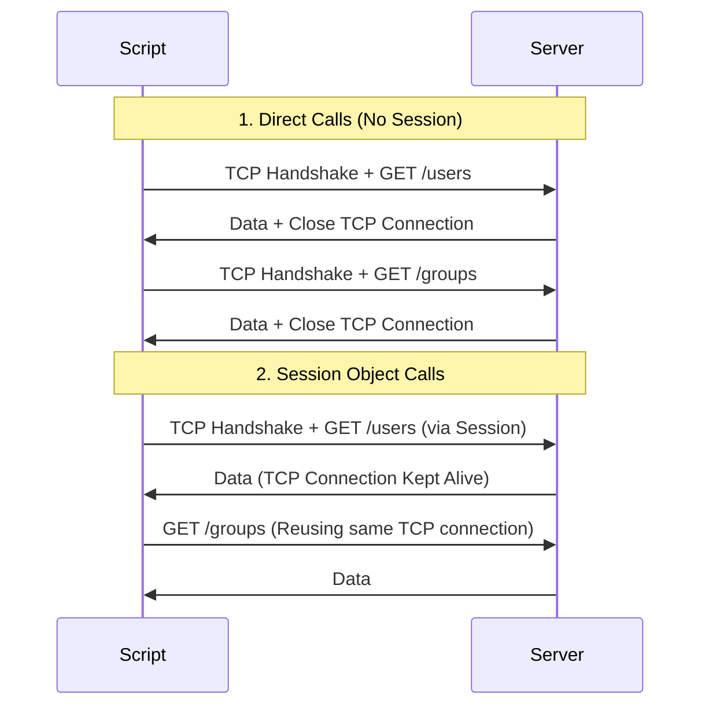

# Session Management and Connection Pooling

When your automation scripts interact with an API, they often make multiple requests to the same server in a short period (for example, reading 50 cloud resource statuses in a loop). 

If you use standard calls like `requests.get()` for each query, Python opens a new TCP connection, performs the TLS handshake, resolves DNS, sends the data, and then tears down the connection for *every single call*. This is incredibly slow and puts unnecessary load on the server.

To prevent this, the `requests` library provides the [requests.Session](https://requests.readthedocs.io/en/latest/user/advanced/#session-objects) object. It supports **connection pooling** (reusing TCP connections) and automatically persists headers, cookies, and authentication states across requests.

In this guide, we will learn how to manage HTTP sessions and speed up API scripts.

---

## Comparison: Direct Requests vs. Session Objects

Here is how using a Session object compares to making direct, individual request calls:

| Feature | Direct Calls (`requests.get`) | Session Calls (`session.get`) |
| :--- | :--- | :--- |
| **TCP Connections** | Opened and closed for every single call. | Reused across multiple requests (Connection Pooling). |
| **Response Speed** | Slower (requires DNS resolution and TLS handshakes each time). | Much faster after the first request. |
| **Cookie Persistence** | Lost between calls. | Automatically saved and sent back to the server. |
| **Shared Headers** | Must be passed in every function call. | Configured once on the session; inherited automatically. |

---

## Connection Reuse Flow

Using a Session object keeps the TCP socket open for subsequent requests:



---

## Basic Session Usage

Let us write a script that sets up a session, configures a default header, and makes multiple requests. The default header will automatically apply to all requests made within that session.

```python
import requests

# 1. Create a Session object
# Using a context manager ensures the connection pool is closed when done
with requests.Session() as session:
    
    # 2. Configure shared headers for the session
    session.headers.update({
        "X-App-ID": "Automation-Engine-v2",
        "Accept": "application/json"
    })
    
    print("Sending Request 1...")
    # This request automatically includes the 'X-App-ID' header
    response1 = session.get("https://httpbin.org/headers", timeout=3.0)
    print(f"Request 1 Status: {response1.status_code}")
    
    print("\nSending Request 2...")
    # This request also includes the 'X-App-ID' header, and reuses the same TCP socket
    response2 = session.get("https://httpbin.org/headers", timeout=3.0)
    print(f"Request 2 Status: {response2.status_code}")
```

### Expected Output

```text
Sending Request 1...
Request 1 Status: 200

Sending Request 2...
Request 2 Status: 200
```

---

## Real-World DevOps Scenario: Authenticated Cookie Session

Many enterprise interfaces (like Jenkins or private Docker registries) require you to hit a login API first. The server responds by setting a session cookie. For all subsequent API calls, you must present this cookie to prove you are logged in.

Let us write a script that authenticates once, captures the login cookie, and reuses it for all subsequent operations.

```python
import requests

def perform_api_transactions():
    login_url = "https://httpbin.org/cookies/set/session_token/auth_cookie_xyz123"
    profile_url = "https://httpbin.org/cookies"
    
    print("Initiating authenticated API session...")
    print("========================================")
    
    # We use a session so cookies are handled automatically
    with requests.Session() as session:
        # Configure User-Agent globally
        session.headers.update({"User-Agent": "BackupClient/1.1"})
        
        try:
            # 1. Authenticate (triggers cookie setting)
            print("Step 1: Authenticating to Gateway...")
            login_response = session.get(login_url, timeout=3.0)
            login_response.raise_for_status()
            
            # Print cookie jar info
            cookies_saved = session.cookies.get_dict()
            print(f"Authentication cookie captured: {cookies_saved}")
            
            # 2. Make authenticated call to query profile data
            # The session automatically attaches the cookie received in Step 1
            print("\nStep 2: Accessing secure resource...")
            profile_response = session.get(profile_url, timeout=3.0)
            profile_response.raise_for_status()
            
            print(f"Server profile raw output: {profile_response.json()}")
            
        except requests.exceptions.RequestException as err:
            print(f"Session transaction failed: {err}")

perform_api_transactions()
```

### Expected Output

```text
Initiating authenticated API session...
========================================
Step 1: Authenticating to Gateway...
Authentication cookie captured: {'session_token': 'auth_cookie_xyz123'}

Step 2: Accessing secure resource...
Server profile raw output: {'cookies': {'session_token': 'auth_cookie_xyz123'}}
```

---

## Common Mistakes

Here are some typical mistakes people make with Sessions:

### 1. Creating a new Session object inside a loop
If you instantiate a session inside your loop (like the code below), you completely lose connection pooling. A new connection pool will be created and destroyed on every iteration:

```python
# WRONG - session recreated each loop iteration
for url in url_list:
    with requests.Session() as s:
        s.get(url)

# CORRECT - reuse same session
with requests.Session() as s:
    for url in url_list:
        s.get(url)
```

### 2. Leaking connections by not closing the Session
If you write `session = requests.Session()` and do not use a `with` statement or call `session.close()` at the end of your script, the TCP connections will remain open in the background. This can result in socket leaks on your system.

### 3. Forgetting that session-level changes are global
If you assign a header to the session (like `session.headers['Authorization'] = 'Bearer token'`), it is sent with *every* request. If you later query a public API endpoint within the same session, your private token will be leaked to that public server. If a header is only needed for one specific request, pass it as a parameter to the request method rather than saving it to the session:

```python
# Pass token for this specific call only
session.get(target_url, headers={"Authorization": "Bearer token"})
```

---

## Summary

* Use a [requests.Session](https://requests.readthedocs.io/en/latest/user/advanced/#session-objects) object to reuse TCP connections across multiple HTTP requests.
* Reusing TCP connections (connection pooling) increases request speed significantly.
* Sessions automatically handle cookies, saving cookies set by the server and returning them on later calls.
* Save global variables (like User-Agents) inside the `session.headers` dictionary.
* Open session loops inside `with` statement blocks to ensure the connection pool is closed automatically.
* Avoid creating new Session instances inside loop code blocks.
* Clean up manual sessions by calling `session.close()` in `finally` exception blocks.
* Do not attach sensitive auth tokens to the session configuration if you are querying public URLs.
* Temporary headers can be passed directly to request methods (like `session.get(url, headers=...)`) without modifying the global session properties.
