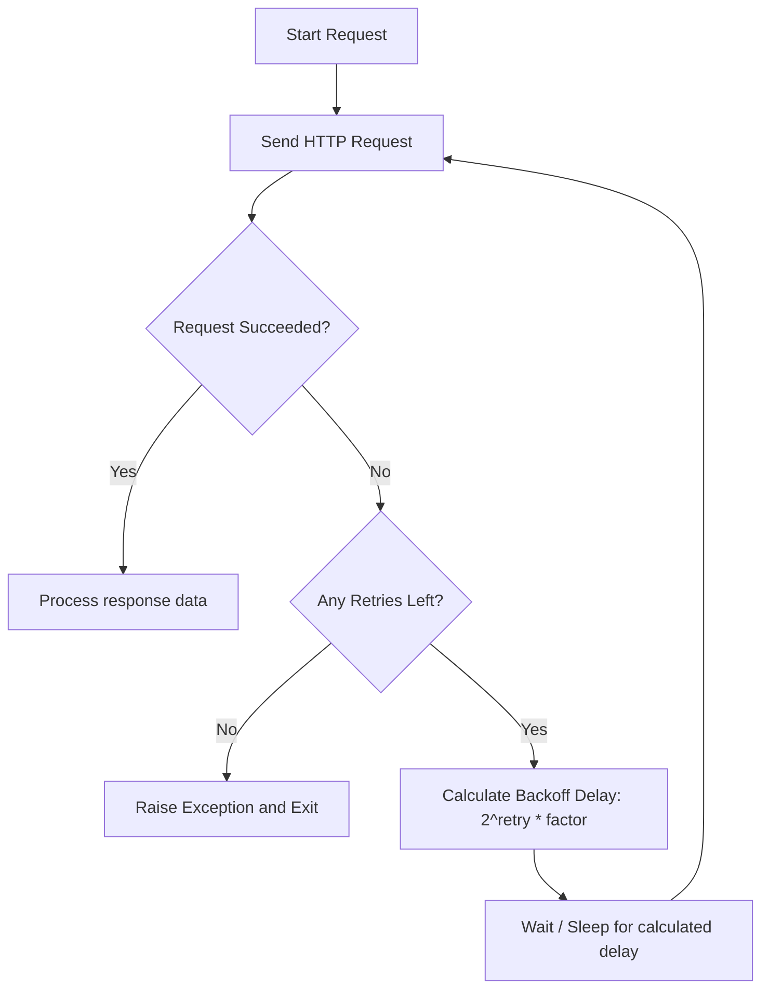

# Timeouts and Retries

In a production network, temporary issues occur all the time. A router might drop a packet, a server might reboot for updates, or a backend gateway might return a temporary `503 Service Unavailable` error due to high load.

If your automation scripts do not handle these temporary glitches, your deployments will fail unnecessarily. To build resilient automation scripts, you must:
1. **Set Timeouts**: Ensure your script does not hang forever if the remote server is unresponsive.
2. **Implement Retries**: Automatically retry failed requests using a backoff delay, giving the server a chance to recover.

In this guide, we will learn how to configure connection and read timeouts, and build an automatic retry system using the `requests` library.

---

## Understanding Timeouts and Retries

When configuring HTTP client requests, you should understand the distinct parameters:

| Configuration | Metric Category | Scope | Best Practice Recommendation |
| :--- | :--- | :--- | :--- |
| **Connection Timeout** | Network Level | Time limit to establish the TCP socket connection to the server. | Set between 2.0 to 5.0 seconds. |
| **Read Timeout** | Application Level | Time limit to wait for the first byte of data after connection succeeds. | Set between 10.0 to 30.0 seconds. |
| **Retry Count** | Execution Level | Number of times to resend the request if it fails or times out. | Set to 3 to 5 retries. |
| **Backoff Factor** | Delay Control | Exponential multiplier to delay subsequent retries (e.g., waiting 1s, 2s, 4s). | Set to 1.0 or 2.0 seconds. |

---

## Request Retry and Backoff Loop

Here is the logic flow of an automated retry cycle with exponential backoff:



---

## Configuring Timeouts

You configure timeouts in `requests` by passing a tuple `(connect_timeout, read_timeout)` to the `timeout` parameter. Passing a single number sets both timeouts to that value.

```python
import requests

url = "https://httpbin.org/delay/1"

try:
    print("Sending request with split timeout parameters...")
    # 2.0s connection timeout, 5.0s read timeout
    response = requests.get(url, timeout=(2.0, 5.0))
    print(f"Success! Status: {response.status_code}")
    
except requests.exceptions.ConnectTimeout:
    print("Error: Connection timed out before reaching the server.")
except requests.exceptions.ReadTimeout:
    print("Error: The server connected but did not send data back in time.")
except requests.exceptions.RequestException as err:
    print(f"Failed request: {err}")
```

### Expected Output

```text
Sending request with split timeout parameters...
Success! Status: 200
```

---

## Implementing Automated Retries

To configure automatic retries, we use the `HTTPAdapter` from `requests.adapters` and the `Retry` configuration class from `urllib3.util`. We "mount" this adapter to our Session object.

```python
import requests
from requests.adapters import HTTPAdapter
from urllib3.util import Retry

def create_resilient_session():
    # 1. Define retry configuration rules
    retry_strategy = Retry(
        total=3,                          # Retry 3 times before failing
        backoff_factor=1,                 # Wait 1s, 2s, 4s between retries
        status_forcelist=[500, 502, 503, 504], # Retry on these server errors
        raise_on_status=False             # Return response object instead of raising error
    )
    
    # 2. Create HTTP adapter using this strategy
    adapter = HTTPAdapter(max_retries=retry_strategy)
    
    # 3. Mount adapter to the session
    session = requests.Session()
    session.mount("https://", adapter)
    session.mount("http://", adapter)
    
    return session

# Test the session
with create_resilient_session() as session:
    # We query an endpoint that returns a 503 status
    url = "https://httpbin.org/status/503"
    print("Sending query to flakey server...")
    
    try:
        response = session.get(url, timeout=3.0)
        # Note: In logs, you will see a delay before this prints as retries execute
        print(f"Completed run. Final code: {response.status_code}")
    except Exception as err:
        print(f"Failed after retries: {err}")
```

### Expected Output (after delayed retries)

```text
Sending query to flakey server...
Completed run. Final code: 503
```

---

## Common Mistakes

Here are some typical gotchas when dealing with network glitches:

### 1. Hardcoding retry logic using manual loop scripts
Avoid writing manual `while` loops containing `time.sleep()` to retry failed requests. This clutter your code and is prone to infinite loop bugs. Use `HTTPAdapter` and `Retry` wrappers instead, as they are cleaner, standardized, and safer.

### 2. Retrying on POST requests that are not idempotent
Retrying a failed HTTP GET request is safe because GET requests do not modify server data. However, if a POST request (like `/api/v1/charge_payment`) succeeds on the server but the connection drops before you receive the response, retrying the request could create duplicate entries or charges. Be careful when retrying non-idempotent methods (like `POST` or `PATCH`).

### 3. Setting backoff factors to 0
Setting `backoff_factor=0` retries requests instantly. If a server is failing because it is overloaded, hitting it with retries instantly (known as a retry storm) will overload it further, keeping it from recovering. Always use exponential backoffs to give the backend time to recover.

---

## Summary

* Set timeouts to prevent scripts from hanging on dead or firewall-blocked servers.
* Pass split settings to the `timeout` parameter as a `(connect, read)` tuple.
* Implement retries to handle temporary network errors or server reboot cycles.
* Configure retries using `urllib3.util.Retry` and mounting it via `HTTPAdapter`.
* Define an exponential backoff factor to double the wait delay between retries.
* Choose target error codes (like 502 or 503) to retry on, avoiding retries on client errors (like 404).
* Avoid retrying POST requests that modify server state to prevent duplicate operations.
* Use standard adapter classes instead of custom `while` loops to keep code clean.
* Set standard timeouts (e.g. 3.0 seconds connect, 15.0 seconds read) on all automation HTTP calls.
