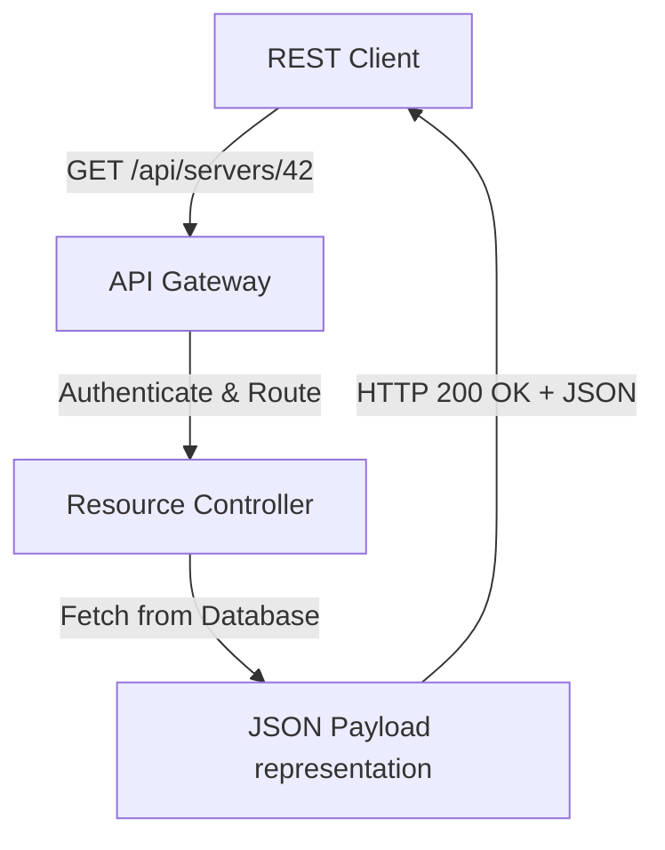

# Introduction to REST APIs

In DevOps automation, you write scripts that interact with various cloud services and tools. Whether you are provisioning virtual machines on AWS, triggering builds on Jenkins, creating tickets in Jira, or updating DNS records, you will do so by calling a **REST API**.

REST stands for **Representational State Transfer**. It is a software architectural style that defines how web services should communicate over the HTTP protocol. 

In this guide, we will explore the core concepts of REST APIs, how resources are mapped to URLs, and how standard HTTP methods represent actions.

---

## Core Concepts of REST

A REST API is structured around **resources**. A resource is any data object that you can query or modify (for example, a user, a server, a deployment, or a cluster). Each resource has a unique identifier called a **URI** (Uniform Resource Identifier).

REST APIs follow a set of guidelines:
1. **Statelessness**: Every request from a client must contain all the information needed to understand and process the request. The server does not store session context about the client.
2. **Client-Server**: The client (your script) and the server (the API gateway) are completely independent.
3. **Uniform Interface**: Actions on resources are standardized using standard HTTP methods.

---

## REST HTTP Verbs Comparison

REST maps actions to standard HTTP verbs. Here is how they compare:

| HTTP Verb | Action | Safe? | Idempotent? | Purpose | Example Endpoint |
| :--- | :--- | :--- | :--- | :--- | :--- |
| **`GET`** | Read | Yes | Yes | Retrieve details of a resource. | `GET /api/v1/servers` |
| **`POST`** | Create | No | No | Create a new resource. | `POST /api/v1/servers` |
| **`PUT`** | Update (Full) | No | Yes | Replace an existing resource or create if missing. | `PUT /api/v1/servers/12` |
| **`PATCH`** | Update (Partial)| No | No | Modify specific fields of a resource. | `PATCH /api/v1/servers/12` |
| **`DELETE`** | Delete | No | Yes | Remove a resource. | `DELETE /api/v1/servers/12` |

> [!NOTE]
> **Idempotent** means that making the same request multiple times in a row will produce the same system state as making it once. For example, deleting a server once removes it; deleting it again does nothing new, so it is idempotent.

---

## REST API Request Flow

Here is how a REST client interacts with a resource controller:



---

## Mapping Resources to Endpoints

Let us look at a practical example of how a server management API is mapped to REST endpoints.

```python
import json

# Representing API endpoints and how you map actions to them
mock_api_spec = {
    "resource": "virtual_machines",
    "endpoints": [
        {
            "method": "GET",
            "path": "/api/v1/instances",
            "description": "List all virtual machines."
        },
        {
            "method": "POST",
            "path": "/api/v1/instances",
            "description": "Create a new virtual machine."
        },
        {
            "method": "GET",
            "path": "/api/v1/instances/i-1002",
            "description": "Get detailed specifications of instance i-1002."
        },
        {
            "method": "DELETE",
            "path": "/api/v1/instances/i-1002",
            "description": "Terminate instance i-1002."
        }
    ]
}

print("REST API Spec Mapping:")
print("=====================")
for endpoint in mock_api_spec["endpoints"]:
    print(f"{endpoint['method']:<6} {endpoint['path']:<25} | {endpoint['description']}")
```

### Expected Output

```text
REST API Spec Mapping:
=====================
GET    /api/v1/instances         | List all virtual machines.
POST   /api/v1/instances         | Create a new virtual machine.
GET    /api/v1/instances/i-1002  | Get detailed specifications of instance i-1002.
DELETE /api/v1/instances/i-1002  | Terminate instance i-1002.
```

---

## Real-World DevOps Scenario: Managing Deployments via REST

Here is a mock Python script that demonstrates how you use different HTTP methods within a REST framework to manage the lifecycle of a deployment record.

```python
import requests

api_gateway = "https://httpbin.org"

def manage_deploy_job():
    print("REST API lifecycle demonstration:")
    print("---------------------------------")
    
    # 1. READ (GET) - Check if a deployment exists
    # We query the server using GET
    print("Step 1: Reading status (GET)...")
    get_response = requests.get(f"{api_gateway}/get", params={"job_id": 44}, timeout=3.0)
    if get_response.ok:
        print("GET Request successful.")
        
    # 2. CREATE (POST) - Create a new deployment
    # We send a JSON payload using POST
    print("\nStep 2: Creating resource (POST)...")
    payload = {"service": "web-api", "version": "v1.2.0"}
    post_response = requests.post(f"{api_gateway}/post", json=payload, timeout=3.0)
    if post_response.status_code == 200:
        print("POST Request successful. Resource created.")
        
    # 3. DELETE (DELETE) - Terminate or delete a resource
    # We trigger deletion using DELETE
    print("\nStep 3: Removing resource (DELETE)...")
    delete_response = requests.delete(f"{api_gateway}/delete", params={"id": 99}, timeout=3.0)
    if delete_response.ok:
        print("DELETE Request successful. Resource terminated.")

manage_deploy_job()
```

### Expected Output

```text
REST API lifecycle demonstration:
---------------------------------
Step 1: Reading status (GET)...
GET Request successful.

Step 2: Creating resource (POST)...
POST Request successful. Resource created.

Step 3: Removing resource (DELETE)...
DELETE Request successful. Resource terminated.
```

---

## Common Mistakes

Here are some typical mistakes when working with REST APIs:

### 1. Using the wrong HTTP method for an action
A common mistake is using GET to modify data (like hitting `GET /api/v1/servers/delete?id=12`). Web crawlers, link prefetchers, or proxy cache engines might follow that GET link automatically, causing accidental resources deletions. Always use DELETE or POST for data modifications.

### 2. Violating uniform naming conventions
Keep paths clean and noun-based. Avoid naming endpoints like `/api/v1/deleteServer` or `/api/v1/createInstance`. Instead, use nouns representing the resource collections, and let the HTTP method define the action:
* **Bad**: `POST /api/v1/createNewUser`
* **Good**: `POST /api/v1/users`

### 3. Assuming status code is always 200 on success
A successful POST request often returns `201 Created` instead of `200 OK`. If you hardcode assertions like `assert response.status_code == 200`, your script might fail on valid creations. Always check `response.ok` or use a range check.

---

## Summary

* REST is an architectural style designed to manage resources over the HTTP protocol.
* Resources are represented as noun-based URIs (e.g. `/api/v1/deployments`).
* Standard HTTP methods represent actions (GET = Read, POST = Create, DELETE = Remove).
* GET requests are safe and idempotent; they must never modify server database states.
* POST requests are neither safe nor idempotent; they always create new resource records.
* PUT replaces or creates resources, while PATCH modifies specific attributes.
* Access APIs using stateless requests where each call contains complete auth/parameter details.
* Avoid verb-based endpoint names; keep paths noun-based and use HTTP methods to dictate actions.
* Verify request success using status code ranges rather than hardcoding checks for code 200.
