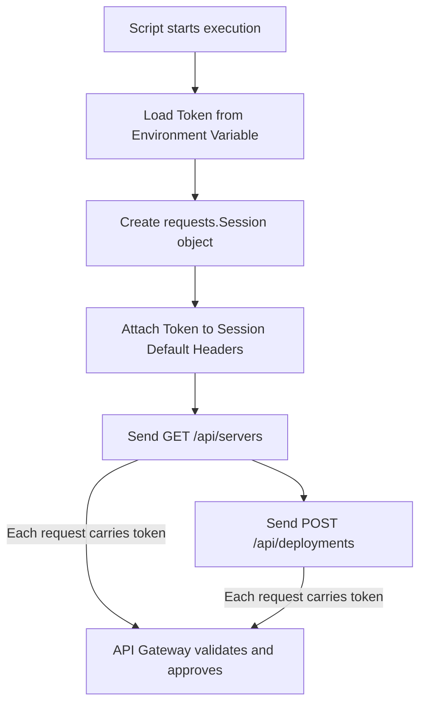

# API Authentication Patterns

Websites use user sessions and cookies to remember who you are after you log in. However, REST APIs are designed to be stateless. The server does not store session details about your script. This means your script must send credentials with **every single request** to prove it has permission to query or modify resources.

In DevOps scripting, authentication is typically handled using token-based schemes, such as Bearer tokens (OAuth2) or custom API headers.

In this guide, we will learn about the different REST API authentication patterns, how to structure auth headers, and how to safely load and manage tokens.

---

## Authentication Schemes Comparison

Here is how the common API authentication schemes compare:

| Scheme Name | HTTP Header Structure | Common Use Cases | Security Level |
| :--- | :--- | :--- | :--- |
| **Bearer Token (OAuth2)** | `Authorization: Bearer <token>` | Cloud providers (AWS, GCP), GitHub API, Kubernetes API. | High (tokens are timed and scoped). |
| **API Key / Token** | `X-API-Key: <token>` | Third-party services, monitoring webhooks (Datadog, Slack). | Medium (keys are long-lived). |
| **Basic Auth** | `Authorization: Basic <base64>` | Internal infrastructure servers, legacy web interfaces. | Low (sends encoded credentials). |

---

## Stateless Authentication Flow

Because REST is stateless, authentication details must be packaged with every outgoing API transaction:



---

## Implementing Bearer Token Auth

Let us write a script that demonstrates how to implement Bearer Token authentication. We will use a `requests.Session` object to ensure the token header is automatically attached to all requests made during the session.

```python
import os
import requests

# Simulate secure token loading
os.environ["CLOUD_API_TOKEN"] = "token_vault_key_112233"

# 1. Retrieve the token from environment variables
token = os.environ.get("CLOUD_API_TOKEN")

if not token:
    raise ValueError("Missing CLOUD_API_TOKEN environment variable.")

# 2. Create a Session and attach the Auth header
# This ensures we do not have to copy-paste the header configuration on every call
session = requests.Session()
session.headers.update({
    "Authorization": f"Bearer {token}",
    "Accept": "application/json"
})

try:
    print("Querying secure service stats...")
    # Send GET request - session automatically attaches the Authorization header
    response = session.get("https://httpbin.org/bearer", timeout=3.0)
    
    # Check status
    response.raise_for_status()
    print(f"Server response code: {response.status_code}")
    print(f"Authenticated? {response.json().get('authenticated')}")
    
finally:
    # Clean up variables
    session.close()
    os.environ.pop("CLOUD_API_TOKEN")
```

### Expected Output

```text
Querying secure service stats...
Server response code: 200
Authenticated? True
```

---

## Real-World DevOps Scenario: Private API Client Class

In production code, writing raw request calls can clutter your scripts. It is best practice to bundle your authentication and API calls into a clean, reusable Client class.

Here is an example of an API client class that manages connection sessions and attaches Bearer tokens.

```python
import os
import requests

class DevOpsClient:
    def __init__(self, base_url, token_env_var="DEVOPS_TOKEN"):
        self.base_url = base_url
        token = os.environ.get(token_env_var)
        
        if not token:
            raise KeyError(f"Authentication failed: Env variable '{token_env_var}' is missing.")
            
        # Create session and set headers
        self.session = requests.Session()
        self.session.headers.update({
            "Authorization": f"Bearer {token}",
            "Accept": "application/json",
            "Content-Type": "application/json"
        })
        
    def get_system_health(self):
        url = f"{self.base_url}/get"
        try:
            response = self.session.get(url, timeout=3.0)
            response.raise_for_status()
            return response.json()
        except requests.exceptions.HTTPError as err:
            if err.response.status_code == 401:
                return {"error": "Authentication invalid (401)"}
            return {"error": f"API Error: {err}"}
        except requests.exceptions.RequestException as err:
            return {"error": f"Network failure: {err}"}
            
    def close(self):
        self.session.close()

# --- Verification ---

# Configure env
os.environ["DEVOPS_TOKEN"] = "devops_token_secret_88"

# Initialize client
client = DevOpsClient(base_url="https://httpbin.org")

try:
    print("Checking system health via DevOps client...")
    result = client.get_system_health()
    print(f"Result: {result.get('headers', {}).get('Authorization')}")
finally:
    client.close()
    os.environ.pop("DEVOPS_TOKEN")
```

### Expected Output

```text
Checking system health via DevOps client...
Result: Bearer devops_token_secret_88
```

---

## Common Mistakes

Here are some security and code pitfalls to avoid:

### 1. Committing tokens to version control
If you write your tokens or passwords directly inside your script files, they will eventually end up in Git logs. Even if you delete the line later, the secret remains in the Git history. Always use environment variables or secret vaults.

### 2. Failing to check for `401 Unauthorized` and `403 Forbidden`
If your token expires, the API will return a `401 Unauthorized` or `403 Forbidden` status code. If your script does not check for these status codes explicitly, it might continue running and fail with confusing errors later. Always handle authentication failure codes:

```python
if response.status_code == 401:
    print("Error: The token is invalid. Access Denied.")
```

### 3. Using token variable names that clash with system variables
Avoid naming your custom token environment variables `TOKEN` or `KEY`. Other programs on the system might read or overwrite these generic variables. Use distinct prefixes instead, such as `DEPLOY_PIPELINE_TOKEN` or `MONITORING_API_KEY`.

---

## Summary

* REST APIs are stateless, meaning credentials must be sent with every request.
* Bearer tokens (OAuth2) are the standard for modern cloud and API automation.
* Pass Bearer tokens using the HTTP header format `"Authorization": "Bearer <token>"`.
* Load credentials from environment variables to keep secrets out of source code.
* Use `requests.Session` to automatically attach auth headers to all requests.
* Bundle authentication logic and API endpoints inside reusable Client classes.
* Catch authentication errors by checking for `401 Unauthorized` and `403 Forbidden` status codes.
* Never send authentication tokens over unencrypted `http://` endpoints.
* Use distinct environment prefixes (like `APP_MONITOR_KEY`) to prevent key naming clashes.
