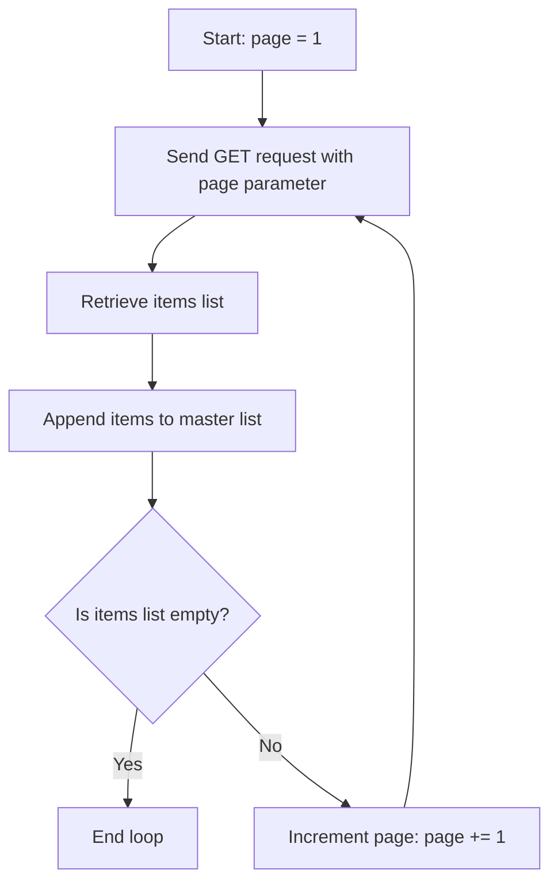

# Pagination Handling in REST APIs

When you query an API for resources (like listing all server instances, audit logs, or users), the database might contain thousands or millions of records. If the API tried to return all of this data in a single response, the server would run out of memory, and your script would freeze.

To prevent this, REST APIs use **pagination**. Instead of returning everything at once, the API returns a small chunk of data (a page) and provides a pointer to the next page. To retrieve all the records, your script must loop through the pages.

In this guide, we will learn about the different pagination strategies, how to write loops to traverse pages, and how to combine paginated results.

---

## Pagination Strategies Comparison

REST APIs use three main pagination techniques:

| Strategy Name | URL Parameters used | How it works | Best For |
| :--- | :--- | :--- | :--- |
| **Offset-Based** | `page=2&per_page=100` or `limit=100&offset=200` | You specify the page number or the number of records to skip. | Simple datasets, static database tables. |
| **Cursor-Based** | `starting_after=id_xyz` or `cursor=token` | The server returns a "cursor" (token) pointing to the last item. You send this token in the next request. | High-frequency tables (avoids skipping records when items are deleted). |
| **Link Headers** | None (inspect headers) | The server provides the exact URL for the next page inside the HTTP `Link` header. | GitHub API and standardized REST architectures. |

---

## Offset Pagination Logic Flow

Here is the loop process your script must use to collect all items from an offset-based API:



---

## Implementing Offset Pagination

Let us write a script that fetches virtual machine configurations from a simulated paginated API. The API returns 2 items per page. Our script will loop until the API returns an empty list, merging all records.

```python
import requests

# We query a public API endpoint. httpbin.org can simulate pagination using status checks,
# but for a real loop demonstration, we will query a mock list.
def fetch_all_nodes(page_limit=5):
    # Simulated database of instances
    # We will use this url to make requests, passing page numbers
    url = "https://httpbin.org/get"
    
    page = 1
    items_per_page = 2
    all_instances = []
    
    print("Initiating paginated retrieval loop...")
    print("--------------------------------------")
    
    while True:
        # Stop loop if we hit a safety limit to prevent infinite loops during testing
        if page > page_limit:
            print(f"Safety limit hit! Stopped at page {page_limit}.")
            break
            
        params = {
            "page": page,
            "limit": items_per_page
        }
        
        try:
            response = requests.get(url, params=params, timeout=3.0)
            response.raise_for_status()
            
            # Since httpbin just returns our arguments back to us, 
            # we will simulate the pagination behavior locally:
            # Imagine the API returned a list of instances. We simulate 3 pages.
            if page == 1:
                page_data = [{"id": "i-1", "env": "prod"}, {"id": "i-2", "env": "prod"}]
            elif page == 2:
                page_data = [{"id": "i-3", "env": "stage"}, {"id": "i-4", "env": "dev"}]
            else:
                page_data = [] # Page 3 is empty, indicating end of data
                
            if not page_data:
                print(f"Page {page} returned no data. End of database reached.")
                break
                
            print(f"Page {page}: Retrieved {len(page_data)} items.")
            all_instances.extend(page_data)
            
            page += 1
            
        except requests.exceptions.RequestException as err:
            print(f"Error fetching page {page}: {err}")
            break
            
    print("--------------------------------------")
    print(f"Loop finished. Total items retrieved: {len(all_instances)}")
    print(f"Final Inventory: {all_instances}")

fetch_all_nodes()
```

### Expected Output

```text
Initiating paginated retrieval loop...
--------------------------------------
Page 1: Retrieved 2 items.
Page 2: Retrieved 2 items.
Page 3: returned no data. End of database reached.
--------------------------------------
Loop finished. Total items retrieved: 4
Final Inventory: [{'id': 'i-1', 'env': 'prod'}, {'id': 'i-2', 'env': 'prod'}, {'id': 'i-3', 'env': 'stage'}, {'id': 'i-4', 'env': 'dev'}]
```

---

## Real-World DevOps Scenario: Paginating GitHub Link Headers

The GitHub REST API uses **Link Headers** for pagination. Instead of using page numbers in your script, you inspect the response headers. If a next page exists, the server returns a header like:
`Link: <https://api.github.com/resource?page=2>; rel="next"`

Let us look at a script that parses the `Link` header to fetch pages.

```python
import requests

def get_github_issues_paginated(owner, repo):
    # GitHub issues API endpoint
    url = f"https://api.github.com/repos/{owner}/{repo}/issues"
    params = {"per_page": 2, "state": "open"} # Keep per_page small for demo
    headers = {"User-Agent": "DevOps-Paginator-v1"}
    
    all_issues = []
    page_count = 1
    max_pages = 3 # Safety limit for public API rate limits
    
    try:
        print(f"Querying issues page 1 for {owner}/{repo}...")
        response = requests.get(url, params=params, headers=headers, timeout=5.0)
        response.raise_for_status()
        
        all_issues.extend(response.json())
        
        # Loop as long as the server provides a 'next' link in the headers
        while "next" in response.links and page_count < max_pages:
            # Extract the exact URL of the next page
            next_url = response.links["next"]["url"]
            page_count += 1
            
            print(f"Querying issues page {page_count} from: {next_url}")
            # Note: We do not need params here because next_url contains them already
            response = requests.get(next_url, headers=headers, timeout=5.0)
            response.raise_for_status()
            
            all_issues.extend(response.json())
            
        print(f"Completed. Retrieved {len(all_issues)} issues across {page_count} pages.")
        
    except requests.exceptions.RequestException as err:
        print(f"Request failed: {err}")

# Run paginator on a public repo
get_github_issues_paginated("ansible", "ansible")
```

### Expected Output

```text
Querying issues page 1 for ansible/ansible...
Querying issues page 2 from: https://api.github.com/repositories/345423/issues?per_page=2&state=open&page=2
Querying issues page 3 from: https://api.github.com/repositories/345423/issues?per_page=2&state=open&page=3
Completed. Retrieved 6 issues across 3 pages.
```

---

## Common Mistakes

Here are some typical mistakes when traversing pagination logs:

### 1. Forgetting to set a loop break safety limit
If the API has a bug or returns data infinitely, a standard `while True` loop will run forever, locking up your CPU and exhausting memory. Always implement a safety counter (like `page_limit = 100`) to exit the loop if it runs too many times.

### 2. Retaining duplicate items when database updates mid-run
If you are using offset-based pagination (`page=2`), and an item is deleted from the database *while* your loop is executing, all items shift left. When you query page 2, you might miss an item or get a duplicate. If accuracy is critical, use cursor-based pagination.

### 3. Exhausting memory by storing too many records
If you are fetching 100,000 logs and appending them to a single Python list (`all_logs.extend()`), you might exhaust your script's RAM. If you are processing large datasets, parse and write items to a file (like a CSV or database) *inside* the loop, rather than keeping them in memory.

---

## Summary

* Pagination limits the quantity of data returned in a single HTTP response.
* Offset pagination uses parameters like `page` and `limit` to request chunks of data.
* Cursor pagination uses unique tokens to request records created after the last item.
* Link header pagination provides the exact URL of the next page in response headers.
* Implement pagination using a `while True` loop that breaks when the returned list is empty.
* Access GitHub-style pagination links directly using the `response.links` dictionary.
* Always set a safety limit (e.g. `max_pages`) on loops to prevent infinite runtime loops.
* Write records to disk inside the page loop when retrieving massive datasets to save RAM.
* Be careful with offset pagination on active databases, as entries can shift mid-run.
