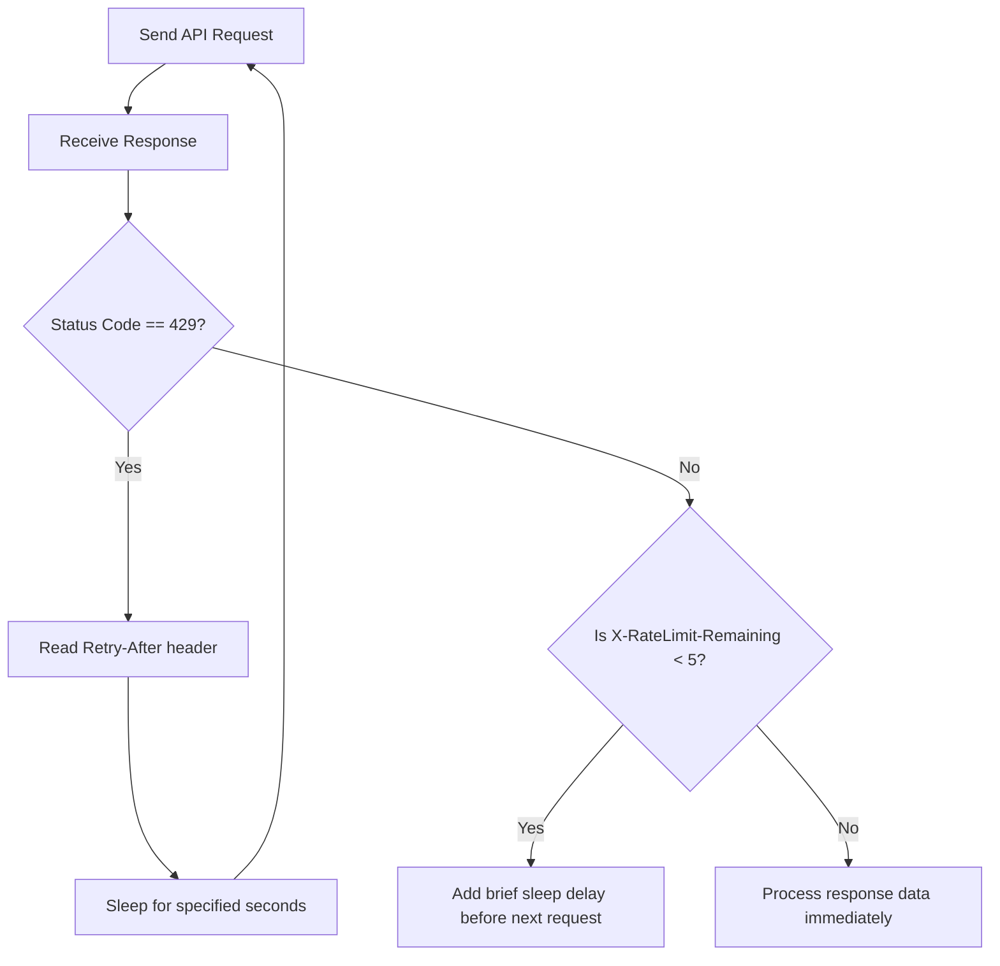

# Rate Limiting Handling in REST APIs

When you build scripts that run in pipelines or cron jobs, they can make hundreds of requests per minute. If everyone did this, API servers would crash under the load. To protect their systems, API providers implement **rate limiting**.

Rate limiting restricts the number of requests a client can make in a given time window (for example, allowing 60 requests per minute). If your script exceeds this limit, the API blocks your requests, returning an HTTP status code **`429 Too Many Requests`**.

In this guide, we will learn how to read rate-limiting headers, handle 429 status codes, and write code that pauses and retries requests safely.

---

## Rate-Limit Headers Reference

Most API providers include metadata about your usage limits inside the response headers of every request.

Here are the standard headers you should inspect:

| Header Name | Type | Description | Best Practice Action |
| :--- | :--- | :--- | :--- |
| **`X-RateLimit-Limit`** | `int` | Maximum requests allowed in the current time window. | Diagnostic reference. |
| **`X-RateLimit-Remaining`** | `int` | Number of requests remaining in the current window. | If this gets close to 0, slow down request intervals. |
| **`X-RateLimit-Reset`** | `int` | Unix timestamp (epoch seconds) showing when the limit resets. | Calculate wait delay: `reset_time - current_time`. |
| **`Retry-After`** | `int` | Number of seconds to wait before trying again (sent with 429). | Pause execution using `time.sleep()` for this duration. |

---

## Rate Limit Handling Flow

Here is how your API client should process rate limits:



---

## Basic Rate Limit Reader

Let us write a script that queries a mock endpoint and prints the rate-limit headers returned by the server. We will inspect standard response header structures.

```python
import requests

# We query a status check endpoint
url = "https://httpbin.org/headers"

try:
    response = requests.get(url, timeout=3.0)
    response.raise_for_status()
    
    # Extract headers
    headers = response.headers
    
    # Note: httpbin does not return rate limit headers by default.
    # We will simulate them using dict lookups for parsing demonstration.
    limit = headers.get("X-RateLimit-Limit", "100")
    remaining = headers.get("X-RateLimit-Remaining", "98")
    reset = headers.get("X-RateLimit-Reset", "1782376300")
    
    print("Rate Limit Tracking Info:")
    print("-------------------------")
    print(f"Total Limit Allowed: {limit}")
    print(f"Requests Remaining:  {remaining}")
    print(f"Reset Epoch Time:    {reset}")
    
except requests.exceptions.RequestException as err:
    print(f"Connection failed: {err}")
```

### Expected Output

```text
Rate Limit Tracking Info:
-------------------------
Total Limit Allowed: 100
Requests Remaining:  98
Reset Epoch Time:    1782376300
```

---

## Real-World DevOps Scenario: Backing Off on 429 Status Codes

Let us write a resilient API client function. It makes request calls in a loop. If it encounters a `429 Too Many Requests` code, it reads the `Retry-After` header, sleeps for the specified time, and retries the connection.

```python
import time
import requests

def get_billing_data_safely(endpoint_url):
    max_retries = 3
    retry_count = 0
    
    while retry_count < max_retries:
        try:
            print(f"Querying API gateway (Attempt {retry_count + 1})...")
            response = requests.get(endpoint_url, timeout=3.0)
            
            # 1. Check if we hit the rate limit
            if response.status_code == 429:
                # Read the Retry-After header. Default to 2 seconds if missing.
                retry_after = int(response.headers.get("Retry-After", 2))
                print(f"[RATE LIMITED] Server returned code 429. Pausing for {retry_after} seconds...")
                time.sleep(retry_after)
                retry_count += 1
                continue
                
            # Raise exception for other HTTP errors (like 404 or 500)
            response.raise_for_status()
            
            # If successful, return data
            print("[SUCCESS] API responded successfully.")
            return response.json()
            
        except requests.exceptions.RequestException as err:
            print(f"Connection failed: {err}")
            break
            
    print("Error: Exceeded maximum retries due to rate limit throttling.")
    return None

# We run the check against a simulated 429 status code endpoint
get_billing_data_safely("https://httpbin.org/status/429")
```

### Expected Output (simulates rate limit hit and retrying)

```text
Querying API gateway (Attempt 1)...
[RATE LIMITED] Server returned code 429. Pausing for 2 seconds...
Querying API gateway (Attempt 2)...
[RATE LIMITED] Server returned code 429. Pausing for 2 seconds...
Querying API gateway (Attempt 3)...
[RATE LIMITED] Server returned code 429. Pausing for 2 seconds...
Error: Exceeded maximum retries due to rate limit throttling.
```

---

## Common Mistakes

Here are some pitfalls when dealing with API limits:

### 1. Loop-calling an API without sleeping on 429 errors
If your script gets a 429 error and immediately tries again in a tight `while` loop (without calling `time.sleep()`), you will spam the server with hundreds of requests per second. The server firewall might interpret this as a DDoS attack and block your script's IP address entirely.

### 2. Not converting `Retry-After` to an integer
The value returned by `response.headers.get('Retry-After')` is a string (e.g. `"5"`). If you try to pass this string directly to `time.sleep("5")`, Python will throw a `TypeError`. Always cast the value using `int()`.

### 3. Assuming `X-RateLimit-Reset` is a countdown value
The `X-RateLimit-Reset` header is usually a Unix Epoch timestamp (seconds since 1970), not a countdown timer. Writing `time.sleep(reset_header)` will try to pause your script for billions of seconds. You must calculate the delay manually:

```python
# Calculate delay from epoch reset timestamp
import time
delay = int(response.headers.get("X-RateLimit-Reset", time.time())) - time.time()
time.sleep(max(1, delay)) # Sleep at least 1 second
```

---

## Summary

* Rate limiting protects API servers from overloading by restricting request frequency.
* The standard HTTP status code for rate limit throttling is **`429 Too Many Requests`**.
* Check the `X-RateLimit-Remaining` header to see how many calls you have left.
* Read the `Retry-After` header to find out how many seconds your script must wait before retrying.
* Always convert the `Retry-After` header value to an integer before passing it to `time.sleep()`.
* Calculate reset delays using `reset_timestamp - current_timestamp` if using `X-RateLimit-Reset`.
* Never run retry loops on 429 status codes without calling `time.sleep()`.
* Wrap loop retries in a `max_retries` counter to prevent scripts from running forever.
* Slow down request intervals proactively if your remaining limit drops below 5.
