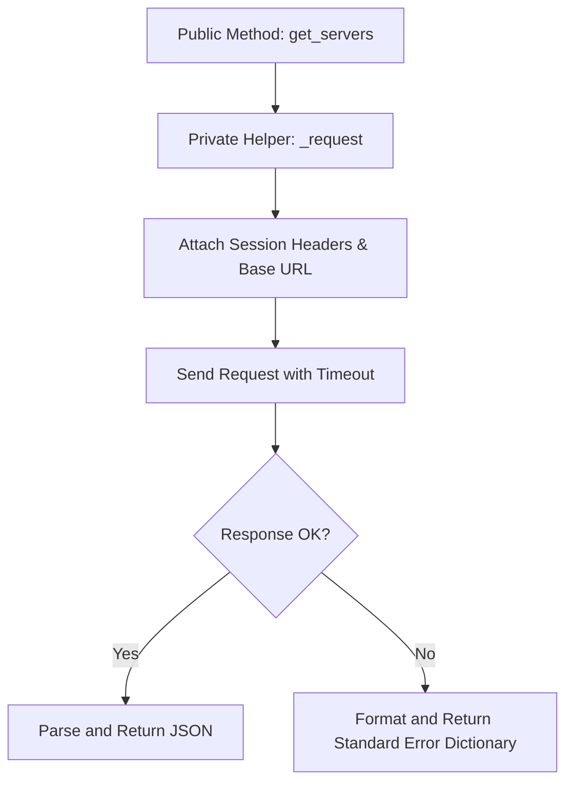

# Building a Custom API Client Wrapper

When you write scripts that interact with web services, placing raw `requests.get()` and `requests.post()` calls all over your codebase makes the code difficult to maintain. If the API base URL changes, if you need to update authentication headers, or if you need to add custom timeout limits, you would have to edit every single file.

To solve this, senior engineers wrap API interactions inside a custom **API Client Class**. This class encapsulates the base URL, authentication headers, retry policies, connection sessions, and error handling in a single place.

In this guide, we will build a production-ready API client wrapper step-by-step.

---

## Direct Requests vs. API Client Wrapper

Here is how wrapping your API calls compares to writing raw request functions:

| Feature | Raw Requests Code | API Client Wrapper |
| :--- | :--- | :--- |
| **Maintenance** | High (API path changes require editing multiple files). | Low (edit the wrapper class once). |
| **Authentication** | High duplication (must attach auth headers to every call). | Automated (configured once on the session). |
| **Error Handling** | Inconsistent (different try-except blocks across files). | Standardized (unified private request wrapper handles errors). |
| **Testability** | Hard to test (requires mocking global request functions). | Easy to test (mock client class methods). |

---

## API Client Architecture

Here is the internal data flow of a custom API client class:



---

## Building the API Client Wrapper

Let us build a client class called `SystemMonitorAPI` that manages connections to a server registry.

```python
import os
import requests

class SystemMonitorAPI:
    def __init__(self, base_url="https://httpbin.org", token=None):
        self.base_url = base_url
        self.token = token or os.environ.get("MONITOR_API_TOKEN")
        
        if not self.token:
            raise ValueError("Authentication Failed: A API token must be provided.")
            
        # Initialize session and set defaults
        self.session = requests.Session()
        self.session.headers.update({
            "Authorization": f"Bearer {self.token}",
            "Accept": "application/json",
            "Content-Type": "application/json"
        })
        
    def _request(self, method, endpoint, params=None, json_data=None):
        # Build full URL
        url = f"{self.base_url}/{endpoint.lstrip('/')}"
        
        try:
            # Send request
            response = self.session.request(
                method=method,
                url=url,
                params=params,
                json=json_data,
                timeout=5.0 # Enforce timeout client-wide
            )
            
            # Check for errors
            response.raise_for_status()
            return {"success": True, "data": response.json()}
            
        except requests.exceptions.HTTPError as err:
            return {"success": False, "error": f"HTTP Error {err.response.status_code}: {err.response.reason}"}
        except requests.exceptions.RequestException as err:
            return {"success": False, "error": f"Connection Failed: {err}"}
            
    def get_server_status(self):
        # Fetch status resource (using GET)
        return self._request("GET", "get")
        
    def register_new_host(self, hostname, ip):
        # Create server resource (using POST)
        payload = {"hostname": hostname, "ip_address": ip}
        return self._request("POST", "post", json_data=payload)
        
    def close(self):
        # Close connection session
        self.session.close()

# --- Verification ---

# Configure env
os.environ["MONITOR_API_TOKEN"] = "devops_token_value_abc"

# Initialize Client
client = SystemMonitorAPI()

try:
    print("Step 1: Fetching system status...")
    status = client.get_server_status()
    print(f"Success? {status['success']} | API Auth Verified: {status['data']['headers'].get('Authorization')}")
    
    print("\nStep 2: Registering a new host...")
    reg_result = client.register_new_host("web-prod-02", "192.168.1.15")
    print(f"Success? {reg_result['success']} | Payload: {reg_result['data']['json']}")
    
finally:
    client.close()
    os.environ.pop("MONITOR_API_TOKEN")
```

### Expected Output

```text
Step 1: Fetching system status...
Success? True | API Auth Verified: Bearer devops_token_value_abc

Step 2: Registering a new host...
Success? True | Payload: {'hostname': 'web-prod-02', 'ip_address': '192.168.1.15'}
```

---

## Common Mistakes

Here are some design mistakes to avoid when writing API wrappers:

### 1. Hardcoding the base URL inside resource methods
Do not write `url = 'https://api.com/v1/servers'` inside your resource functions. Build URLs dynamically by joining the base URL (defined once in `__init__`) and the endpoint path: `f"{self.base_url}/{endpoint}"`. This allows you to point the client to a local staging environment for testing without changing the code.

### 2. Not providing a close method
If your wrapper class creates a `requests.Session` object, it holds TCP connections open in the background. If you instantiate the client class inside scripts and do not close it, you can leak system file descriptors. Always write a `close()` method that calls `self.session.close()`.

### 3. Exposing raw requests library exceptions to your main code
Your wrapper should catch `requests.exceptions` internally and return a standardized format (like a dictionary containing `{'success': False, 'error': 'message'}`). If you let raw requests exceptions bubble up, any script using your client will need to import `requests` to catch errors, breaking the encapsulation benefits of the wrapper.

---

## Summary

* API wrappers encapsulate base URLs, configurations, sessions, and headers in one place.
* Client classes prevent duplicate authentication code across your files.
* Initialize connections using `requests.Session()` to enable connection pooling.
* Implement a private helper method (e.g. `_request`) to handle timeouts, requests, and errors.
* Build resource paths dynamically by combining base URLs and endpoint variables.
* Catch all `requests.exceptions` inside the client wrapper to keep script code clean.
* Return standardized status dictionaries (e.g. `{'success': True, 'data': ...}`) to callers.
* Write a `close()` method to release session connection pools when the client is finished.
* Use environment variables to pass tokens into the client class constructor securely.
