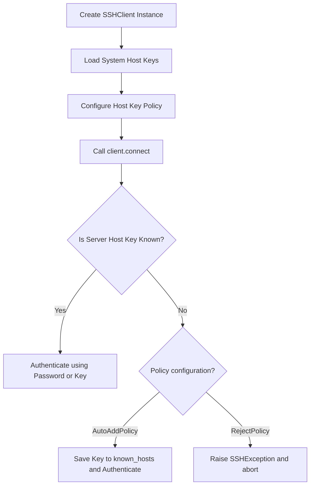

# Introduction to Paramiko

In DevOps, managing systems requires remote access. If you need to deploy an application, check a log file, or run a configuration script on dozens of remote Linux servers, you will do so using the **SSH (Secure Shell)** protocol.

While you can run shell commands inside your terminal using the command-line `ssh` utility, automating these commands inside Python scripts requires a library. The standard pure-Python library for implementing SSHv2 protocol client connections is [Paramiko](https://www.paramiko.org/).

In this guide, we will explore what Paramiko is, how it compares to other orchestration tools, and its core classes.

---

## Paramiko vs. Alternative Tools

Here is how Paramiko compares to other tools used for remote automation:

| Tool | Language | Execution Level | Best For | Description |
| :--- | :--- | :--- | :--- | :--- |
| **Paramiko** | Python | Low-Level API | Custom Python automation scripts, library development. | Direct control over raw sockets, channels, and SFTP protocols. |
| **Fabric** | Python | High-Level Tool | Application deployments, quick task running. | Built on top of Paramiko. Offers clean task wrappers and parallel execution. |
| **Ansible** | YAML / Python | Framework | Infrastructure configurations, system provisioning. | Large agentless config engine. Reusable roles. |
| **Native SSH** | C / System | CLI Command | Quick manual checks, simple Bash scripts. | Requires shell subprocess calls inside Python. |

---

## Connection and Host Key Verification Flow

When connecting to a remote server, Paramiko must handle key verification to prevent Man-in-the-Middle (MITM) security attacks:



---

## Installing Paramiko

Paramiko is a third-party package. It depends on cryptography libraries, which compile automatically during installation. Install it using `pip`:

```bash
pip install paramiko
```

---

## Basic SSH Connection Test

Let us write a simple script that initializes Paramiko's `SSHClient`, configures its host key lookup settings, and verifies if it is ready to establish connections.

```python
import paramiko

# 1. Create an instance of SSHClient
client = paramiko.SSHClient()

# 2. Configure Host Key Policy
# By default, Paramiko rejects connections to unknown servers.
# AutoAddPolicy automatically adds the hostname and host key to the local HostKeys object
client.set_missing_host_key_policy(paramiko.AutoAddPolicy())

# 3. Load host keys from your operating system's standard known_hosts file
try:
    client.load_system_host_keys()
    print("System SSH host keys loaded successfully.")
except Exception as err:
    print(f"Warning: Failed to load system host keys: {err}")

# Inspect client specifications
print("\nClient Specifications:")
print("----------------------")
print(f"SSH Client Class: {client.__class__.__name__}")
print(f"Transport Layer:  {client.get_transport()}") # None until connected

# 4. Always close the client connection (safe practice even if not connected)
client.close()
print("Client resource released.")
```

### Expected Output

```text
System SSH host keys loaded successfully.

Client Specifications:
----------------------
SSH Client Class: SSHClient
Transport Layer:  None
Client resource released.
```

---

## Common Mistakes

Here are some typical gotchas with Paramiko:

### 1. Auto-accepting unknown keys in production (`AutoAddPolicy`)
Using `client.set_missing_host_key_policy(paramiko.AutoAddPolicy())` is common in tutorials because it bypasses key mismatch errors. However, this is a security risk in production because it disables host key verification, making your script vulnerable to Man-in-the-Middle (MITM) hijacking attacks. In secure systems, load host keys explicitly and use `RejectPolicy` (the default).

### 2. Forgetting to release connection sockets
Each connected SSH client creates active TCP channels and processes on the remote server. If you spawn client connections inside loops and forget to call `client.close()`, you will lock remote server slots, causing the remote host to block further connections.

### 3. Missing dependencies on minimal OS containers
Paramiko depends on the `cryptography` Python package, which compiles C modules during installation. If you are building minimal Docker containers, installing Paramiko might fail unless you install development headers (like `gcc`, `libffi-dev`, and `openssl-dev`) first.

---

## Summary

* Paramiko is a pure-Python library implementing the SSHv2 protocol.
* Use it to automate CLI commands and transfer files on remote Linux servers.
* Install it using `pip install paramiko`.
* The high-level interface class used to manage connections is `paramiko.SSHClient()`.
* Configure the client's host key validation behaviors using host key policies.
* Avoid using `AutoAddPolicy()` in production environments due to MITM security risks.
* Load system keys from your local SSH directory using `client.load_system_host_keys()`.
* Always close connections using `client.close()` to release sockets and remote processes.
* Remember that Paramiko requires compiling cryptography dependencies during installation.
