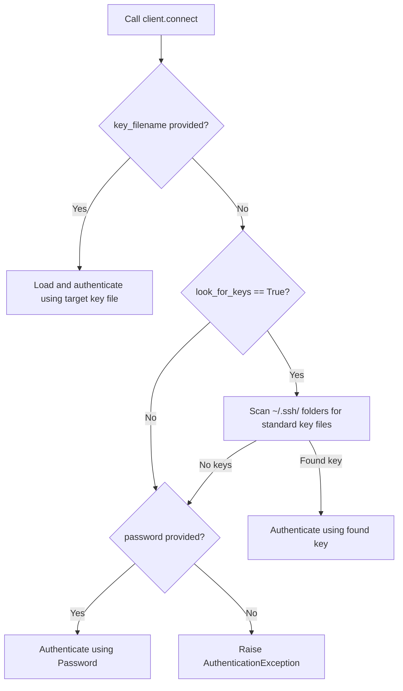

# Establishing SSH Connections

In production environments, you rarely authenticate to remote servers using simple passwords. Passwords are vulnerable to brute-force attacks and hard to rotate. Instead, DevOps teams use **SSH Key-Pair Authentication** (typically RSA or Ed25519 keys) to gain secure access.

The `SSHClient.connect()` method in Paramiko supports both password logins and private key authentication.

In this guide, we will look at how to connect to remote servers, authenticate using SSH private keys, handle passphrases, and secure connection options.

---

## Connection Arguments Reference

The `connect()` method accepts several parameters to configure connection parameters and security options:

| Parameter | Type | Default Value | Description |
| :--- | :--- | :--- | :--- |
| **`hostname`** | `str` | *Required* | IP address or domain name of the target server. |
| **`port`** | `int` | `22` | SSH port on the target server. |
| **`username`** | `str` | `None` | The user account name to log in as. |
| **`password`** | `str` | `None` | User password (used for password auth or key passphrase). |
| **`key_filename`** | `str` / `list` | `None` | Path to the private key file (e.g., `~/.ssh/id_rsa`). |
| **`timeout`** | `float` | `None` | Connection timeout in seconds. |
| **`look_for_keys`** | `bool` | `True` | Automatically look for keys in standard `~/.ssh/` folder. |

---

## Authentication Decision Tree

When attempting a connection, Paramiko evaluates authentication parameters in the following sequence:



---

## Connecting with an SSH Private Key

Let us write a script that connects to a remote server using a private key file. If your private key is encrypted with a security passphrase, you pass the passphrase to the `password` argument.

```python
import os
import paramiko

# Simulated connection variables
hostname = "192.168.10.25"
username = "deployer"

# Locate private key file path safely
home_dir = os.path.expanduser("~")
key_path = os.path.join(home_dir, ".ssh", "id_rsa")

client = paramiko.SSHClient()
client.set_missing_host_key_policy(paramiko.AutoAddPolicy())

try:
    print(f"Connecting to {username}@{hostname} using key: {key_path}...")
    
    # Connect using key file authentication
    # We set a timeout of 5 seconds to prevent hanging on unreachable hosts
    client.connect(
        hostname=hostname,
        port=22,
        username=username,
        key_filename=key_path,
        timeout=5.0
    )
    print("Connection established successfully!")
    
except FileNotFoundError:
    print(f"Error: SSH private key not found at {key_path}")
except paramiko.AuthenticationException:
    print("Error: Authentication failed. Key rejected or passphrase incorrect.")
except paramiko.SSHException as err:
    print(f"SSH protocol connection error: {err}")
except Exception as err:
    print(f"Failed to connect: {err}")
finally:
    client.close()
```

---

## Real-World DevOps Scenario: Multi-Host Connection Check

In large environments, you might want to run a quick ping checklist to confirm that your deployer key has valid SSH permissions across a pool of staging servers. Let us write a connection validator script.

```python
import os
import paramiko

def verify_ssh_credentials(servers, user, private_key_file):
    print("Starting Staging Fleet SSH Credentials Audit...")
    print("===============================================")
    
    if not os.path.exists(private_key_file):
        print(f"CRITICAL ERROR: Key file '{private_key_file}' does not exist.")
        return False
        
    failures = 0
    
    for host in servers:
        client = paramiko.SSHClient()
        client.set_missing_host_key_policy(paramiko.AutoAddPolicy())
        
        try:
            # Attempt a quick connection
            client.connect(
                hostname=host,
                username=user,
                key_filename=private_key_file,
                timeout=3.0 # Quick timeout
            )
            print(f"[SUCCESS] Access approved for {user}@{host}")
            
        except paramiko.AuthenticationException:
            print(f"[REJECTED] Authentication failed for {user}@{host}")
            failures += 1
        except Exception as err:
            print(f"[OFFLINE]  Host {host} is unreachable: {err}")
            failures += 1
        finally:
            client.close()
            
    print("===============================================")
    print(f"Audit finished. Failed target count: {failures}")
    return failures == 0

# Staging server list
staging_servers = ["stage-web-01.internal", "stage-db-01.internal", "127.0.0.1"]
key_file = os.path.expanduser("~/.ssh/id_rsa")

# Run credentials checker (will show offline/errors for dummy hosts)
verify_ssh_credentials(staging_servers, "admin", key_file)
```

### Expected Output

```text
Starting Staging Fleet SSH Credentials Audit...
===============================================
[OFFLINE]  Host stage-web-01.internal is unreachable: [Errno -2] Name or service not known
[OFFLINE]  Host stage-db-01.internal is unreachable: [Errno -2] Name or service not known
[OFFLINE]  Host 127.0.0.1 is unreachable: [Errno 111] Connection refused
===============================================
Audit finished. Failed target count: 3
```

---

## Common Mistakes

Here are some pitfalls when connecting with Paramiko:

### 1. Hardcoding private key passphrases in plain text
If your private SSH key is encrypted with a passphrase, do not hardcode it in your script. Pass the passphrase using environment variables instead:

```python
# CORRECT
passphrase = os.environ.get("SSH_KEY_PASSPHRASE")
client.connect(..., password=passphrase)
```

### 2. Not setting a timeout parameter
If you do not pass `timeout=5.0` to `connect()`, Paramiko will wait indefinitely for the OS connection timeout if a server is offline. This will freeze your automated pipelines.

### 3. Invalid file permissions on the private key file
SSH servers reject key connections if the client's local private key file has loose file permissions (like being readable by everyone on the system). Ensure your private key file permissions are restricted to owner-only read/write (`chmod 600 ~/.ssh/id_rsa` or equivalent on Windows).

---

## Summary

* SSH key-pair authentication is the recommended method for secure server access.
* Connect to remote hosts by calling the `SSHClient.connect()` method.
* Specify your private key path using the `key_filename` parameter.
* Scan standard directories for local keys automatically by keeping `look_for_keys=True` (default).
* Pass a private key passphrase to the `password` argument if the key is encrypted.
* Set the `timeout` parameter to prevent scripts from hanging on unreachable servers.
* Catch credential errors by trapping the `paramiko.AuthenticationException` class.
* Catch protocol errors by trapping `paramiko.SSHException`.
* Keep key files secure by setting file permissions to `600` (owner-only access).
* Always call `client.close()` inside `finally` blocks to release active server connections.
