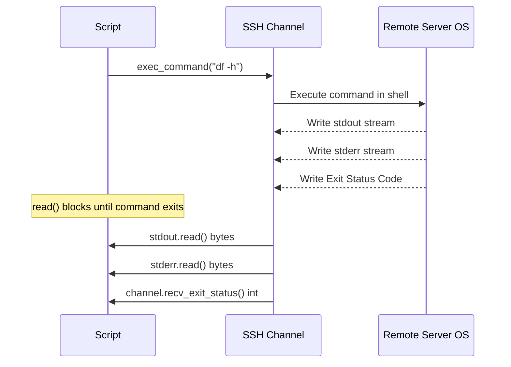

# Running Remote Commands with Paramiko

Establishing a secure SSH connection is just the first step. Once connected, your automation scripts need to run commands on the remote server. You might run diagnostic tools (`df -h`), trigger restarts (`sudo systemctl restart nginx`), or check application statuses.

The primary method for running commands on a remote server in Paramiko is `SSHClient.exec_command()`. 

In this guide, we will learn how to execute remote commands, read standard output and standard error streams, and check command exit status codes.

---

## The Three Communication Channels

When you call `exec_command()`, the remote server opens a new shell session. The method returns a tuple containing three file-like stream objects:

| Stream Variable | Type | Direction | Purpose |
| :--- | :--- | :--- | :--- |
| **`stdin`** | `ChannelFile` | Write-Only | Sending input data or password prompts to the remote command. |
| **`stdout`** | `ChannelFile` | Read-Only | Capturing the standard output text returned by the remote command. |
| **`stderr`** | `ChannelFile` | Read-Only | Capturing error logs or warning messages from the remote command. |

---

## Remote Execution Sequence Diagram

Here is the data flow when executing commands remotely:



---

## Basic Command Execution Example

Let us write a script that runs a command to inspect remote disk space and captures the output.

```python
import paramiko

# Define target connection (using localhost for parsing check)
hostname = "127.0.0.1"
username = "admin"

client = paramiko.SSHClient()
client.set_missing_host_key_policy(paramiko.AutoAddPolicy())

try:
    # Connect
    client.connect(hostname, username=username, timeout=3.0)
    
    # 1. Run the remote command
    # exec_command returns three stream channels
    stdin, stdout, stderr = client.exec_command("df -h")
    
    # 2. Read and decode outputs (raw streams return bytes)
    output = stdout.read().decode("utf-8")
    errors = stderr.read().decode("utf-8")
    
    # 3. Read exit status code
    # This blocks until the command completes execution
    exit_code = stdout.channel.recv_exit_status()
    
    print("Execution Results:")
    print("------------------")
    print(f"Command Exit Code: {exit_code}")
    print(f"Stdout:\n{output}")
    if errors:
        print(f"Stderr:\n{errors}")
        
except Exception as err:
    print(f"Failed to execute command: {err}")
finally:
    client.close()
```

---

## Real-World DevOps Scenario: System Package Checker

Let us write an automation script that checks if a package (like `docker` or `nginx`) is active on the remote server. We will inspect the exit status code of the command: exit code `0` means the service is active, while non-zero values indicate failures.

```python
import paramiko

def check_remote_service_active(host, user, service_name):
    print(f"Auditing service '{service_name}' on host '{host}'...")
    print("-----------------------------------------------------")
    
    client = paramiko.SSHClient()
    client.set_missing_host_key_policy(paramiko.AutoAddPolicy())
    
    try:
        # Connect
        client.connect(host, username=user, timeout=5.0)
        
        # Check systemd status
        command = f"systemctl is-active {service_name}"
        stdin, stdout, stderr = client.exec_command(command)
        
        # Read exit status first to confirm completion
        exit_status = stdout.channel.recv_exit_status()
        
        # Read output stream
        status_output = stdout.read().decode("utf-8").strip()
        error_output = stderr.read().decode("utf-8").strip()
        
        if exit_status == 0:
            print(f"[ONLINE] Service '{service_name}' is actively running. Status: {status_output}")
            return True
        else:
            print(f"[FAILED] Service '{service_name}' is not running (Exit code: {exit_status})")
            if error_output:
                print(f"Details: {error_output}")
            return False
            
    except Exception as err:
        print(f"SSH Audit failed: {err}")
        return False
    finally:
        client.close()

# Run the system audit (will print connection errors for dummy targets)
check_remote_service_active("192.168.10.25", "deployer", "nginx")
```

### Expected Output

```text
Auditing service 'nginx' on host '192.168.10.25'...
-----------------------------------------------------
SSH Audit failed: [Errno 113] No route to host
```

---

## Common Mistakes

Here are some typical mistakes you will run into:

### 1. Reading `stdout.read()` before sending input data
If you run an interactive command (like `sudo apt-get install`) that asks for input, and your script calls `stdout.read()`, the script will hang forever. The remote command is waiting for input on `stdin`, while your Python script is waiting for output on `stdout`. Always write inputs to `stdin` and call `stdin.flush()` before reading outputs:

```python
# Write input to command first
stdin.write("my_password\n")
stdin.flush()
```

### 2. Assuming environment variables persist between calls
Each call to `client.exec_command()` runs in a brand-new shell environment session. If you run `client.exec_command('export ENV=prod')` and then run `client.exec_command('echo $ENV')`, the variable will be empty. To run multiple commands in the same environment, chain them together using semicolons or double ampersands:

```python
# Chain commands together in one session
client.exec_command("export ENV=prod && echo $ENV")
```

### 3. Ignoring the `stderr` stream
If a remote command fails, the output text is written to `stderr`, and `stdout` is empty. If your script only reads `stdout.read()`, it will appear as though the command succeeded but returned empty results. Always inspect `stderr` alongside `stdout`.

---

## Summary

* Run commands on remote servers using the `SSHClient.exec_command()` method.
* The method returns a tuple of three stream channels: `stdin`, `stdout`, and `stderr`.
* Read output values by calling `.read().decode('utf-8')` on the stdout and stderr streams.
* Access the integer exit status code of the command using `stdout.channel.recv_exit_status()`.
* Keep in mind that `recv_exit_status()` blocks your Python script until the remote command finishes.
* Avoid running interactive command prompts without writing replies to the `stdin` channel first.
* Remember that separate `exec_command` calls do not share shell environment variables.
* Chain multiple operations together (using `&&`) to run them in the same shell session.
* Always inspect `stderr` to capture syntax errors and command execution failures.
