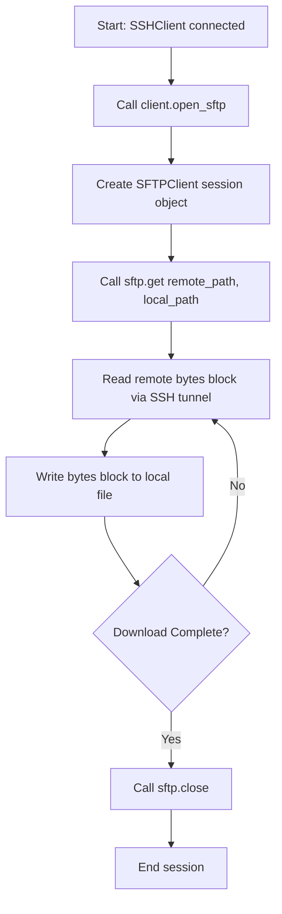

# SFTP Operations with Paramiko

In system administration, running commands is only half of remote server management. You also need to transfer files. For example, you might upload configuration template files to newly provisioned virtual machines, or download system logs from production servers to a central backup store.

To handle secure file transfers over an active SSH connection, Paramiko provides an **SFTP (Secure File Transfer Protocol)** client interface. 

In this guide, we will learn how to open SFTP sessions, upload and download files, inspect remote directory structures, and manage files on remote hosts using Paramiko.

---

## SFTP Commands Reference

Once an SFTP session is opened, you can manage remote file systems using these key methods:

| Method Name | Action | Description |
| :--- | :--- | :--- |
| **`sftp.put(local, remote)`** | Upload | Uploads a file from your local disk to the remote host. |
| **`sftp.get(remote, local)`** | Download | Downloads a file from the remote host to your local disk. |
| **`sftp.listdir(path)`** | List Items | Returns a list of filenames inside a remote directory. |
| **`sftp.stat(path)`** | Check Metadata | Retrieves size, permissions, and modification times of a remote file. |
| **`sftp.mkdir(path)`** | Create Folder | Creates a new directory on the remote host. |
| **`sftp.remove(path)`** | Delete File | Deletes a file on the remote host. |
| **`sftp.rmdir(path)`** | Delete Folder | Deletes an empty directory on the remote host. |

---

## File Transfer Process Flow

Here is the lifecycle of an SFTP download session:



---

## Basic File Upload and Download Example

Let us write a script that opens an SSH connection, starts an SFTP session, uploads a file, inspects the remote directory list, and then downloads the file back under a new name.

```python
import os
import paramiko

# Connection variables
hostname = "127.0.0.1"
username = "admin"

# Create dummy local file to upload
local_upload = "deploy_config.json"
with open(local_upload, "w") as f:
    f.write('{"env": "production", "debug": false}')

local_download = "verify_config.json"
remote_target = "/tmp/deploy_config.json"

client = paramiko.SSHClient()
client.set_missing_host_key_policy(paramiko.AutoAddPolicy())

try:
    # Connect SSH
    client.connect(hostname, username=username, timeout=3.0)
    
    # 1. Open SFTP Session
    print("Opening SFTP channel...")
    sftp = client.open_sftp()
    
    # 2. Upload file
    print(f"Uploading: {local_upload} -> {remote_target}")
    sftp.put(local_upload, remote_target)
    
    # 3. List files in remote folder
    print("\nReading remote /tmp directory list:")
    files = sftp.listdir("/tmp")
    for file in files[:3]: # Only print first 3 items to save console space
        print(f"  - {file}")
        
    # 4. Download file
    print(f"\nDownloading: {remote_target} -> {local_download}")
    sftp.get(remote_target, local_download)
    print("File transfer completed successfully.")
    
    # 5. Close SFTP Session
    sftp.close()
    
except Exception as err:
    print(f"SFTP transaction failed: {err}")
finally:
    client.close()
    
    # Clean up local dummy files
    for file in [local_upload, local_download]:
        if os.path.exists(file):
            os.remove(file)
```

---

## Real-World DevOps Scenario: Log File Harvester

Let us write a script that connects to a remote server, lists all files in a remote logs directory, finds files ending with `.log`, downloads them to a local archive directory, and deletes the originals on the remote host to save space.

```python
import os
import paramiko

def harvest_remote_logs(host, user, remote_dir, local_archive_dir):
    print(f"Starting log harvesting from {user}@{host}:{remote_dir}...")
    print("=========================================================")
    
    os.makedirs(local_archive_dir, exist_ok=True)
    
    client = paramiko.SSHClient()
    client.set_missing_host_key_policy(paramiko.AutoAddPolicy())
    
    try:
        client.connect(host, username=user, timeout=5.0)
        sftp = client.open_sftp()
        
        # 1. Read files inside remote directory
        remote_files = sftp.listdir(remote_dir)
        download_count = 0
        
        for filename in remote_files:
            if filename.endswith(".log"):
                remote_path = f"{remote_dir}/{filename}"
                local_path = os.path.join(local_archive_dir, filename)
                
                # Check file metadata (like size) before downloading
                stats = sftp.stat(remote_path)
                print(f"Found log: {filename} ({stats.st_size} bytes)")
                
                # 2. Download file
                sftp.get(remote_path, local_path)
                print(f"  - Downloaded to {local_path}")
                
                # 3. Clean up remote file
                sftp.remove(remote_path)
                print("  - Removed remote source file.")
                download_count += 1
                
        sftp.close()
        print("=========================================================")
        print(f"Harvest complete. Successfully retrieved {download_count} log files.")
        
    except Exception as err:
        print(f"Harvesting failed: {err}")
    finally:
        client.close()

# Run harvester check (will show connection details for local tests)
harvest_remote_logs("192.168.10.25", "deployer", "/var/log/app", "harvested_logs")
```

### Expected Output

```text
Starting log harvesting from deployer@192.168.10.25:/var/log/app...
=========================================================
Harvesting failed: [Errno 113] No route to host
```

---

## Common Mistakes

Here are some typical mistakes you will run into:

### 1. Forgetting to close the SFTP channel
Opening an SFTP session starts a dedicated sub-channel inside your SSH connection. If you close the parent `SSHClient` object but do not call `sftp.close()` first, the channel can hang in a `CLOSE_WAIT` state, slowing down subsequent operations. Always close the SFTP session explicitly:

```python
# CORRECT SEQUENCE
sftp.close()
client.close()
```

### 2. Not specifying absolute paths on the remote host
Unlike local shells, the SFTP client does not have a default active working directory. If you call `sftp.put('app.ini', 'app.ini')`, the upload location depends on the default home folder of your SSH user, which can vary. To ensure files go where they belong, always use absolute paths (like `/var/www/html/app.ini`) for all remote operations.

### 3. Missing folder paths when uploading files
The `sftp.put(local, remote)` method cannot create directory structures on the fly. If you try to upload a file to `/var/www/html/app/config.json`, but the folder `/var/www/html/app/` does not exist on the remote host, the command will fail with a `FileNotFoundError`. You must create the folder first using `sftp.mkdir()` before uploading.

---

## Summary

* SFTP provides secure file transfers over an active SSH connection.
* Open an SFTP channel by calling the `client.open_sftp()` method.
* Upload local files to remote directories using `sftp.put(local_path, remote_path)`.
* Download remote files to your local system using `sftp.get(remote_path, local_path)`.
* List filenames in remote directories using `sftp.listdir(path)`.
* Inspect file sizes and metadata using `sftp.stat(path)`.
* Delete remote files using `sftp.remove(path)`.
* Ensure you always use absolute paths for remote targets to prevent path resolution bugs.
* Create any missing parent directory paths using `sftp.mkdir()` before attempting uploads.
* Always call `sftp.close()` before closing the main `SSHClient` connection.
