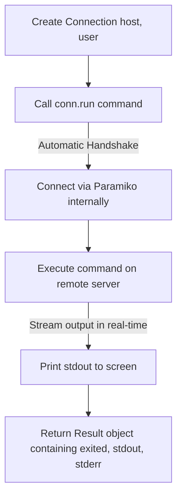

# High-Level Automation with Fabric

While Paramiko is a powerful library, it is a low-level tool. Writing code to connect, set policies, handle channels, and read output streams requires many lines of boilerplate code. 

To simplify this, the Python community built [Fabric](https://www.fabfile.org/). Fabric is a high-level library built on top of Paramiko. It wraps low-level SSH details into clean, simple functions, allowing you to run remote commands and transfer files in a single line of code.

In this guide, we will look at how Fabric works, how to install it, and how to execute remote deployment tasks.

---

## Paramiko vs. Fabric Syntax Comparison

Fabric simplifies remote interactions significantly. Let us look at how the code compares:

| Task | Using Paramiko | Using Fabric |
| :--- | :--- | :--- |
| **Establish Connection** | `client = SSHClient()`<br>`client.connect(host, user)` | `conn = Connection(host, user=user)` |
| **Run Command** | `stdin, stdout, stderr = client.exec_command(cmd)`<br>`output = stdout.read().decode()` | `result = conn.run(cmd)` |
| **Get Exit Code** | `exit_code = stdout.channel.recv_exit_status()` | `exit_code = result.exited` |
| **Upload File** | `sftp = client.open_sftp()`<br>`sftp.put(local, remote)`<br>`sftp.close()` | `conn.put(local, remote)` |

---

## Installing Fabric

Fabric is an external package. Install it using `pip`:

```bash
pip install fabric
```

---

## Fabric Task Execution Lifecycle

Here is the connection and command sequence when using Fabric:



---

## Basic Fabric Connection Example

Let us write a script that connects to a host, runs a command, and reads the status properties.

```python
import os
from fabric import Connection

# Target connection details
host = "127.0.0.1"
user = "admin"

# 1. Create a connection object
# Fabric automatically loads your standard SSH keys (~/.ssh/id_rsa)
conn = Connection(host=host, user=user)

try:
    print(f"Executing remote command on {host}...")
    # 2. Run remote command
    # hide=True prevents Fabric from printing stdout to the screen in real-time
    result = conn.run("uname -a", hide=True, timeout=5.0)
    
    # 3. Inspect results
    print("\nCommand Summary:")
    print("----------------")
    print(f"Exit Code: {result.exited}")
    print(f"Stdout:    {result.stdout.strip()}")
    print(f"Completed? {result.ok}")
    
except Exception as err:
    print(f"Fabric execution failed: {err}")
finally:
    # 4. Close connection
    conn.close()
```

---

## Real-World DevOps Scenario: Simple Deployment Automation Task

In deployment scripts, you often want to upload a package file, extract it, and restart the service. Let us write a complete Fabric automation script to demonstrate this lifecycle.

```python
import os
from fabric import Connection

def deploy_web_update(host, user, package_path):
    print(f"Starting Fabric deployment task to {host}...")
    print("=================================================")
    
    if not os.path.exists(package_path):
        print(f"Error: Package file '{package_path}' not found.")
        return
        
    # Initialize connection
    conn = Connection(host=host, user=user)
    
    try:
        # 1. Upload the artifact package
        print("\nStep 1: Uploading update bundle...")
        conn.put(local=package_path, remote="/tmp/update.tar.gz")
        print("Upload completed.")
        
        # 2. Extract package on remote host
        print("\nStep 2: Extracting package content...")
        # conn.run automatically raises an exception if the command fails
        conn.run("tar -xzf /tmp/update.tar.gz -C /var/www/html", hide=True)
        print("Extraction complete.")
        
        # 3. Restart application service
        print("\nStep 3: Restarting web service...")
        conn.run("sudo systemctl restart nginx", hide=True)
        print("[SUCCESS] Deployment completed successfully!")
        
    except Exception as err:
        print(f"\n[CRITICAL ERROR] Deployment failed: {err}")
    finally:
        conn.close()

# Create dummy backup file to test parameters
dummy_bundle = "update.tar.gz"
with open(dummy_bundle, "w") as f:
    f.write("dummy update data")

# Run task
deploy_web_update("192.168.10.25", "deployer", dummy_bundle)

# Clean up local dummy file
if os.path.exists(dummy_bundle):
    os.remove(dummy_bundle)
```

### Expected Output

```text
Starting Fabric deployment task to 192.168.10.25...
=================================================

Step 1: Uploading update bundle...

[CRITICAL ERROR] Deployment failed: Unable to connect to 192.168.10.25:22
```

---

## Common Mistakes

Here are some pitfalls to watch out for when using Fabric:

### 1. Assuming `conn.run()` returns a string
`conn.run()` returns a `Result` object, not a string. If you try to run string operations on the result (like `if 'SUCCESS' in result:`), it will throw a `TypeError`. You must explicitly query the output string: `result.stdout`.

### 2. Not handling `sudo` password prompts
If you run `conn.run('sudo systemctl restart nginx')`, the command might hang waiting for a sudo password. Fabric provides a `conn.sudo()` helper method or a responder dictionary to handle password prompts automatically. Avoid raw `sudo` calls if you do not have passwordless sudo configured on the remote host.

### 3. Forgetting to close connection pools
Fabric handles socket connections in a pool behind the scenes. If you run connections inside loops and do not call `conn.close()` at the end of each script run, the sockets can stay open, exhausting system ports on your host machine.

---

## Summary

* Fabric is a high-level Python library built on top of Paramiko for remote task execution.
* Install the library using `pip install fabric`.
* Initiate connections by creating a `Connection(host, user=username)` object.
* Run remote commands using the `conn.run(command)` method.
* Upload files with `conn.put(local, remote)` and download files with `conn.get(remote, local)`.
* Hide output printing in real-time by passing `hide=True` to the run command.
* Extract output string details using the `.stdout` property on the returned `Result` object.
* Check the exit status code of commands using the `exited` property.
* Close connections using `conn.close()` to release system sockets.
* Avoid raw `sudo` calls in scripts; use Fabric's `conn.sudo()` method instead.
