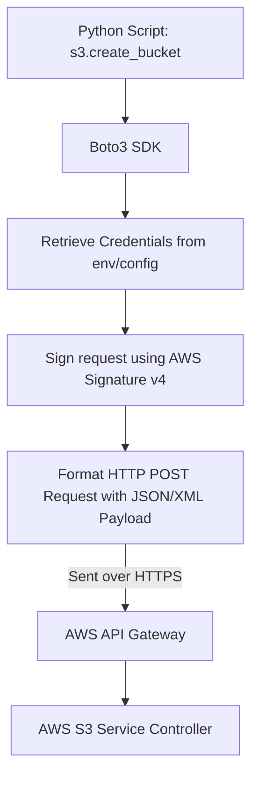

# Introduction to Boto3

If you are managing infrastructure on Amazon Web Services (AWS), you will run into automation requirements. You might need to spin up EC2 instances on a schedule, back up log directories to S3 buckets, delete unused EBS volumes to save costs, or rotate security credentials. 

While you can perform these actions manually using the AWS Web Console or write Bash scripts around the AWS Command Line Interface (CLI), the standard way to automate AWS in Python is using the **Boto3** library. Boto3 is the official **AWS Software Development Kit (SDK) for Python**.

In this guide, we will look at what Boto3 is, how it works, and why it is the standard for AWS automation.

---

## What is Boto3?

Boto3 is a Python library that allows you to write scripts that create, configure, and manage AWS services. The name "Boto" comes from the fresh-water dolphin native to the Amazon River.

Boto3 acts as a wrapper around the raw AWS REST HTTP APIs. Instead of writing complex HTTP requests to sign calls and send XML or JSON, you write standard Python classes and methods, and Boto3 translates them into signed API calls.

Let us compare using the AWS CLI vs the Boto3 SDK:

| Task / Feature | AWS CLI | Boto3 SDK |
| :--- | :--- | :--- |
| **Primary Interface** | Command line / Terminal / Shell. | Python scripts / Applications. |
| **Output Format** | JSON, Text, or Table strings. | Native Python dictionaries and objects. |
| **Conditional Logic** | Complex (requires Bash, `jq`, or PowerShell). | Simple (uses standard Python `if`, loops, lists). |
| **Execution Speed** | Slower (spawns processes for each command). | Faster (persistent HTTP connection pools). |
| **Best For** | Ad-hoc queries, quick manual command line checks. | Large-scale automated daemon checkers, serverless Lambdas. |

---

## Boto3 API Call Architecture

Here is the path an action takes from your Python script to the AWS Cloud:



---

## Basic Boto3 Code Structure

Here is a simple example showing how Boto3 is imported and used to inspect local AWS configuration details.

```python
import boto3

# 1. Initialize an AWS session
# Sessions read your local AWS credentials (~/.aws/credentials) automatically
session = boto3.Session()

# 2. Get session details
profile_name = session.profile_name
current_region = session.region_name

print("Boto3 Session Discovery")
print("=======================")
print(f"Active Credentials Profile: {profile_name}")
# If no region is configured locally, it defaults to None
print(f"Default Configuration Region: {current_region}")
```

### Expected Output

```text
Boto3 Session Discovery
=======================
Active Credentials Profile: default
Default Configuration Region: us-east-1
```

---

## Real-World DevOps Scenario: Multi-Region Service Availability Check

In cloud systems, you want to verify that you can reach AWS service endpoints from your server before launching deploy tasks. Here is a script that initializes a Boto3 client and checks the availability of S3 resources.

```python
import boto3
from botocore.exceptions import NoCredentialsError, ClientError

def test_s3_connection():
    print("Testing connection to AWS S3 Gateway...")
    print("---------------------------------------")
    
    try:
        # Create a low-level client for S3
        s3_client = boto3.client("s3")
        
        # Make a quick, low-cost metadata call to list buckets
        response = s3_client.list_buckets()
        
        buckets = response.get("Buckets", [])
        print(f"[OK] Connection successful! Found {len(buckets)} buckets in this account.")
        
    except NoCredentialsError:
        print("[CRITICAL] Authentication Failed: No AWS credentials found on this system.")
        print("Please run 'aws configure' or set AWS_ACCESS_KEY_ID in your environment.")
    except ClientError as err:
        print(f"[CRITICAL] API Access Refused: {err}")
    except Exception as err:
        print(f"[ERROR] Connection failed: {err}")

# Run connection test
test_s3_connection()
```

### Expected Output (if no credentials are set up)

```text
Testing connection to AWS S3 Gateway...
---------------------------------------
[CRITICAL] Authentication Failed: No AWS credentials found on this system.
Please run 'aws configure' or set AWS_ACCESS_KEY_ID in your environment.
```

---

## Common Mistakes

Here are some typical mistakes you will run into with Boto3:

### 1. Assuming Boto3 contains credentials by default
Installing Boto3 does not give you access to AWS. You must configure credentials separately on your host system (using the AWS CLI or setting environment variables). If you run Boto3 code without this setup, it will crash with a `NoCredentialsError`.

### 2. Committing AWS keys into your codebase
Never hardcode your AWS access keys inside your Python scripts:
`s3 = boto3.client('s3', aws_access_key_id='AKIA...')`
If you push this code to a public repository, scanner bots will steal your keys in seconds, potentially launching hundreds of expensive server instances under your account. Always use AWS profiles or IAM instance roles.

### 3. Ignoring regions configurations
AWS is highly regional. If your S3 buckets are in `us-east-1` but your system configuration is set to `eu-west-1`, your scripts might throw `NoSuchBucket` errors or read outdated data. Always confirm which region your session is targeting.

---

## Summary

* Boto3 is the official AWS Software Development Kit (SDK) for Python.
* It wraps raw AWS REST HTTP APIs into clean Python methods and classes.
* Boto3 automatically signs requests using local system credentials.
* Use it instead of the AWS CLI when you need conditional logic, loops, or complex data handling.
* Create a client connection using the `boto3.client('service_name')` function.
* Handle authentication failures by trapping the `NoCredentialsError` exception class.
* Never write AWS keys inside code; load them via configuration files or environment variables.
* Always check which region your session is running in to prevent connection mismatches.
* Use low-cost metadata calls (like listing resource counts) to test endpoint connectivity.
