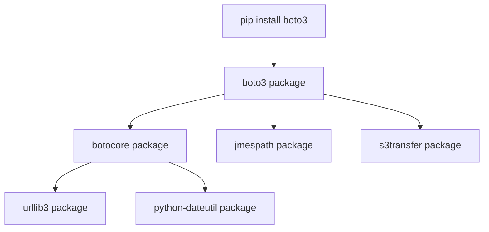

# Installing Boto3

To begin automating AWS with Python, you must set up your local development environment. This requires installing the `boto3` library, along with its core dependencies. 

When you install Boto3, `pip` automatically installs a library called `botocore` as a dependency. Understanding the relationship between these packages is essential for managing your automation environment.

In this guide, we will look at how to install Boto3, verify the installation, and manage dependency versions.

---

## Boto3 Package Dependency Chain

When you install Boto3, it pulls in several libraries behind the scenes:



* **`botocore`**: The foundation module. It contains the JSON service models (definitions of all AWS APIs), signs requests, and handles raw HTTP connections.
* **`jmespath`**: A library used to query JSON data structures easily.
* **`s3transfer`**: A specialized package managing multi-threaded S3 uploads and downloads.

---

## Boto3 vs. Botocore Comparison

Let us look at how the two primary libraries differ:

| Feature / Library | `boto3` | `botocore` |
| :--- | :--- | :--- |
| **User Exposure** | High-level (what you import and call directly in your code). | Low-level (internal engine, rarely imported directly). |
| **API Abstractions** | Clients, Resources, Sessions, and Collections. | JSON API schemas, connection pooling, security signing. |
| **Exception Handling** | Imports exceptions from `botocore.exceptions`. | Defines all low-level network and API errors. |
| **Update Cycle** | Daily updates (incorporates new AWS features). | Daily updates (mirrors CLI updates). |

---

## Installing Boto3

It is best practice to install Boto3 inside a Python virtual environment to prevent version conflicts with other system tools.

```bash
# 1. Create a virtual environment
python -m venv aws_env

# 2. Activate it
# On Windows:
aws_env\Scripts\activate
# On Linux/macOS:
source aws_env/bin/activate

# 3. Install Boto3
pip install boto3
```

---

## Verifying the Installation

Let us write a script that verifies our environment has Boto3 installed and reports package versions.

```python
import sys

try:
    import boto3
    import botocore
    import jmespath
    
    print("Environment Verification: SUCCESS")
    print("=================================")
    print(f"Python version:   {sys.version.split()[0]}")
    print(f"Boto3 version:    {boto3.__version__}")
    print(f"Botocore version: {botocore.__version__}")
    print(f"JMESPath version: {jmespath.__version__}")
    
except ImportError as err:
    print("Environment Verification: FAILED")
    print("---------------------------------")
    print(f"Missing dependency: {err}")
    print("Please install the package using: pip install boto3")
```

### Expected Output (with active environment)

```text
Environment Verification: SUCCESS
=================================
Python version:   3.11.2
Boto3 version:    1.26.100
Botocore version: 1.29.100
JMESPath version: 1.0.1
```

---

## Common Mistakes

Here are some typical issues when setting up Boto3:

### 1. Version drift between Boto3 and Botocore
AWS releases updates daily. If you install Boto3 in a virtual environment today, and run `pip install --upgrade botocore` next week, your package versions will drift. If `botocore` is too new or too old for the `boto3` wrapper layer, your scripts can throw strange `ImportError` or `AttributeError` exceptions. Always upgrade both packages together:

```bash
# Correct way to upgrade Boto3 environment
pip install --upgrade boto3 botocore
```

### 2. Installing Boto3 globally on Linux system Python
If you run `sudo pip install boto3` on Linux systems (like Ubuntu), you will pollute the system's default Python environment. This can break system-level configuration utilities (like `apt` helpers or cloud-init processes) that rely on specific library versions. Always use virtual environments (`venv`) or install packages locally using the `--user` flag.

### 3. Missing Boto3 in Serverless deployments (AWS Lambda)
When deploying code to AWS Lambda, the Python runtime environment includes Boto3 by default. However, the pre-installed version in Lambda might be several months old. If you use a brand-new AWS API parameter, your Lambda function will crash. It is best practice to package your target Boto3 version with your deployment package.

---

## Summary

* Set up Boto3 in virtual environments to isolate dependencies.
* Install Boto3 by running the command `pip install boto3`.
* Boto3 depends on `botocore`, which parses JSON schemas and handles signing.
* Verify your installation by checking the `boto3.__version__` property.
* Avoid installing packages directly into system Python environments on Linux.
* Upgrade Boto3 and Botocore together using `pip install --upgrade boto3 botocore`.
* Be aware that `s3transfer` is installed automatically to manage S3 operations.
* Include specific Boto3 versions in your `requirements.txt` file for staging parity.
* Pack your own Boto3 dependency in AWS Lambda if you need access to brand-new API updates.
