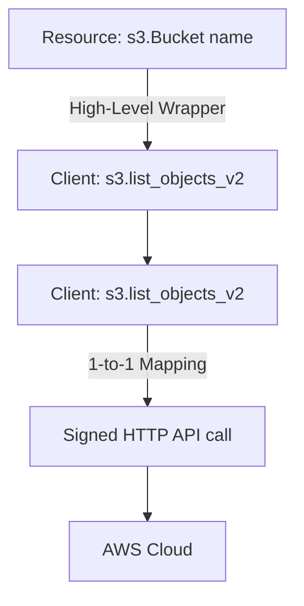

# Boto3 Clients vs. Resources

When writing Boto3 scripts, you will notice two different ways to interact with AWS services: **Clients** and **Resources**. 

* **Client**: A low-level interface that maps 1-to-1 with the raw AWS service APIs.
* **Resource**: A high-level, object-oriented interface that wraps the low-level API calls into clean Python objects.

Understanding when to use each interface is essential for writing clean, efficient automation scripts.

In this guide, we will compare Clients and Resources, look at their syntax differences, and learn when to choose one over the other.

---

## Comparison Table

Here is a summary of how Clients and Resources stack up:

| Feature | Client (`boto3.client`) | Resource (`boto3.resource`) |
| :--- | :--- | :--- |
| **API Level** | Low-level. | High-level (object-oriented). |
| **Service Support** | **All AWS services** (generated automatically from service models). | **Only select services** (like S3, EC2, DynamoDB, IAM). |
| **Response Format** | Raw Python dictionaries (requires key lookup: `resp['Buckets']`). | Rich Python objects (properties accessed via dot notation: `bucket.name`). |
| **Actions / Methods** | 1-to-1 mapping with AWS API (e.g., `list_buckets()`). | High-level actions (e.g. `bucket.objects.all()`). |
| **Usage Recommendation** | For complex operations, pagination, or unsupported services. | For simple S3, EC2, or IAM automations. |

---

## Architecture Flow

Here is how both interfaces translate your commands before sending them to AWS:



---

## S3 Listing Code Comparison

Let us look at a comparison of listing S3 objects in a bucket using both Client and Resource interfaces.

### 1. Using the Client Interface
The Client interface returns a raw dictionary. You must navigate the dictionary keys manually and handle empty states.

```python
import boto3

# Initialize Client
s3_client = boto3.client("s3")

try:
    # list_objects_v2 returns a dictionary
    response = s3_client.list_objects_v2(Bucket="my-deploy-bucket-2026")
    
    # We must navigate keys and handle cases where the bucket is empty
    if "Contents" in response:
        for obj in response["Contents"]:
            print(f"File found: {obj['Key']} ({obj['Size']} bytes)")
    else:
        print("Bucket is empty.")
        
except Exception as err:
    print(f"Client lookup failed: {err}")
```

### 2. Using the Resource Interface
The Resource interface wraps the API response. You can iterate through objects directly using standard Python loops.

```python
import boto3

# Initialize Resource
s3_resource = boto3.resource("s3")

try:
    # Access bucket object representation
    bucket = s3_resource.Bucket("my-deploy-bucket-2026")
    
    # Iterate directly through objects collection
    for obj in bucket.objects.all():
        print(f"File found: {obj.key} ({obj.size} bytes)")
        
except Exception as err:
    print(f"Resource lookup failed: {err}")
```

Notice how the Resource code is much cleaner, object-oriented, and does not require you to check dictionary keys like `"Contents"`.

---

## Real-World DevOps Scenario: Fetching Instances Stats

Let us look at another service that supports both: EC2. We will write a script that attempts to query instance details.

```python
import boto3
from botocore.exceptions import ClientError

def inspect_ec2_volumes():
    print("Initiating EC2 Resource Audit...")
    print("---------------------------------")
    
    try:
        # Using Resource interface for EC2
        ec2 = boto3.resource("ec2")
        
        # Get all instances (automatically handles API pagination under the hood)
        instances = ec2.instances.all()
        
        count = 0
        for inst in instances:
            print(f"Instance ID: {inst.id} | Type: {inst.instance_type} | State: {inst.state['Name']}")
            count += 1
            
        print("---------------------------------")
        print(f"Audit completed. Scanned {count} instances.")
        
    except ClientError as err:
        print(f"Resource access failed: {err}")
    except Exception as err:
        print(f"Error: {err}")

inspect_ec2_volumes()
```

### Expected Output (if no credentials or instances are set up)

```text
Initiating EC2 Resource Audit...
---------------------------------
Resource access failed: Unable to locate credentials
```

---

## Common Mistakes

Here are some typical gotchas when choosing interfaces:

### 1. Trying to use `boto3.resource` for unsupported services
Only a handful of core services support the Resource interface. If you try to run `boto3.resource('lambda')` or `boto3.resource('rds')`, Python will raise a `ResourceNotSupportedError`. For these services, you **must** use `boto3.client()`.

### 2. Confusing property casing between Clients and Resources
Client dictionaries use capitalized camelCase keys (e.g. `response['Contents']` or `response['Owner']`). Resource object properties use snake_case (e.g. `obj.key` or `obj.owner`). Mixing these up will raise `KeyError` or `AttributeError`.

### 3. Missing access to low-level client features on Resources
If you are using a Resource interface (like `s3_resource`), but need to access a low-level client method that is not wrapped in the Resource class, you do not need to create a new client object. You can access the underlying client directly via the `.meta.client` property:

```python
# Access client methods from resource object
s3_resource.meta.client.generate_presigned_url(...)
```

---

## Summary

* Boto3 Clients are low-level interfaces mapping 1-to-1 with AWS API services.
* Boto3 Resources are high-level, object-oriented abstractions that return rich Python objects.
* All AWS services support the Client interface; only core services support Resources.
* Client methods return raw dictionaries, requiring key lookups.
* Resource attributes are accessed using snake_case properties (e.g. `obj.key`).
* Resource collections automatically handle API pagination under the hood.
* Avoid using Resources for services like Lambda or RDS; use Clients instead.
* Access the underlying low-level client from a resource using `resource.meta.client`.
* Be careful with key and property casing, as they differ between clients and resources.
