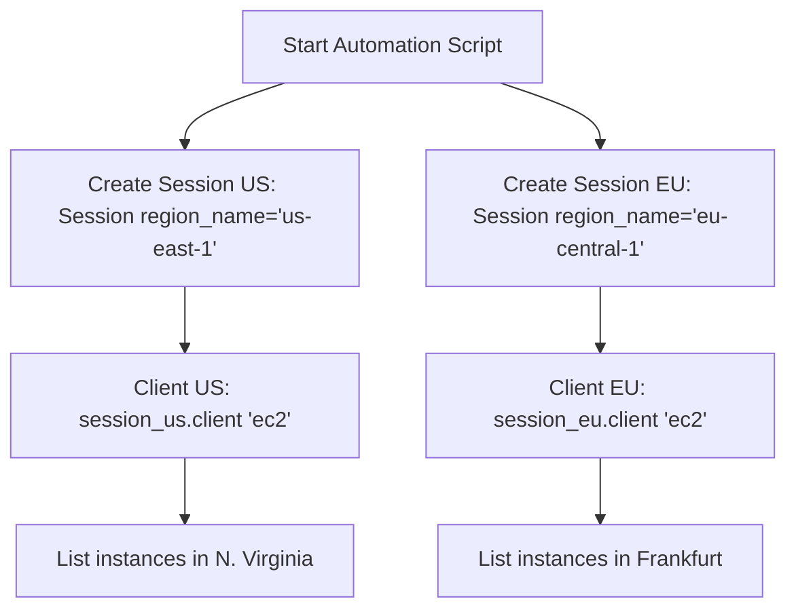

# Sessions in Boto3

When you make a basic client call (like `boto3.client('s3')`), Boto3 automatically creates a default session in the background, loading credentials from your environment or files. This is called the **default session**.

While this works for simple scripts, production scripts often need more control. You might need to query resources across multiple AWS accounts (using different profiles) or manage services in multiple AWS regions (like copying backups from `us-east-1` to `eu-west-1`) in the same script run.

To do this, you must use **explicit sessions** (`boto3.Session`).

In this guide, we will learn the difference between default and explicit sessions, how to manage multi-region automation, and how sessions handle threads.

---

## Default vs. Explicit Sessions

Let us compare the two ways of managing sessions in Boto3:

| Feature | Default Session (`boto3.client`) | Explicit Session (`boto3.Session`) |
| :--- | :--- | :--- |
| **Instantiation** | Handled implicitly in the background. | Created explicitly: `session = boto3.Session(...)` |
| **Credentials Source** | Locked to default system environment. | Can load specific profiles: `profile_name='staging'`. |
| **Target Region** | Locked to default config region. | Can specify regional overrides: `region_name='us-west-2'`. |
| **Thread Safety** | Shared globally (not thread-safe). | Can isolate sessions per thread (thread-safe). |
| **Best For** | Quick scripts, single-account checkups. | Production-grade automation, multi-region deployments. |

---

## Multi-Region Execution Flow

Here is how explicit sessions allow your scripts to route commands to different regions simultaneously:



---

## Basic Session Configuration Example

Let us write a script that instantiates two explicit sessions targeting different regions, creating clients from those specific sessions.

```python
import boto3

# 1. Create explicit sessions for different regions
session_us = boto3.Session(region_name="us-east-1")
session_eu = boto3.Session(region_name="eu-central-1")

# 2. Create clients bound to their respective sessions
s3_us = session_us.client("s3")
s3_eu = session_eu.client("s3")

print("Session Configuration Mapping:")
print("------------------------------")
print(f"US Client Region: {s3_us.meta.region_name}")
print(f"EU Client Region: {s3_eu.meta.region_name}")
```

### Expected Output

```text
Session Configuration Mapping:
------------------------------
US Client Region: us-east-1
EU Client Region: eu-central-1
```

---

## Real-World DevOps Scenario: Multi-Account Resource Inspector

In enterprise cloud management, you often have separate AWS accounts for development, testing, and production. Let us write a script that connects to both development and production profiles to audit resources.

```python
import boto3
from botocore.exceptions import ProfileNotFound, NoCredentialsError

def audit_multi_account_buckets():
    # Define profiles we want to scan
    # Ensure these are configured in your ~/.aws/credentials file
    target_profiles = ["default", "staging"]
    
    print("Initiating Multi-Account Bucket Audit...")
    print("========================================")
    
    for profile in target_profiles:
        try:
            print(f"\nAccessing account profile: '{profile}'...")
            # 1. Instantiate explicit session
            session = boto3.Session(profile_name=profile)
            
            # 2. Create client bound to this session
            s3 = session.client("s3")
            response = s3.list_buckets()
            
            buckets = response.get("Buckets", [])
            print(f"[OK] Found {len(buckets)} buckets under profile '{profile}':")
            for b in buckets:
                print(f"  - {b['Name']}")
                
        except ProfileNotFound:
            print(f"[WARNING] Profile '{profile}' is not configured on this host machine.")
        except NoCredentialsError:
            print(f"[REJECTED] Access keys are missing for profile '{profile}'.")
        except Exception as err:
            print(f"[ERROR] Session failed: {err}")
            
    print("========================================")

audit_multi_account_buckets()
```

### Expected Output

```text
Initiating Multi-Account Bucket Audit...
========================================

Accessing account profile: 'default'...
[REJECTED] Access keys are missing for profile 'default'.

Accessing account profile: 'staging'...
[WARNING] Profile 'staging' is not configured on this host machine.
========================================
```

---

## Common Mistakes

Here are some typical gotchas when using sessions:

### 1. Thread-safety violations with shared clients
In Boto3, **sessions are not thread-safe**. If you create a single session (`session = boto3.Session()`) and spawn multiple threads that share this session object to make simultaneous API calls, Boto3 will experience race conditions and crash. Always create a new Session object inside each thread's worker function:

```python
# CORRECT way to write multi-threaded Boto3 code
def worker_function(profile, region):
    # Instantiate session local to this thread
    session = boto3.Session(profile_name=profile, region_name=region)
    s3 = session.client("s3")
    # safe to run API calls now
```

### 2. Confusing `boto3.Session` with `boto3.client`
A common mistake is trying to run API methods directly on the Session object (like `session.list_buckets()`). The Session class is only a configuration container. You must create client or resource objects *from* the session using `session.client('s3')` or `session.resource('s3')` before making API calls.

### 3. Assuming environment variables override custom Session settings
If you define `boto3.Session(profile_name='dev')` inside your script, Boto3 will load credentials for the `dev` profile even if you have set `AWS_PROFILE=prod` in your terminal shell. Explicit arguments passed in code always take priority over system environment variables.

---

## Summary

* Basic calls like `boto3.client()` create an implicit default session in the background.
* Explicit sessions (`boto3.Session`) allow you to target multiple profiles and regions.
* Instantiate custom sessions by passing `profile_name` and `region_name` arguments.
* Create clients and resources from a session using `session.client()` or `session.resource()`.
* Ensure thread-safety by instantiating separate Session objects inside individual thread loops.
* Remember that Session objects are configuration containers; they do not have API methods.
* Explicit parameters passed to `boto3.Session` constructors override environment variables.
* Audit multi-account setups by looping over profile lists and creating explicit sessions.
* Reclaim connection resources by closing sessions when they are no longer needed.
