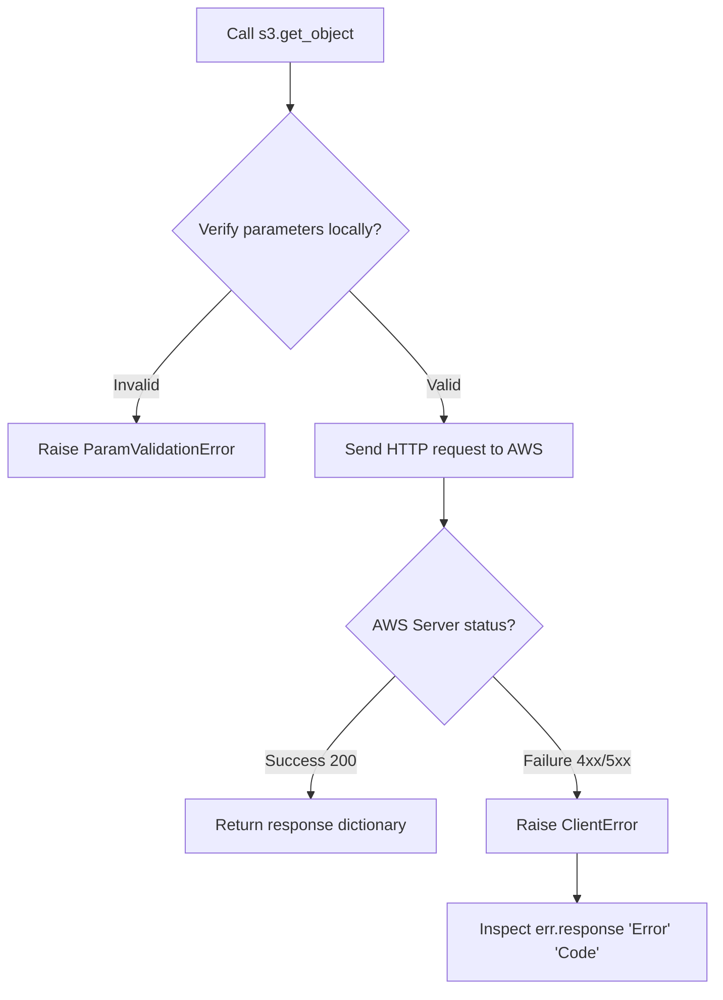

# Error Handling in Boto3

When writing automation scripts with Boto3, things can fail in many ways. A bucket you are trying to write to might not exist, your keys might not have IAM permissions to stop an EC2 instance, or you might pass an invalid parameter.

If your script crashes midway, it can leave configurations half-finished or block CI/CD pipelines.

In this guide, we will learn how to catch Boto3 exceptions, inspect the error details returned by AWS, and write robust error handlers.

---

## Boto3 Exception Hierarchy

In Boto3, exceptions are divided into two main categories:

| Error Category | Exception Class | Cause | Raised by |
| :--- | :--- | :--- | :--- |
| **Local Validation Errors** | `botocore.exceptions.ParamValidationError` | You passed invalid parameters in your code (e.g. wrong type or missing required key). | Client (before making the HTTP request). |
| **AWS API Errors** | `botocore.exceptions.ClientError` | AWS rejected the request (e.g. invalid credentials, resource not found, access denied). | AWS Service Controller. |

---

## Error Handling Flow in Boto3

Here is how Boto3 handles request checks and errors:



---

## Navigating ClientError Response Details

When `ClientError` is raised, it contains a dictionary inside the `response` attribute. You navigate this dictionary to find out why the call failed.

Here is the dictionary structure:
* `err.response['Error']['Code']`: The AWS specific error code string (e.g. `"NoSuchBucket"`, `"AccessDenied"`).
* `err.response['Error']['Message']`: The human-readable error details.
* `err.response['ResponseMetadata']['HTTPStatusCode']`: The HTTP status code returned by the server (e.g. `403` or `404`).

Let us look at a code example that attempts to access a non-existent bucket:

```python
import boto3
from botocore.exceptions import ClientError, ParamValidationError

s3 = boto3.client("s3")
target_bucket = "non-existent-bucket-name-xyz"

try:
    print(f"Querying S3 bucket: '{target_bucket}'...")
    # This call will fail
    s3.list_objects_v2(Bucket=target_bucket)
    
except ParamValidationError as err:
    # Local validation error
    print(f"[PARAMETER ERROR] Local check failed: {err}")
    
except ClientError as err:
    # Retrieve AWS error specifics
    error_code = err.response["Error"]["Code"]
    error_msg = err.response["Error"]["Message"]
    http_status = err.response["ResponseMetadata"]["HTTPStatusCode"]
    
    print("\n[AWS API ERROR]")
    print(f"  Error Code:  {error_code}")
    print(f"  HTTP Status: {http_status}")
    print(f"  Details:     {error_msg}")
```

### Expected Output (if credentials are set but bucket is missing)

```text
Querying S3 bucket: 'non-existent-bucket-name-xyz'...

[AWS API ERROR]
  Error Code:  NoSuchBucket
  HTTP Status: 404
  Details:     The specified bucket does not exist
```

---

## Real-World DevOps Scenario: Robust S3 Bucket Creator

Let us write a script that attempts to create an S3 bucket. If the bucket already exists under another account, AWS will return a `BucketAlreadyExists` error. If it already exists in our own account, it will return `BucketAlreadyOwnedByYou`. Our script will handle these errors gracefully.

```python
import boto3
from botocore.exceptions import ClientError

def safe_create_s3_bucket(bucket_name, region="us-east-1"):
    print(f"Deploying S3 bucket: {bucket_name} in region: {region}...")
    print("----------------------------------------------------------")
    
    s3 = boto3.client("s3", region_name=region)
    
    try:
        # Create bucket
        # Note: us-east-1 does not require LocationConstraint
        if region == "us-east-1":
            s3.create_bucket(Bucket=bucket_name)
        else:
            s3.create_bucket(
                Bucket=bucket_name,
                CreateBucketConfiguration={"LocationConstraint": region}
            )
        print(f"[SUCCESS] S3 bucket '{bucket_name}' created successfully.")
        
    except ClientError as err:
        error_code = err.response["Error"]["Code"]
        
        if error_code == "BucketAlreadyOwnedByYou":
            print(f"[OK] You already own this bucket '{bucket_name}'. No action needed.")
        elif error_code == "BucketAlreadyExists":
            print(f"[CRITICAL] Global Name Collision: Bucket name '{bucket_name}' is already taken by another account.")
        elif error_code == "AccessDenied":
            print(f"[CRITICAL] Permissions Error: Your credentials do not have permission to create buckets.")
        else:
            print(f"[ERROR] AWS API call failed: {err.response['Error']['Message']} (Code: {error_code})")
            
    except Exception as err:
        print(f"[ERROR] Unexpected script error: {err}")

# Test with a name that is guaranteed to be taken globally
safe_create_s3_bucket("test")
```

### Expected Output

```text
Deploying S3 bucket: test in region: us-east-1...
----------------------------------------------------------
[CRITICAL] Global Name Collision: Bucket name 'test' is already taken by another account.
```

---

## Common Mistakes

Here are some typical errors when handling Boto3 errors:

### 1. Trying to import specific AWS errors as classes
AWS has hundreds of error codes (like `NoSuchBucket` or `InstanceNotFound`). These **do not exist as Python exception classes**. If you try to write `except s3.exceptions.NoSuchBucket:`, your script will raise an `AttributeError`. You must catch the generic `ClientError` and check the error code string inside the `except` block.

### 2. Ignoring parameter validation checks locally
`ParamValidationError` is raised locally before Boto3 contacts AWS. If you pass a wrong data type (like `s3.list_objects_v2(Bucket=123)` where bucket must be a string), and only catch `ClientError`, the script will crash. Always catch both `ParamValidationError` and `ClientError`.

### 3. Relying on default string representations of ClientError
Printing the raw exception (`print(err)`) outputs a messy string containing the entire nested dictionary, which is hard for operators to parse in log files. Always extract `Error['Message']` and `Error['Code']` to log clean, human-readable errors.

---

## Summary

* Boto3 raises `ParamValidationError` locally for invalid parameters before sending requests.
* Boto3 raises `ClientError` for any API failures returned by AWS servers.
* Catch the generic `ClientError` to handle all AWS API exceptions.
* AWS-specific error codes (like `NoSuchBucket`) are strings, not Python exception classes.
* Inspect `err.response['Error']['Code']` to determine the specific cause of the failure.
* Read the human-readable explanation from `err.response['Error']['Message']`.
* Check the HTTP code (e.g. 403 or 404) via `err.response['ResponseMetadata']['HTTPStatusCode']`.
* Handle common cloud states (like `BucketAlreadyOwnedByYou`) to make scripts idempotent.
* Always log clean, filtered error messages instead of printing the raw exception dictionary.
