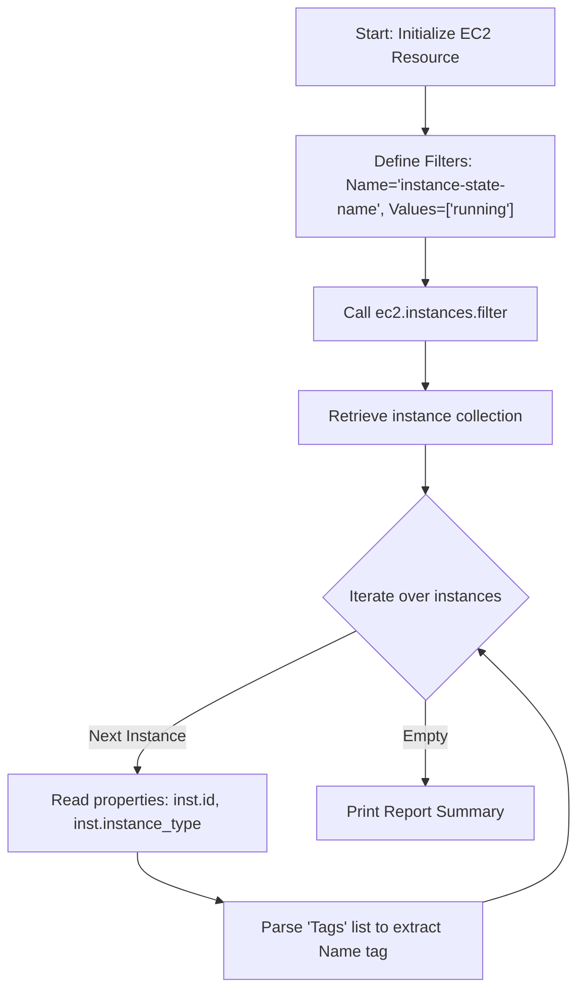

# Listing EC2 Instances

In cloud infrastructure management, auditing virtual machines is a frequent requirement. You might need to list all running instances to verify security configurations, count instance types to monitor infrastructure budgets, or locate orphaned development instances to stop them and save costs.

To fetch instance details, Boto3 provides both the low-level `client.describe_instances()` method and the high-level `resource.instances` collection.

In this guide, we will learn how to list EC2 instances, filter them based on their state or tag keys, and extract metadata like IP addresses, state codes, and instance types.

---

## EC2 Query Methods Comparison

Here is how the two primary methods for querying EC2 instances compare:

| Method Name | Return Type | Filtering Parameter | Best For | Description |
| :--- | :--- | :--- | :--- | :--- |
| **`client.describe_instances()`** | `dict` | `Filters=[...]` | Listing instances with full raw API details. | Returns a list of "Reservations", each containing a list of "Instances". Requires double nested loops. |
| **`resource.instances.filter()`** | Collection | `Filters=[...]` | Object-oriented scripts, loops. | Returns an iterable collection of `Instance` objects directly. |

---

## Instance Listing Flow

Here is the data flow when listing and filtering instances using the Resource interface:



---

## Listing Instances with describe_instances (Client)

Let us write a script that queries the low-level client interface. Because AWS groups instances under logical launching groups called **Reservations**, we must loop through `Reservations` first, and then loop through the `Instances` list inside each reservation.

```python
import boto3

# Initialize low-level EC2 client
ec2_client = boto3.client("ec2")

try:
    print("Querying EC2 fleet details...")
    response = ec2_client.describe_instances()
    
    reservations = response.get("Reservations", [])
    instance_count = 0
    
    for reservation in reservations:
        instances = reservation.get("Instances", [])
        for inst in instances:
            instance_id = inst["InstanceId"]
            instance_type = inst["InstanceType"]
            state = inst["State"]["Name"]
            
            print(f"ID: {instance_id:<20} | Type: {instance_type:<10} | State: {state}")
            instance_count += 1
            
    print(f"\nScan finished. Found {instance_count} instances in this region.")
    
except Exception as err:
    print(f"Failed to query EC2: {err}")
```

---

## Filtering Instances by Tags (Resource)

When managing hundreds of machines, you only want to look at specific subgroups. You can filter instances using the `Filters` parameter, passing a list of dictionaries with `Name` and `Values` keys.

Here is a script that filters for running instances with the tag `Environment=Production`.

```python
import boto3

# Initialize EC2 resource
ec2 = boto3.resource("ec2")

# Define target filters
# We only want instances that are 'running' AND have the Environment=Production tag
custom_filters = [
    {
        "Name": "instance-state-name",
        "Value": ["running"]
    },
    {
        "Name": "tag:Environment",
        "Value": ["Production"]
    }
]

try:
    print("Scanning for running Production instances...")
    print("------------------------------------------")
    
    # Query instances using the filter configuration
    instances = ec2.instances.filter(Filters=custom_filters)
    
    count = 0
    for inst in instances:
        # Extract Name tag safely
        # Tags are stored as a list of dicts: [{'Key': 'Name', 'Value': 'my-webserver'}]
        tags = inst.tags or []
        name_tag = "Unnamed"
        for tag in tags:
            if tag["Key"] == "Name":
                name_tag = tag["Value"]
                break
                
        print(f"Name: {name_tag:<20} | ID: {inst.id:<19} | IP: {inst.private_ip_address}")
        count += 1
        
    print("------------------------------------------")
    print(f"Total matching instances found: {count}")
    
except Exception as err:
    print(f"Failed to filter instances: {err}")
```

### Expected Output (if no credentials are set up)

```text
Scanning for running Production instances...
------------------------------------------
Failed to filter instances: Unable to locate credentials
```

---

## Common Mistakes

Here are some typical mistakes you will run into when listing instances:

### 1. Forgetting to handle missing `tags` attributes
If an instance has no tags configured, the `Tags` key (in client) or `tags` property (in resource) will be `None` or missing. If you try to iterate over `inst.tags` directly without checking if it is empty, your script will crash with a `TypeError: 'NoneType' object is not iterable`. Always write a fallback check: `tags = inst.tags or []`.

### 2. Confusing `describe_instances()` return types
Remember that `ec2_client.describe_instances()` returns a dictionary, not a list. The actual list of instances is nested deep inside reservations. Writing `for inst in response` will iterate over the root dictionary keys (like `"Reservations"`, `"ResponseMetadata"`), causing type errors.

### 3. Not specifying the region configuration
If your EC2 instances are in `eu-west-1` but your default local AWS configuration points to `us-east-1`, your scripts will run successfully but return 0 instances, making you think your servers were deleted. Always verify your targeted AWS region.

---

## Summary

* List EC2 instances using `describe_instances()` (client) or `instances` collections (resource).
* Low-level client queries group instances under a double-nested `Reservations` list.
* Filter query results by passing a list of target filters to the `Filters` parameter.
* Target specific tag keys by formatting filter names as `"tag:KeyName"`.
* Always write fallback rules (`inst.tags or []`) to handle instances without tags safely.
* Loop through tags to extract the value associated with the `"Name"` key.
* Access instance network attributes like `inst.private_ip_address` or `inst.public_ip_address`.
* Check targeted AWS regions, as queries only return instances in the active region.
* Use `instances.filter()` instead of client calls when you want to avoid double nested loops.
