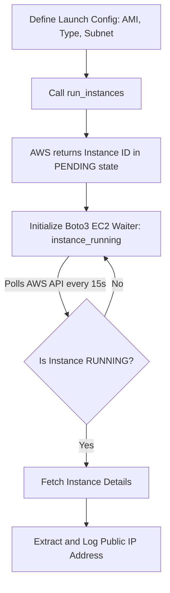

# Launching EC2 Instances

Provisioning virtual machines (EC2 instances) is one of the most fundamental cloud automation tasks. Instead of clicking through the AWS Web Console to launch servers, you can write Python scripts that launch servers dynamically based on deployment requirements.

In Boto3, you launch instances using `client.run_instances()` or `resource.create_instances()`.

In this guide, we will learn how to configure launch parameters (like AMI images and instance types), tag resources on creation, and use Boto3 **waiters** to block execution until the new server is online and has been assigned a public IP.

---

## EC2 Launch Methods Comparison

Here is how the Client and Resource approaches compare when creating new instances:

| Feature | Client (`run_instances`) | Resource (`create_instances`) |
| :--- | :--- | :--- |
| **Return Type** | A raw Python dictionary containing nested instance metadata. | A list of `Instance` objects. |
| **Blocking Wait** | Requires creating a separate client waiter object. | Can call `instance.wait_until_running()` directly on the returned object. |
| **Tagging on Launch** | Done via `TagSpecifications` parameter. | Done via `TagSpecifications` parameter or calling `create_tags()`. |
| **Best For** | Lower-level API integrations. | Clean, object-oriented provisioning scripts. |

---

## Instance Provisioning Flow

When launching an instance, it takes time for AWS to allocate hardware, boot the operating system, and configure the network. Here is how your script should handle the lifecycle:



---

## Launching an Instance with Waiters

Let us write a script that launches a single `t2.micro` instance using a standard Amazon Linux 2 AMI. We will configure tags on launch, and use a Boto3 client waiter to block our script until the instance is running, allowing us to print its public IP address.

```python
import boto3
from botocore.exceptions import ClientError

# Configuration parameters
# Note: AMI IDs are region-specific. This ID represents Amazon Linux 2 in us-east-1
AMI_ID = "ami-0c55b159cbfafe1f0" 
INSTANCE_TYPE = "t2.micro"

ec2_client = boto3.client("ec2", region_name="us-east-1")

try:
    print(f"Launching instance using AMI: {AMI_ID}...")
    
    # 1. Run the instance
    response = ec2_client.run_instances(
        ImageId=AMI_ID,
        InstanceType=INSTANCE_TYPE,
        MinCount=1,
        MaxCount=1,
        # Tag resources on launch
        TagSpecifications=[
            {
                "ResourceType": "instance",
                "Tags": [
                    {"Key": "Name", "Value": "web-deploy-test"},
                    {"Key": "Environment", "Value": "Staging"}
                ]
            }
        ]
    )
    
    # Extract Instance ID from response dictionary
    instance_id = response["Instances"][0]["InstanceId"]
    print(f"[PENDING] Instance successfully created! Assigned ID: {instance_id}")
    
    # 2. Initialize the waiter to block until running
    print("Waiting for instance to enter 'running' state (this takes ~1-2 mins)...")
    waiter = ec2_client.get_waiter("instance_running")
    waiter.wait(InstanceIds=[instance_id])
    print("[RUNNING] Instance is online!")
    
    # 3. Retrieve updated instance details to read the IP address
    details = ec2_client.describe_instances(InstanceIds=[instance_id])
    instance_info = details["Reservations"][0]["Instances"][0]
    public_ip = instance_info.get("PublicIpAddress", "No Public IP Assigned")
    
    print("\nServer Deployment Report:")
    print("-------------------------")
    print(f"Instance ID: {instance_id}")
    print(f"Public IP:   {public_ip}")
    print(f"Private IP:  {instance_info.get('PrivateIpAddress')}")
    
except ClientError as err:
    print(f"Provisioning failed: {err}")
```

---

## Common Mistakes

Here are some typical mistakes when launching EC2 instances:

### 1. Hardcoding region-specific AMI IDs in cross-region scripts
AMI IDs (like `ami-0c55...`) are unique to each AWS region. If you try to run a script in `us-west-2` using an AMI ID from `us-east-1`, the API will fail with an `InvalidAMIID.NotFound` error. Always look up the correct AMI ID for your targeted region before launching.

### 2. Not setting `MinCount` and `MaxCount` correctly
`MinCount` and `MaxCount` tell AWS the minimum and maximum number of instances you want to launch. If you set `MinCount=5` and AWS only has capacity to launch 4 instances, the entire request will fail and 0 instances will be created. Set `MinCount=1` if you want to launch as many as available up to your `MaxCount`.

### 3. Forgetting to use Waiters before querying IP addresses
When the `run_instances()` call returns, the instance is in a `pending` state and has not been assigned a public IP address yet. If you try to print `response['Instances'][0]['PublicIpAddress']` immediately, it will return `None`. You must wait for the instance to transition to `running` using a waiter before querying IP properties.

---

## Summary

* Provision EC2 instances using `client.run_instances()` or `resource.create_instances()`.
* Specify target machine configurations using `ImageId` (AMI) and `InstanceType`.
* Define resource metadata on launch using the `TagSpecifications` list.
* Waiters block script execution until resources transition to target states.
* Initialize the client waiter using `client.get_waiter('instance_running')`.
* Block execution by calling `waiter.wait(InstanceIds=[id])`.
* Query details using `describe_instances()` after the waiter completes to read network IPs.
* Ensure AMI IDs match the target region configured on your session client.
* Set `MinCount=1` to allow partial fulfillment of launch requests during capacity limits.
* Always handle `ClientError` to capture API launch issues (like invalid credentials).
