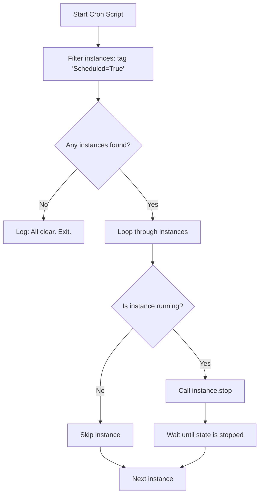

# Stopping and Starting EC2 Instances

Cloud resources are billed by the second. If your development and staging servers run 24/7, you are paying for resources that are idle on weekends and overnight. An effective way to reduce cloud costs is to write automated scripts that shut down development servers at the end of the day and start them back up in the morning.

In Boto3, you control instance power states using `stop_instances()` and `start_instances()`.

In this guide, we will look at how to stop and start instances, wait for state transitions to complete, and write a script to shut down tagged instances automatically.

---

## Power Operations Comparison

It is important to understand the difference between stopping, rebooting, and terminating an instance:

| Operation | billing State | Disk Storage (EBS) | Data Retention | Use Case |
| :--- | :--- | :--- | :--- | :--- |
| **Stop** | Suspended (no CPU charges). | Persists (you pay for disk storage). | Data on EBS volume is saved. Ephemeral RAM data is lost. | Nightly shutdowns, temporary maintenance. |
| **Start** | Resumed (billing restarts). | Persists. | Loads previous EBS data. Private IP is kept; public IP might change. | Resuming work hours. |
| **Reboot** | Continuous (no billing gap). | Persists. | OS restarts. IP addresses do not change. | Applying OS patches, kernel updates. |
| **Terminate** | Permanent (billing stops). | Deleted (unless set to retain). | All instance data is permanently deleted. | Destroying retired stacks. |

---

## Scheduled Power Cycle Logic

Here is how an automated cleanup cron job identifies and stops instances:



---

## Stopping and Starting with Waiters

Let us write a script that stops a specific instance and uses a waiter to block execution until the instance is completely stopped.

```python
import boto3
from botocore.exceptions import ClientError

instance_id = "i-09f1a23b456789abc"
ec2_client = boto3.client("ec2", region_name="us-east-1")

try:
    print(f"Initiating shutdown sequence for instance: {instance_id}...")
    
    # 1. Stop the instance
    ec2_client.stop_instances(InstanceIds=[instance_id])
    
    # 2. Initialize waiter
    print("Waiting for instance to enter 'stopped' state...")
    waiter = ec2_client.get_waiter("instance_stopped")
    waiter.wait(InstanceIds=[instance_id])
    print("[SUCCESS] Instance is stopped.")
    
except ClientError as err:
    print(f"Operation failed: {err}")
```

---

## Real-World DevOps Scenario: Cost-Saver Shutdown Auditor

Let us build a complete cost optimization script. This script scans all EC2 instances. If an instance has the tag `AutoShutDown=True` and is currently running, the script shuts it down, saving company resources.

```python
import boto3

def audit_and_shutdown_dev_servers():
    print("Starting Development Fleet Cost-Saver Audit...")
    print("============================================")
    
    ec2 = boto3.resource("ec2")
    
    # Filter for running instances with AutoShutDown=True tag
    filters = [
        {"Name": "instance-state-name", "Values": ["running"]},
        {"Name": "tag:AutoShutDown", "Values": ["True"]}
    ]
    
    running_instances = list(ec2.instances.filter(Filters=filters))
    
    if not running_instances:
        print("No running instances found with AutoShutDown enabled.")
        print("============================================")
        return
        
    instance_ids = [inst.id for inst in running_instances]
    print(f"Found {len(instance_ids)} instances to stop: {instance_ids}")
    
    try:
        # Stop all matching instances in a single API call
        print("Sending stop command...")
        ec2.meta.client.stop_instances(InstanceIds=instance_ids)
        
        # Block until all instances are stopped
        print("Waiting for all instances to confirm shutdown...")
        waiter = ec2.meta.client.get_waiter("instance_stopped")
        waiter.wait(InstanceIds=instance_ids)
        
        print("\n[SUCCESS] Cost-saver audit finished. All target instances stopped.")
        
    except Exception as err:
        print(f"Failed to stop instances: {err}")
    print("============================================")

# Run audit
audit_and_shutdown_dev_servers()
```

### Expected Output (if no credentials exist)

```text
Starting Development Fleet Cost-Saver Audit...
============================================
Failed to stop instances: Unable to locate credentials
============================================
```

---

## Common Mistakes

Here are some typical mistakes you will run into:

### 1. Forgetting that public IP addresses change on start
By default, standard EC2 instances are assigned dynamic public IP addresses. When you stop and start an instance, **its public IP address changes**. If you hardcode server IPs in your deployments or local hosts files, stopping the instance will break your connections on start. Always use Elastic IPs or DNS names for persistent endpoint access.

### 2. Trying to stop an instance that is already stopping or terminated
If you try to stop an instance that is in the middle of a state transition (like `stopping`) or has been `terminated`, the API will return an `IncorrectInstanceState` error. Always verify or filter for `running` instances before calling the stop command.

### 3. Attempting to stop instances with Instance Store volumes
Some older instance types use ephemeral Instance Store volumes rather than EBS volumes for storage. If you call `stop_instances()` on these instances, the API will fail because stopping is not supported (since data on Instance Store volumes is lost on shutdown). You can only terminate or reboot these instance types.

---

## Summary

* Control instance power states using `stop_instances()` and `start_instances()`.
* Reusing existing EBS volumes keeps storage data intact when instances are stopped.
* Running instances accumulate CPU charges, whereas stopped instances only incur storage costs.
* Filter instances dynamically by scanning for custom tags like `AutoShutDown=True`.
* Use the client waiter `instance_stopped` to block scripts until shutdown completes.
* Use the client waiter `instance_running` to block scripts until boot finishes.
* Remember that dynamic public IP addresses change when an instance is stopped and started.
* Avoid calling stop commands on instances that are not currently running to prevent state errors.
* Use Elastic IP addresses if you need instance endpoints to remain unchanged after power cycles.
* Note that instances utilizing Instance Store volumes do not support stopping.
