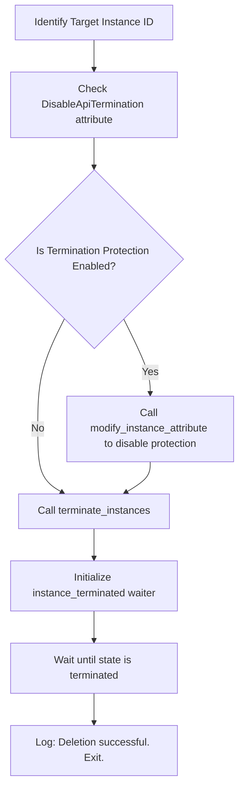

# Terminating EC2 Instances

In cloud infrastructure, virtual machines are often temporary. You spin up servers to run test suites, compile applications, or handle traffic spikes during peak hours. Once the work is done, you must destroy these resources permanently to stop incurring charges. In AWS, this permanent destruction is called **termination**.

Because termination is permanent and deletes local disk storage, AWS provides safety features like **Termination Protection** to prevent accidental deletions.

In this guide, we will learn how to terminate instances, manage termination protection settings, and use waiters to confirm that resources are fully destroyed.

---

## Stopping vs. Terminating

Before destroying a server, make sure you understand how termination differs from stopping:

| Feature | Stopping | Terminating |
| :--- | :--- | :--- |
| **Instance State** | Moves to `stopped` (can be restarted). | Moves to `shutting-down` then `terminated` (deleted permanently). |
| **Billing** | Stops CPU charges. Disk storage charges continue. | All billing stops immediately. |
| **EBS Disk Volume** | Saved on disk (persists). | Deleted automatically (unless configured to retain on launch). |
| **Data Retention** | High (OS configuration is preserved). | Zero (data is permanently wiped). |
| **Use Case** | Pausing servers for nights or weekends. | Wiping temporary test nodes, retiring old applications. |

---

## Safe Termination Process Flow

To prevent scripts from crashing when instances have safety protection enabled, follow this sequence:



---

## Terminating an Instance with Waiters

Let us write a script that terminates a specific instance and blocks execution until the instance status reports `terminated`.

```python
import boto3
from botocore.exceptions import ClientError

instance_id = "i-08c4e56d7890abc12"
ec2_client = boto3.client("ec2", region_name="us-east-1")

try:
    print(f"Initiating termination sequence for instance: {instance_id}...")
    
    # 1. Terminate the instance
    # This immediately changes the state to 'shutting-down'
    response = ec2_client.terminate_instances(InstanceIds=[instance_id])
    
    # 2. Block until fully deleted
    print("Waiting for instance to be completely destroyed (terminated)...")
    waiter = ec2_client.get_waiter("instance_terminated")
    waiter.wait(InstanceIds=[instance_id])
    print("[SUCCESS] Instance has been permanently deleted.")
    
except ClientError as err:
    print(f"Termination failed: {err}")
```

---

## Disabling Termination Protection

If an instance has termination protection enabled, calling `terminate_instances()` will fail with an `UnauthorizedOperation` error. You must disable protection first by modifying the instance attribute.

```python
import boto3
from botocore.exceptions import ClientError

instance_id = "i-09f1a23b456789abc"
ec2_client = boto3.client("ec2", region_name="us-east-1")

try:
    print(f"Disabling termination protection on: {instance_id}...")
    
    # Modify the DisableApiTermination attribute to False
    ec2_client.modify_instance_attribute(
        InstanceId=instance_id,
        DisableApiTermination={"Value": False}
    )
    print("Termination protection disabled.")
    
    # Now it is safe to terminate
    print("Terminating instance...")
    ec2_client.terminate_instances(InstanceIds=[instance_id])
    print("Termination initiated.")
    
except ClientError as err:
    print(f"Operation failed: {err}")
```

---

## Real-World DevOps Scenario: Temporary Stack Cleanup

Let us write a clean-up script representing a pipeline cleanup task. It scans all instances. If an instance has the tag `TemporaryStack=True` and is not protected, the script terminates it.

```python
import boto3

def cleanup_temporary_testing_fleet():
    print("Starting Temporary Staging Stack Cleanup...")
    print("=========================================")
    
    ec2 = boto3.resource("ec2")
    
    # Filter for active instances with TemporaryStack=True tag
    filters = [
        {"Name": "instance-state-name", "Values": ["running", "stopped"]},
        {"Name": "tag:TemporaryStack", "Values": ["True"]}
    ]
    
    target_instances = list(ec2.instances.filter(Filters=filters))
    
    if not target_instances:
        print("No temporary testing instances found. Cleanup skipped.")
        print("=========================================")
        return
        
    terminated_ids = []
    
    for inst in target_instances:
        try:
            # Check termination protection attribute
            # We must use client describe interface since resource doesn't expose it directly
            attr = inst.meta.client.describe_instance_attribute(
                InstanceId=inst.id,
                Attribute="disableApiTermination"
            )
            is_protected = attr.get("DisableApiTermination", {}).get("Value", False)
            
            if is_protected:
                print(f"[SKIPPED] Instance {inst.id} is protected. Skipping termination.")
                continue
                
            print(f"[DELETING] Terminating instance: {inst.id}...")
            inst.terminate()
            terminated_ids.append(inst.id)
            
        except Exception as err:
            print(f"[ERROR] Failed to process instance {inst.id}: {err}")
            
    if terminated_ids:
        print("\nWaiting for termination confirmation...")
        waiter = ec2.meta.client.get_waiter("instance_terminated")
        waiter.wait(InstanceIds=terminated_ids)
        print(f"[SUCCESS] Wiped {len(terminated_ids)} temporary instances.")
        
    print("=========================================")

cleanup_temporary_testing_fleet()
```

### Expected Output (if no credentials exist)

```text
Starting Temporary Staging Stack Cleanup...
=========================================
No temporary testing instances found. Cleanup skipped.
=========================================
```

---

## Common Mistakes

Here are some typical errors when terminating instances:

### 1. Assuming attached EBS volumes are automatically preserved
By default, the root EBS volume of an EC2 instance is configured with `DeleteOnTermination=True`. When you terminate the instance, **the disk is deleted along with it**. If you have critical logs or database files on the server, they will be lost. Always configure important volumes to persist (`DeleteOnTermination=False`) during instance creation or take snapshot backups.

### 2. Trying to check termination protection on terminated instances
If you call `describe_instance_attribute()` on an instance that has already been terminated, the API will fail with a `NoSuchInstance` error. Filter out terminated instances (`instance-state-name` values like `terminated`) before auditing.

### 3. Not waiting for termination to complete in scripts that create replacement resources
If your deployment script terminates an old server and immediately launches a new one with the same configuration settings (like registering with a specific load balancer), doing so before the old server is fully terminated can cause naming collisions or routing conflicts. Always use the `instance_terminated` waiter to ensure the old instance is completely dead first.

---

## Summary

* Terminating an instance permanently deletes the virtual machine and stops billing.
* Call `terminate_instances()` (client) or `instance.terminate()` (resource) to delete instances.
* By default, the root EBS disk volume is deleted automatically upon instance termination.
* Manage termination protection using the `DisableApiTermination` attribute.
* Disable termination protection by passing `DisableApiTermination={'Value': False}` to `modify_instance_attribute()`.
* Inspect termination protection status using the `describe_instance_attribute()` method.
* Block scripts until deletion is complete by calling the `instance_terminated` waiter.
* Avoid checking attributes on already terminated instances to prevent API errors.
* Use waiters to verify deletion completes before spinning up replacement servers.
* Back up critical data using EBS snapshots before terminating cloud servers.
