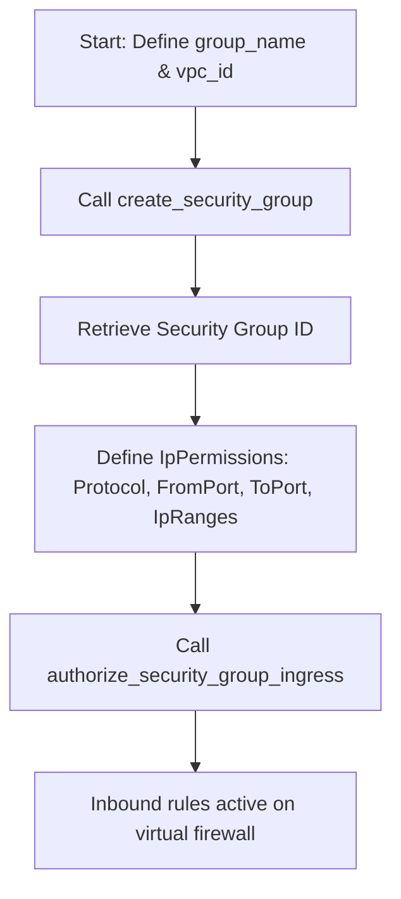

# Managing Security Groups

In AWS, security groups act as virtual firewalls for your EC2 instances. They control inbound (ingress) and outbound (egress) traffic. By default, when you create a new security group, all outbound traffic is allowed, but **all inbound traffic is blocked**. You must write rules to explicitly allow traffic on specific ports (like port 22 for SSH or 443 for HTTPS).

Automating security group configurations is critical for infrastructure security, allowing you to open and lock down firewall ports dynamically during deployments.

In this guide, we will learn how to create security groups, configure inbound rules, and revoke access ports using Boto3.

---

## Traffic Direction Rules

When configuring security groups, you define two types of permissions:

| Rule Type | Direction | Default Behavior | Common Use Cases |
| :--- | :--- | :--- | :--- |
| **Ingress (Inbound)** | Traffic coming *into* the instance. | **Blocked** (Deny All). | Allowing port 80/443 for web traffic, port 22 for administrative SSH access. |
| **Egress (Outbound)** | Traffic going *out of* the instance. | **Allowed** (Allow All). | Allowing the instance to download OS updates or query external database APIs. |

---

## Security Group Creation Process

Here is the flow for creating a group and adding firewall rules:



---

## Creating a Security Group and Adding Rules

Let us write a script that creates a security group named `web-traffic-rules` inside your default VPC, and authorizes inbound web traffic on port 80 and secure SSH access on port 22 from a specific IP range.

```python
import boto3
from botocore.exceptions import ClientError

# Configuration parameters
GROUP_NAME = "web-traffic-rules"
DESCRIPTION = "Firewall rules for web servers"
VPC_ID = "vpc-08a67c12345678abc" # Update with your target VPC ID

ec2_client = boto3.client("ec2", region_name="us-east-1")

try:
    print(f"Creating security group: {GROUP_NAME}...")
    # 1. Create the Security Group
    response = ec2_client.create_security_group(
        GroupName=GROUP_NAME,
        Description=DESCRIPTION,
        VpcId=VPC_ID
    )
    group_id = response["GroupId"]
    print(f"[SUCCESS] Security Group created. Assigned ID: {group_id}")
    
    # 2. Authorize Ingress (Inbound) Rules
    # We allow Port 80 (HTTP) from anywhere, and Port 22 (SSH) only from our office IP
    print("\nAuthorizing inbound firewall rules...")
    ec2_client.authorize_security_group_ingress(
        GroupId=group_id,
        IpPermissions=[
            {
                "IpProtocol": "tcp",
                "FromPort": 80,
                "ToPort": 80,
                "IpRanges": [{"CidrIp": "0.0.0.0/0", "Description": "Allow HTTP from everywhere"}]
            },
            {
                "IpProtocol": "tcp",
                "FromPort": 22,
                "ToPort": 22,
                "IpRanges": [{"CidrIp": "198.51.100.0/24", "Description": "Allow SSH from office network"}]
            }
        ]
    )
    print("Inbound rules configured successfully.")
    
except ClientError as err:
    print(f"Security Group configuration failed: {err}")
```

---

## Real-World DevOps Scenario: Security Group Auditor and Janitor

Over time, developers might add temporary rules (like opening SSH port 22 to `0.0.0.0/0` for quick debugging) and forget to remove them. This exposes your servers to the entire internet. Let us write an automated audit script that finds these open SSH rules and revokes them immediately.

```python
import boto3
from botocore.exceptions import ClientError

def audit_and_lock_ssh_ports():
    print("Starting Inbound SSH Security Port Audit...")
    print("==========================================")
    
    ec2 = boto3.resource("ec2")
    issues_resolved = 0
    
    try:
        # Scan all security groups in the account
        for sg in ec2.security_groups.all():
            # Check inbound permissions
            permissions = sg.ip_permissions
            
            for perm in permissions:
                # Target TCP protocol and check if port range covers SSH (22)
                protocol = perm.get("IpProtocol")
                from_port = perm.get("FromPort")
                to_port = perm.get("ToPort")
                
                if protocol == "tcp" and from_port <= 22 <= to_port:
                    # Scan IP ranges permitted
                    ip_ranges = perm.get("IpRanges", [])
                    for ip_range in ip_ranges:
                        cidr = ip_range.get("CidrIp")
                        
                        # Check if SSH is open to the entire internet (0.0.0.0/0)
                        if cidr == "0.0.0.0/0":
                            print(f"[ALERT] Security Group '{sg.group_name}' ({sg.id}) allows public SSH access!")
                            print("  - Action: Revoking public SSH permission rule...")
                            
                            # Revoke the permission
                            sg.revoke_ingress(
                                IpProtocol="tcp",
                                FromPort=from_port,
                                ToPort=to_port,
                                CidrIp="0.0.0.0/0"
                            )
                            print("  - [RESOLVED] Rule successfully removed.")
                            issues_resolved += 1
                            
        print("==========================================")
        print(f"Audit finished. Closed {issues_resolved} public SSH ports.")
        
    except ClientError as err:
        print(f"Audit failed: {err}")

# Run audit
audit_and_lock_ssh_ports()
```

### Expected Output (if no credentials exist)

```text
Starting Inbound SSH Security Port Audit...
==========================================
Audit failed: Unable to locate credentials
```

---

## Common Mistakes

Here are some typical mistakes when managing security groups:

### 1. Creating duplicate security group names
Security group names must be unique within a VPC. If you run a script that calls `create_security_group(GroupName='webserver-rules')` and that group name already exists, the API will fail with a `InvalidGroup.Duplicate` error. Always check if the group exists before creating it, or handle the duplicate exception.

### 2. Trying to delete a security group that is still in use
If an active EC2 instance is attached to a security group, or if another security group references it in a rule, trying to call `delete_security_group()` will fail with a `DependencyViolation` error. You must detach the security group from all instances and rules before you can delete it.

### 3. Mixing up security group rules and network ACLs
Security groups are **stateful**. If you allow inbound traffic on port 80, the return traffic is allowed automatically. Network ACLs (NACLs) are stateless and require you to configure both inbound and outbound rules. Do not write manual egress rules inside security groups just to let return traffic through.

---

## Summary

* Security groups act as stateful virtual firewalls controlling traffic to EC2 instances.
* By default, new security groups block all inbound traffic and allow all outbound traffic.
* Create security groups by calling `create_security_group(GroupName=...)`.
* Configure inbound access permissions using `authorize_security_group_ingress()`.
* Remove permissions rules immediately on discovery using `revoke_security_group_ingress()`.
* Define targeted traffic rules using protocol names, port numbers, and IP CIDR blocks.
* Delete unused security groups using `delete_security_group(GroupId=...)`.
* Detach groups from all running instances before attempting deletion to avoid dependency errors.
* Avoid opening SSH port 22 to `0.0.0.0/0` in production environments.
