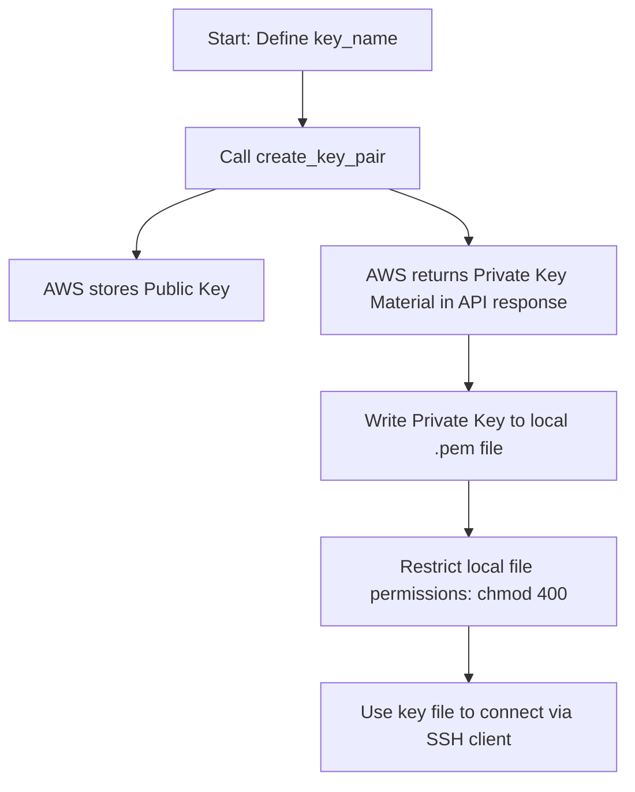

# Key Pair Management

To connect to your EC2 instances via SSH, you must associate them with an SSH Key Pair. A key pair consists of a **Public Key** (which AWS stores on the virtual machine's authorized hosts list) and a **Private Key** (which you download and store securely on your local computer).

Instead of creating keys manually inside the console, you can write automation scripts that generate key pairs on the fly, save the private key to local disk, and apply correct security permissions.

In this guide, we will look at how to create, import, and delete SSH key pairs using Boto3.

---

## Creation vs. Import

You can configure keys in AWS using two different methods:

| Feature | Creating a Key Pair (`create_key_pair`) | Importing a Public Key (`import_key_pair`) |
| :--- | :--- | :--- |
| **Key Generation** | AWS generates both private and public keys. | You generate the keys locally using tools like `ssh-keygen`. |
| **Private Key download** | **Required** (AWS returns the private key string in the API response once). | Not required (the private key never leaves your local machine). |
| **Security Profile** | Medium (private key travels across network during download). | High (private key is never transmitted or shared). |
| **Best For** | Automated quick-testing stacks, temporary environments. | Production networks, standard developer credentials management. |

---

## Key Pair Creation Lifecycle

Here is the process of generating a new key pair in Boto3:



---

## Generating and Saving a Key Pair

Let us write a script that generates a new key pair, saves the private key string into a local file named `deployer_key.pem`, and changes the file permissions using `os.chmod` to satisfy SSH security rules.

```python
import os
import boto3
from botocore.exceptions import ClientError

KEY_NAME = "pipeline-deployer-key"
output_file = f"{KEY_NAME}.pem"

ec2_client = boto3.client("ec2", region_name="us-east-1")

try:
    print(f"Generating SSH Key Pair: {KEY_NAME}...")
    
    # 1. Create the Key Pair in AWS
    response = ec2_client.create_key_pair(KeyName=KEY_NAME)
    
    # 2. Extract the private key material
    private_key_data = response["KeyMaterial"]
    
    # 3. Save the private key to local disk
    with open(output_file, "w", encoding="utf-8") as file:
        file.write(private_key_data)
        
    print(f"[SUCCESS] Key Pair registered in AWS. Private key saved to: {output_file}")
    
    # 4. Restrict file permissions (equivalent to chmod 400 on Linux/macOS)
    # 0o400 sets read-only permission for the owner, and no access for others
    os.chmod(output_file, 0o400)
    print("Local key file permissions restricted to owner-read-only.")
    
except ClientError as err:
    print(f"Key generation failed: {err}")
finally:
    # Clean up local file for demo safety
    if os.path.exists(output_file):
        os.remove(output_file)
```

---

## Importing an Existing Public Key

For production security, it is best practice to generate your keys locally using `ssh-keygen` and import the public key into AWS. This ensures your private key is never transmitted.

```python
import boto3
from botocore.exceptions import ClientError

KEY_NAME = "developer-local-key"
# A mock public key string (usually read from ~/.ssh/id_rsa.pub)
mock_public_key = "ssh-rsa AAAAB3NzaC1yc2EAAAADAQABAAABAQDbC... developer@workstation"

ec2_client = boto3.client("ec2", region_name="us-east-1")

try:
    print(f"Importing local public key to AWS as: {KEY_NAME}...")
    
    # Import the key
    # PublicKeyMaterial accepts the raw public key string converted to bytes
    response = ec2_client.import_key_pair(
        KeyName=KEY_NAME,
        PublicKeyMaterial=mock_public_key.encode("utf-8")
    )
    
    print(f"[SUCCESS] Key imported! Fingerprint: {response['KeyFingerprint']}")
    
except ClientError as err:
    print(f"Key import failed: {err}")
```

---

## Common Mistakes

Here are some typical gotchas when managing key pairs:

### 1. Forgetting to download the private key immediately
When you call `create_key_pair()`, AWS returns the private key string (`KeyMaterial`) in the API response **only once**. AWS does not save the private key. If your script does not write the output to a file immediately, the private key is lost forever, and any instance launched with that key pair will be inaccessible.

### 2. Not restricting local key file permissions
SSH clients (like native `ssh` or Paramiko) will reject private key files that are readable by other users on the system, raising an "UNPROTECTED PRIVATE KEY FILE!" warning. Always run `os.chmod(key_path, 0o400)` immediately after writing the key file.

### 3. Attempting to create a key pair with a duplicate name
Key pair names must be unique within an AWS region. If you try to run `create_key_pair(KeyName='deployer')` and the name already exists, the API will fail with a `InvalidKeyPair.Duplicate` error. Verify or delete the old key using `delete_key_pair(KeyName=name)` before creating a new one.

---

## Summary

* SSH Key Pairs are composed of a public key in AWS and a private key stored locally.
* Generate new keys using `create_key_pair(KeyName=...)`.
* Extract the private key from the `KeyMaterial` attribute of the returned dictionary.
* Save the private key immediately, as AWS does not store it and returns it only once.
* Restrict local key file permissions using `os.chmod(file, 0o400)` (owner-read-only).
* Import pre-existing public keys securely using `import_key_pair()`.
* Pass public key data converted to bytes to the `PublicKeyMaterial` parameter.
* Delete unused key pairs in AWS by calling `delete_key_pair(KeyName=...)`.
* Remember that deleting a key pair in AWS does not delete local private key files.
