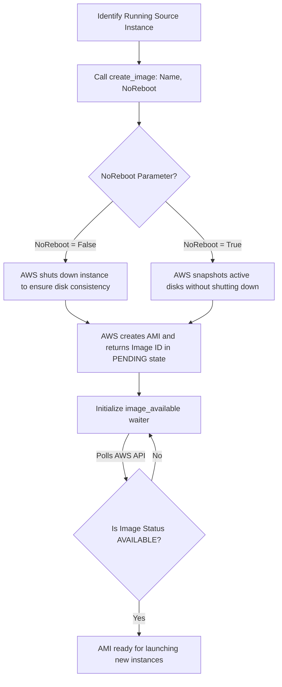

# Amazon Machine Image (AMI) Operations

An **Amazon Machine Image (AMI)** is a pre-configured template containing the operating system, application server, configurations, and software packages needed to launch new servers. In DevOps, creating custom AMIs (commonly called "baking" images) is a standard pattern. Instead of configuring servers from scratch every time you scale up, you launch pre-configured clones from a golden AMI.

You can also use custom AMIs for full system backups before applying major updates.

In this guide, we will learn how to create AMIs from running EC2 instances, monitor their progress using waiters, list owned images, and deregister old backups.

---

## AMIs vs. EBS Snapshots

It is important to understand how custom images differ from simple volume backups:

| Feature | AMI (Amazon Machine Image) | EBS Snapshot |
| :--- | :--- | :--- |
| **Scope** | Complete system configuration (OS, metadata, and all attached volumes). | Individual disk storage volume only. |
| **Bootable?** | **Yes** (you can launch new EC2 servers directly from an AMI). | **No** (must attach to an existing server or convert to a volume first). |
| **Metadata Saved** | Includes block device mapping, virtualization settings, architecture. | Raw data blocks only. |
| **Best For** | Golden machine templates, autoscaling groups, full system backups. | Database volume backups, individual data disk recovery. |

---

## Custom Image Creation Process

Creating a custom AMI involves packaging the active state of an EC2 instance:



---

## Creating an AMI and Waiting for Availability

Let us write a script that creates a custom AMI from an active EC2 instance, names it using a timestamp, and blocks execution until the image is ready for deployment.

```python
import datetime
import boto3
from botocore.exceptions import ClientError

instance_id = "i-08c4e56d7890abc12"

# Create a unique name using a timestamp
timestamp = datetime.datetime.now().strftime("%Y%m%d-%H%M%S")
ami_name = f"backup-golden-image-{timestamp}"

ec2_client = boto3.client("ec2", region_name="us-east-1")

try:
    print(f"Creating custom AMI from instance: {instance_id}...")
    print(f"Target Image Name: {ami_name}")
    
    # 1. Create the image
    # Setting NoReboot=True prevents AWS from shutting down the instance during snapshotting.
    # Note: Ensure no database writes are active during hot backups.
    response = ec2_client.create_image(
        InstanceId=instance_id,
        Name=ami_name,
        Description="Automated golden backup image",
        NoReboot=True
    )
    
    image_id = response["ImageId"]
    print(f"[PENDING] Image creation initiated. Assigned ID: {image_id}")
    
    # 2. Block until the image is available
    print("Waiting for AMI to be built (this can take 5-10 minutes)...")
    waiter = ec2_client.get_waiter("image_available")
    waiter.wait(ImageIds=[image_id])
    print(f"[SUCCESS] AMI '{image_id}' is available and ready for use!")
    
except ClientError as err:
    print(f"AMI creation failed: {err}")
```

---

## Listing and Deregistering Old AMIs

To save costs and clean up your accounts, you should regularly deregister (delete) outdated AMIs. Listing AMIs owned by your account is done using `describe_images(Owners=['self'])`.

```python
import boto3
from botocore.exceptions import ClientError

ec2_client = boto3.client("ec2", region_name="us-east-1")

try:
    print("Scanning owned Amazon Machine Images...")
    print("---------------------------------------")
    
    # List images owned by the caller's account
    response = ec2_client.describe_images(Owners=["self"])
    images = response.get("Images", [])
    
    print(f"Found {len(images)} custom AMIs in this region:")
    for img in images:
        name = img.get("Name")
        img_id = img["ImageId"]
        state = img["State"]
        print(f" - Name: {name:<30} | ID: {img_id} | State: {state}")
        
        # Example: Deregister image if it is marked as failed or outdated
        # if state == 'failed':
        #     ec2_client.deregister_image(ImageId=img_id)
        
except ClientError as err:
    print(f"Failed to query images: {err}")
```

### Expected Output (if no credentials exist)

```text
Scanning owned Amazon Machine Images...
---------------------------------------
Failed to query images: Unable to locate credentials
```

---

## Common Mistakes

Here are some typical mistakes you will run into:

### 1. Creating dirty images using `NoReboot=True` on active databases
If you set `NoReboot=True` to prevent server restarts, AWS snapshots the disk volumes while the operating system is running. If a database is actively writing to disk at that exact moment, the captured files might be corrupted. For database servers, always set `NoReboot=False` (the default) to allow a clean filesystem flush during shutdown.

### 2. Forgetting to delete underlying EBS snapshots when deregistering AMIs
When you call `deregister_image()`, AWS deletes the AMI record, but **the underlying EBS snapshots remain** in your account, accumulating disk storage costs. To delete a custom image completely, you must deregister the AMI first, locate its associated snapshot IDs inside the block device mapping metadata, and delete those snapshots manually:

```python
# Complete deletion sequence
ec2_client.deregister_image(ImageId=ami_id)
ec2_client.delete_snapshot(SnapshotId=associated_snapshot_id)
```

### 3. Sharing AMIs containing baked-in passwords or secrets
If you bake an image that contains private configuration files (like `.env` files or SSH private keys) and share that AMI publicly or with other accounts, anyone can access your credentials. Never include active secrets in golden images. Load secrets dynamically at runtime when the new instance boots up.

---

## Summary

* An AMI is a complete, bootable machine template used to launch cloned EC2 instances.
* Create custom images from running instances using `client.create_image()`.
* Set `NoReboot=False` to force a safe system shutdown and ensure filesystem consistency during backups.
* Set `NoReboot=True` if you must keep the server running and can guarantee no active database writes.
* Block scripts until the template is ready by calling the `image_available` waiter.
* List all custom templates owned by your AWS account using `describe_images(Owners=['self'])`.
* Remove old image templates from your account registry by calling `deregister_image()`.
* Remember that deregistering an AMI does not automatically delete its associated EBS snapshots.
* Avoid baking API keys, passwords, or active secrets directly into golden machine images.
