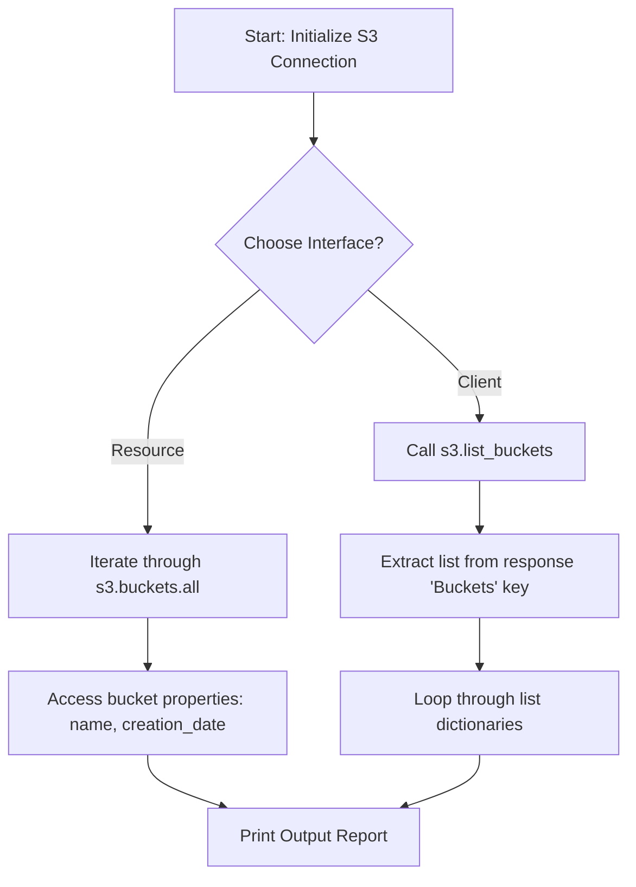

# Listing S3 Buckets

Amazon Simple Storage Service (S3) is the primary storage option on AWS. It is an object storage service designed to store and retrieve any amount of data from anywhere. In DevOps automation, you will constantly interact with S3: checking if log archive buckets exist, creating temporary staging folders, or scanning backups.

The starting point for S3 automation is listing the buckets associated with your AWS account.

In this guide, we will learn how to list S3 buckets using both low-level client and high-level resource interfaces, and retrieve bucket metadata.

---

## Listing Methods Comparison

Here is how the two primary methods for listing S3 buckets in Boto3 compare:

| Feature / Method | `client.list_buckets()` | `resource.buckets.all()` |
| :--- | :--- | :--- |
| **API Interface** | Low-level. | High-level (object-oriented). |
| **Return Format** | A nested Python dictionary containing metadata and header details. | An iterable collection of `Bucket` resource objects. |
| **Accessing Name** | Key lookup: `bucket['Name']`. | Object property: `bucket.name`. |
| **Accessing Date** | Key lookup: `bucket['CreationDate']`. | Object property: `bucket.creation_date`. |
| **Usage Recommendation** | If you need raw response metadata or header details. | Standard listing loops and bulk actions. |

---

## S3 Bucket Discovery Flow

Here is the data traversal when listing S3 buckets:



---

## Listing Buckets with the Client Interface

Let us write a script that queries the low-level S3 client, extracts the buckets list dictionary, and prints each bucket's details.

```python
import boto3
from botocore.exceptions import ClientError

# Initialize client
s3_client = boto3.client("s3")

try:
    print("Querying S3 service for buckets...")
    response = s3_client.list_buckets()
    
    # Retrieve the list of buckets from the response dictionary
    buckets = response.get("Buckets", [])
    
    print("\nAccount S3 Inventory:")
    print("---------------------")
    for bucket in buckets:
        name = bucket["Name"]
        creation_date = bucket["CreationDate"]
        print(f"Bucket: {name:<30} | Created: {creation_date}")
        
    print(f"\nInventory complete. Total buckets found: {len(buckets)}")
    
except ClientError as err:
    print(f"API query failed: {err}")
except Exception as err:
    print(f"Error: {err}")
```

---

## Listing Buckets with the Resource Interface

Now let us write the same script using the high-level Resource interface to demonstrate its cleaner, object-oriented syntax.

```python
import boto3
from botocore.exceptions import ClientError

# Initialize S3 resource
s3 = boto3.resource("s3")

try:
    print("Accessing S3 buckets collection...")
    print("---------------------------------")
    
    count = 0
    # Iterate directly through the buckets collection
    for bucket in s3.buckets.all():
        print(f"Bucket Name: {bucket.name:<30} | Created: {bucket.creation_date}")
        count += 1
        
    print("---------------------------------")
    print(f"Total buckets scanned: {count}")
    
except ClientError as err:
    print(f"Resource query failed: {err}")
```

### Expected Output (if no credentials exist)

```text
Accessing S3 buckets collection...
---------------------------------
Resource query failed: Unable to locate credentials
```

---

## Common Mistakes

Here are some typical mistakes you will run into:

### 1. Hardcoding regional endpoint lookups for S3 listing
Unlike EC2, where queries only return resources in the active region, the `list_buckets()` call is **global**. It returns all buckets owned by your account regardless of which AWS region they are located in. Do not write loop routines that configure separate regional clients just to list your buckets.

### 2. Forgetting that S3 names are globally unique
While listing buckets is easy, remember that S3 bucket names are shared globally across all AWS customers. You cannot create a bucket named `logs` or `backups` because someone else has already claimed those names. Keep this in mind when writing bucket creation loops.

### 3. Assuming `list_buckets` returns object counts or size info
The `list_buckets()` call only returns metadata about the buckets themselves (their name and creation date). It **does not** tell you how many files are inside the bucket or how much storage space they consume. To find file counts and sizes, you must query the objects inside each bucket separately:

```python
# To count objects (requires listing objects)
bucket = s3.Bucket('my-bucket')
object_count = len(list(bucket.objects.all()))
```

---

## Summary

* S3 is AWS's global object storage service, organized into logical buckets.
* List buckets using `client.list_buckets()` or `resource.buckets.all()`.
* The `list_buckets()` call returns all buckets globally owned by your account.
* Client queries return nested dictionaries containing a list of bucket metadata.
* Resource queries yield an iterable collection of S3 `Bucket` objects.
* Access S3 bucket names via the `bucket.name` property (resource).
* Retrieve creation timestamps via the `bucket.creation_date` property.
* Keep in mind that `list_buckets` does not return file counts or storage size.
* Wrap all listing loops in try-except blocks to catch credentials and client errors.
