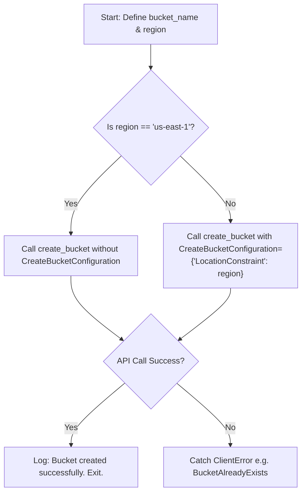

# Creating S3 Buckets

When deploying new applications, you will often need to create new storage buckets. For example, your infrastructure provisioning script might create an S3 bucket to store user uploads, database backups, or web assets.

In Boto3, you create buckets using `client.create_bucket()` or `resource.create_bucket()`.

However, S3 has strict naming and regional rules. S3 bucket names are shared globally, and configuring regional locations requires handling a specific quirk in the AWS API for the default region (`us-east-1`).

In this guide, we will learn how to create S3 buckets, configure region location constraints, and handle naming collisions safely.

---

## Region Configuration Comparison

The default region for S3 is `us-east-1` (N. Virginia). Creating buckets in this region requires a different configuration than creating them in any other AWS region.

| Target Region | LocationConstraint Parameter | API Behavior |
| :--- | :--- | :--- |
| **`us-east-1`** | **Must be omitted** | Fails with an `InvalidLocationConstraint` error if you pass `us-east-1` as a constraint. |
| **Any other region** (e.g. `us-west-2`, `eu-west-1`) | **Required** | You must pass the region string inside the `CreateBucketConfiguration` parameter. |

---

## Safe S3 Bucket Creation Flow

Here is how your script should route bucket creation calls depending on the target region:



---

## Creating a Bucket and Handling Regions

Let us write a script that creates a uniquely named bucket. We will check the session's active region and dynamically format the configuration payload to satisfy AWS's rules.

```python
import uuid
import boto3
from botocore.exceptions import ClientError

# Generate a unique bucket name to prevent global name collisions
# S3 bucket names must be lowercase, alphanumeric, and contain dashes/dots
unique_suffix = str(uuid.uuid4())[:8]
bucket_name = f"devops-deploy-archive-{unique_suffix}"
target_region = "us-west-2"

# Initialize client
s3_client = boto3.client("s3", region_name=target_region)

try:
    print(f"Deploying S3 bucket: '{bucket_name}' in region: '{target_region}'...")
    
    # 1. Route creation based on region rules
    if target_region == "us-east-1":
        # No location constraint payload for us-east-1
        s3_client.create_bucket(Bucket=bucket_name)
    else:
        # Pass CreateBucketConfiguration for other regions
        s3_client.create_bucket(
            Bucket=bucket_name,
            CreateBucketConfiguration={"LocationConstraint": target_region}
        )
        
    print(f"[SUCCESS] S3 bucket created successfully!")
    
except ClientError as err:
    error_code = err.response["Error"]["Code"]
    if error_code == "BucketAlreadyExists":
        print("[CRITICAL] Name Collision: This bucket name is already taken globally.")
    elif error_code == "BucketAlreadyOwnedByYou":
        print("[OK] You already own this S3 bucket.")
    else:
        print(f"[ERROR] AWS API refused request: {err}")
```

---

## Common Mistakes

Here are some typical errors when creating S3 buckets:

### 1. Passing `LocationConstraint='us-east-1'`
If you try to write portable code that always passes the region constraint:
`s3.create_bucket(Bucket='name', CreateBucketConfiguration={'LocationConstraint': 'us-east-1'})`
AWS will reject the call with an `InvalidLocationConstraint` error. You **must** write an `if` statement to skip the parameter if the target region is N. Virginia.

### 2. Violating S3 naming restrictions
S3 bucket names must follow strict rules:
* Must be between 3 and 63 characters long.
* Must consist only of lowercase letters, numbers, dots, and hyphens.
* **Must not** contain underscores (`_`) or uppercase letters.
* Must start and end with a letter or number.

If you pass an invalid name (like `my_backup_folder`), Boto3 will raise a `ParamValidationError` or AWS will reject it with a `400 Bad Request`.

### 3. Using generic bucket names without random suffixes
If you write a script with `bucket_name = 'logs'`, it will fail 100% of the time because that name is already owned by someone else. Always append unique qualifiers (like your company name, environment tag, or a random UUID hash) to ensure the bucket can be created.

---

## Summary

* Create S3 buckets using `client.create_bucket()` or `resource.create_bucket()`.
* Remember that S3 bucket names are shared globally and must be unique.
* Omit the `CreateBucketConfiguration` parameter when creating buckets in `us-east-1`.
* Pass the target region string as a `LocationConstraint` for any other AWS region.
* Avoid using underscores (`_`) or capital letters in S3 bucket names.
* Keep S3 bucket names between 3 and 63 characters in length.
* Append unique hashes or company prefixes to prevent global name collisions.
* Handle duplicate errors like `BucketAlreadyOwnedByYou` to keep scripts idempotent.
* Always wrap bucket creation calls in `try-except` blocks to handle network or credentials issues.
