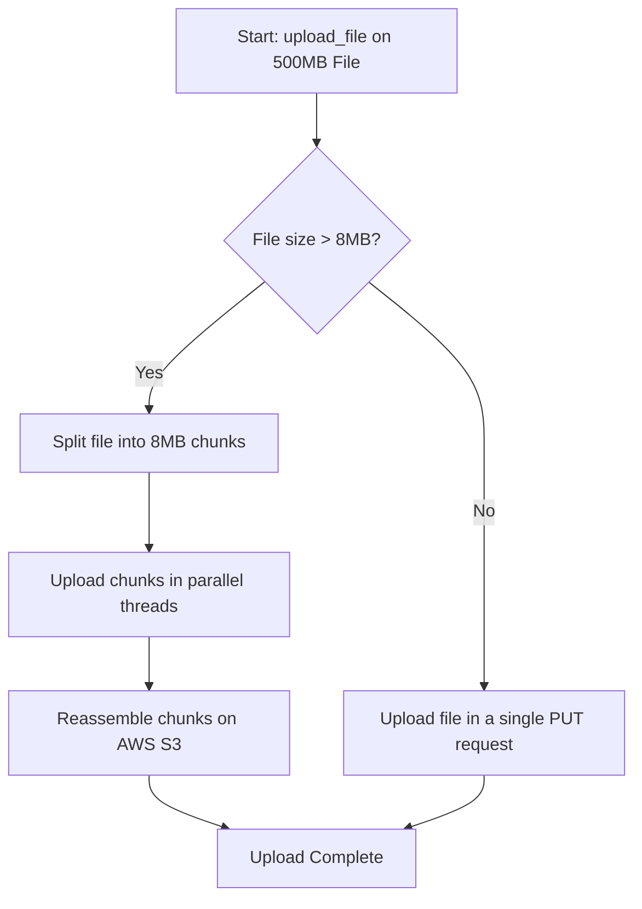

# Uploading Files to S3

In system automation, uploading files to Amazon S3 is a common operation. You might need to upload daily database backups, export system audit logs, publish built package packages, or upload static images for websites.

Boto3 provides several upload methods. Choosing the right one depends on whether your data is stored in a local file on disk, or held as a raw string or bytes in memory (RAM).

In this guide, we will learn how to upload files from disk, upload data directly from memory, configure upload arguments (like file content types and metadata), and track upload progress.

---

## Upload Methods Comparison

Here is how Boto3's primary upload methods compare:

| Method Name | Source Data | Multipart Support? | Best For | Description |
| :--- | :--- | :--- | :--- | :--- |
| **`client.upload_file()`** | Local file on disk. | **Yes** (automatic multi-threaded chunking). | Large files (> 10MB), log archives, database backups. | Recommended for disk files. Automatically splits large files for faster transfers. |
| **`client.put_object()`** | In-memory string/bytes. | No | Raw configuration payloads, API responses, JSON text. | Low-level direct PUT request. Does not write to local disk first. |

---

## Multipart Upload Mechanics

When uploading a large file (for example, a 500 Megabyte backup log), the `upload_file()` method automatically splits it, uploads chunks in parallel, and reassembles them:



---

## Basic File Upload from Disk

Let us write a script that creates a local dummy file, and uploads it to an S3 bucket. We will use the `ExtraArgs` parameter to set the file's HTTP `ContentType` header (so browsers open it rather than downloading it) and attach custom metadata tags.

```python
import os
import boto3
from botocore.exceptions import ClientError

# Configuration parameters
local_file = "system_report.txt"
bucket_name = "devops-deploy-archive-demo"
s3_key = "reports/daily_system_report.txt"

# Create a local dummy file to upload
with open(local_file, "w", encoding="utf-8") as f:
    f.write("CPU=12.5%,RAM=55.2%,Storage=42.1%\n")

s3_client = boto3.client("s3")

try:
    print(f"Uploading local file '{local_file}' to S3 bucket '{bucket_name}'...")
    
    # Configure upload options
    # We specify the content-type and add custom metadata tags
    upload_options = {
        "ContentType": "text/plain",
        "Metadata": {
            "environment": "staging",
            "audit_version": "1.2"
        }
    }
    
    # Send upload request
    s3_client.upload_file(
        Filename=local_file,
        Bucket=bucket_name,
        Key=s3_key,
        ExtraArgs=upload_options
    )
    print(f"[SUCCESS] Upload completed! File saved in S3 as: {s3_key}")
    
except ClientError as err:
    print(f"Upload failed: {err}")
finally:
    # Clean up local file
    if os.path.exists(local_file):
        os.remove(local_file)
```

---

## Uploading Data from Memory (put_object)

If you generate text or JSON data dynamically inside your Python script (like a JSON log line) and want to save it to S3, writing it to a local file first just to upload it wastes disk I/O. You can upload it directly from memory using `put_object()`.

```python
import json
import boto3
from botocore.exceptions import ClientError

# Dynamic log details generated in code
log_payload = {
    "timestamp": "2026-06-25T08:30:00Z",
    "event": "database_backup_initiated",
    "status": "success"
}

# Convert dictionary to JSON string
json_string = json.dumps(log_payload)

s3_client = boto3.client("s3")
bucket_name = "devops-deploy-archive-demo"
s3_key = "logs/event_log.json"

try:
    print(f"Uploading log directly from memory to: {s3_key}...")
    
    # put_object accepts a string or bytes in the Body parameter
    s3_client.put_object(
        Bucket=bucket_name,
        Key=s3_key,
        Body=json_string,
        ContentType="application/json"
    )
    print("[SUCCESS] Log uploaded successfully.")
    
except ClientError as err:
    print(f"In-memory upload failed: {err}")
```

---

## Common Mistakes

Here are some pitfalls when uploading files to S3:

### 1. Forgetting to set correct Content-Type headers
If you upload an HTML page (`index.html`) or a text log (`error.log`) to S3 without specifying `ContentType` in `ExtraArgs`, S3 defaults the file type to `binary/octet-stream`. When users open the S3 link, browsers will download the file rather than displaying it. Always set `"ContentType": "text/html"` or `"application/json"`.

### 2. Confusing target keys with folder syntax
S3 is a flat object storage system. It does not have real folders. Directories are simulated using prefixes with forward slashes (e.g. `reports/daily.txt`). If you try to upload a file to `reports/` (ending in a slash), S3 will create an empty object named `reports/`, and your file content will not be placed inside it. Always specify the complete filename key (e.g. `reports/daily.txt`).

### 3. Exceeding single-PUT upload size limits with `put_object`
`put_object()` uploads the entire payload in a single HTTP request, which has a hard limit of 5 Gigabytes. If you are uploading massive files (like large database backups), `put_object()` will fail. Always use `upload_file()` for files larger than 100MB, as it automatically handles multipart parallel chunking.

---

## Summary

* Upload files from disk using the high-level `upload_file()` method.
* Upload strings or bytes directly from memory using the `put_object()` method.
* `upload_file()` automatically splits files larger than 8MB into parallel multipart uploads.
* Set content types and custom metadata by passing a dictionary to the `ExtraArgs` parameter.
* Avoid downloading raw bytes to disk first if data is generated in memory; use `put_object()`.
* Specify complete target paths (e.g. `folder/file.json`) instead of ending keys in slashes.
* Always define the `"ContentType"` property to prevent files from default downloading in browsers.
* Use `upload_file()` instead of `put_object()` for files larger than 5 Gigabytes.
* Wrap all upload functions in error handling to capture AWS permissions failures.
