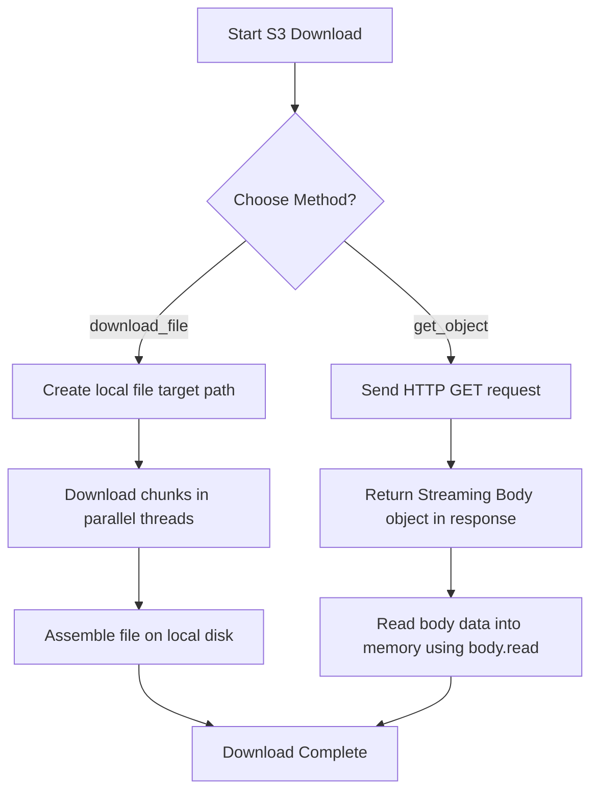

# Downloading Files from S3

In cloud operations, downloading files from S3 is a common necessity. You might download software packages to install them on target virtual machines, fetch database backup archives to restore states locally, or retrieve application settings files during startup boots.

Boto3 provides two primary ways to download S3 data: downloading directly to a local file on disk, or streaming data into your script's memory (RAM) without saving it to disk first.

In this guide, we will look at how to download files to disk, stream objects in memory, and handle data streams efficiently.

---

## Download Methods Comparison

Here is how Boto3's S3 download methods compare:

| Method Name | Destination | Multipart Support? | Best For | Description |
| :--- | :--- | :--- | :--- | :--- |
| **`client.download_file()`** | A local file path on disk. | **Yes** (automatic multi-threaded chunking). | Large files (> 10MB), installation binaries, zip archives. | Recreates files on disk. Automatically handles parallel transfers for speed. |
| **`client.get_object()`** | In-memory raw bytes stream. | No | Small configurations, logs parsing, reading metadata on the fly. | Low-level direct GET request. Returns a streaming object containing body data. |

---

## S3 Download Flow

Here is how Boto3 handles downloading via both methods:



---

## Downloading to Disk (download_file)

Let us write a script that downloads a configuration archive from S3 and saves it to our local workspace as `local_setup.zip`.

```python
import os
import boto3
from botocore.exceptions import ClientError

bucket_name = "devops-deploy-archive-demo"
s3_key = "archives/setup.zip"
local_target = "local_setup.zip"

s3_client = boto3.client("s3")

try:
    print(f"Downloading artifact '{s3_key}' from bucket '{bucket_name}'...")
    
    # Send download request
    # If the file fails to download or bucket does not exist, ClientError is raised
    s3_client.download_file(
        Bucket=bucket_name,
        Key=s3_key,
        Filename=local_target
    )
    print(f"[SUCCESS] Download completed! Saved local file to: {local_target}")
    
except ClientError as err:
    error_code = err.response["Error"]["Code"]
    if error_code == "404":
        print(f"[ERROR] The target key '{s3_key}' does not exist in bucket '{bucket_name}'.")
    else:
        print(f"[ERROR] AWS API refused request: {err}")
finally:
    # Clean up local file for safety
    if os.path.exists(local_target):
        os.remove(local_target)
```

---

## Streaming to Memory (get_object)

If you only need to read a small configuration file (like a JSON database mapping config) to extract parameters, downloading it to disk is wasteful. You can read it directly into memory using `get_object()`.

```python
import json
import boto3
from botocore.exceptions import ClientError

bucket_name = "devops-deploy-archive-demo"
s3_key = "configs/db_config.json"

s3_client = boto3.client("s3")

try:
    print(f"Streaming object content from S3 key: {s3_key}...")
    
    # 1. Fetch raw streaming response
    response = s3_client.get_object(Bucket=bucket_name, Key=s3_key)
    
    # 2. Extract Streaming Body object (botocore.response.StreamingBody)
    body_stream = response["Body"]
    
    # 3. Read and decode the stream data bytes into a string
    raw_content = body_stream.read()
    json_string = raw_content.decode("utf-8")
    
    # 4. Parse JSON
    config_data = json.loads(json_string)
    
    print("\n[SUCCESS] Configuration parsed successfully:")
    print("-------------------------------------------")
    print(f"Database Server: {config_data.get('host')}")
    print(f"Database Port:   {config_data.get('port')}")
    
except ClientError as err:
    print(f"Streaming download failed: {err}")
except Exception as err:
    print(f"Error parsing JSON: {err}")
```

---

## Common Mistakes

Here are some pitfalls when downloading files from S3:

### 1. Forgetting to close or read the `StreamingBody` stream
When calling `get_object()`, Boto3 keeps the HTTP connection socket open until you read the data using `body.read()`. If you query `get_object()` in a loop and forget to read the body or close the stream, you will leak connection sockets. This can eventually lock up your Python process, raising connection errors.

### 2. Storing large files in memory using `get_object()`
If you call `response = get_object(Bucket='...', Key='large_5GB_backup.zip')` and then run `response['Body'].read()`, Python will attempt to load the entire 5GB file into your system RAM. If your server is small, the script will crash with an Out of Memory error. Always use `download_file()` for files larger than 100MB to stream directly to disk.

### 3. Catching `ClientError` but looking for the wrong error codes
Unlike other APIs where missing resources return `"NoSuchKey"`, S3's low-level client returns a generic `"404"` error code inside the `ClientError` response for missing objects. Make sure to check `err.response['Error']['Code'] == '404'` to identify missing files, rather than checking for `"NoSuchKey"` or `"404 Not Found"`.

---

## Summary

* Download files directly to disk using the high-level `download_file()` method.
* Stream files directly into script memory using the low-level `get_object()` method.
* Read data from `get_object` responses by calling `.read()` on the `"Body"` key object.
* `download_file()` automatically splits downloads into parallel multi-threaded threads for speed.
* Always read the streaming body to prevent socket leaks in the background.
* Avoid using `get_object` for large files to protect system RAM from running out.
* Look for the error code string `"404"` inside `ClientError` to catch missing files.
* Decode raw bytes retrieved from `get_object()` using `.decode('utf-8')` before parsing.
* Set standard timeouts on all download actions to prevent scripts from hanging.
