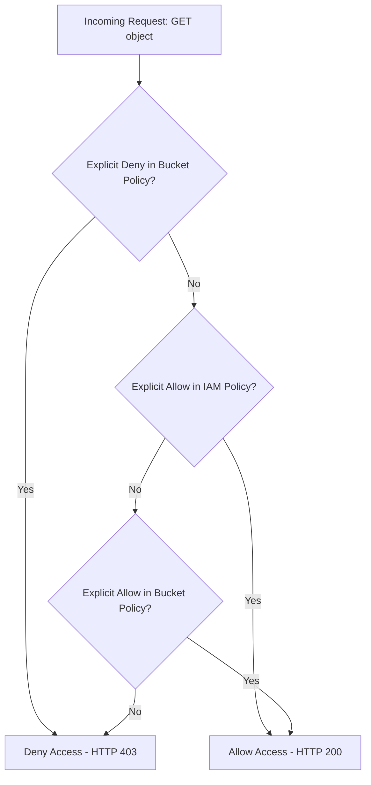

# Managing S3 Bucket Policies

Amazon S3 buckets are private by default. Only the AWS account owner can access the bucket and its objects. If you need to expose a bucket publicly to host static website assets, allow access to specific IP ranges, or share data with a separate partner AWS account, you do so by writing an **S3 Bucket Policy**.

A bucket policy is a resource-based Access Control Policy written in **JSON**.

In this guide, we will learn how to create, apply, inspect, and delete bucket policies using Boto3.

---

## IAM User Policies vs. S3 Bucket Policies

DevOps teams have two main ways to control access to S3 resources:

| Feature / Policy | IAM User Policy | S3 Bucket Policy |
| :--- | :--- | :--- |
| **Association** | Attached to a specific IAM User, Group, or Role. | Attached directly to the S3 bucket itself (Resource-based). |
| **Security Scope** | Controls what *this specific user* can do across all AWS resources. | Controls who (which users, accounts, or IPs) can access *this specific bucket*. |
| **Principal Field** | Not required (the user is the implicit principal). | **Required** (defines who is affected by the policy). |
| **Best For** | Internal developers, local script credentials permissions. | Public read assets, cross-account sharing, IP restricting. |

---

## Bucket Policy Decision Flow

Here is how AWS evaluates access to S3 objects:



---

## Applying a Bucket Policy

Let us write a script that defines a JSON bucket policy and applies it to our S3 bucket. The policy we write will grant read-only access to a specific AWS account.

We use `s3_client.put_bucket_policy()`. Note that the `Policy` parameter expects a **stringified JSON** payload, not a Python dictionary.

```python
import json
import boto3
from botocore.exceptions import ClientError

bucket_name = "devops-deploy-archive-demo"
partner_account_id = "123456789012" # Partner AWS Account ID

# 1. Define S3 bucket policy dictionary
# We construct standard JSON components: Statement, Effect, Principal, Action, Resource
policy_dict = {
    "Version": "2012-10-17",
    "Statement": [
        {
            "Sid": "AllowPartnerReadAccess",
            "Effect": "Allow",
            "Principal": {
                "AWS": f"arn:aws:iam::{partner_account_id}:root"
            },
            "Action": [
                "s3:GetObject",
                "s3:ListBucket"
            ],
            "Resource": [
                f"arn:aws:s3:::{bucket_name}",
                f"arn:aws:s3:::{bucket_name}/*"
            ]
        }
    ]
}

# 2. Stringify policy dictionary (convert to JSON string)
policy_json = json.dumps(policy_dict)

s3_client = boto3.client("s3")

try:
    print(f"Applying bucket policy to: {bucket_name}...")
    
    # 3. Apply policy
    s3_client.put_bucket_policy(
        Bucket=bucket_name,
        Policy=policy_json
    )
    print("[SUCCESS] Bucket policy applied successfully.")
    
    # 4. Verify policy by retrieving it
    print("\nRetrieving active policy...")
    response = s3_client.get_bucket_policy(Bucket=bucket_name)
    active_policy = response.get("Policy")
    print(f"Active policy JSON string: {active_policy[:150]}...")
    
except ClientError as err:
    print(f"Failed to configure policy: {err}")
```

---

## Deleting a Bucket Policy

If you want to remove all custom access permissions and restore the bucket back to its default private state, you can delete the bucket policy using `delete_bucket_policy()`.

```python
import boto3
from botocore.exceptions import ClientError

bucket_name = "devops-deploy-archive-demo"
s3_client = boto3.client("s3")

try:
    print(f"Wiping custom policy from bucket: {bucket_name}...")
    
    # Delete the policy
    s3_client.delete_bucket_policy(Bucket=bucket_name)
    print("[SUCCESS] Policy deleted. Bucket is private again.")
    
except ClientError as err:
    print(f"Failed to delete policy: {err}")
```

---

## Common Mistakes

Here are some typical errors when managing bucket policies:

### 1. Passing a dictionary directly to the `Policy` parameter
The `put_bucket_policy` method expects the `Policy` argument to be a string. If you pass a Python dictionary directly (like `Policy=policy_dict`), Boto3 will raise a `ParamValidationError`. Always convert your dictionary to a string using `json.dumps(policy_dict)`.

### 2. Violating the Resource ARN syntax
When writing bucket policies, your resources list must match the target ARN (Amazon Resource Name) format:
* `arn:aws:s3:::my-bucket` (refers to the bucket itself, required for list actions).
* `arn:aws:s3:::my-bucket/*` (refers to all objects inside the bucket, required for read/write actions).

If you forget the `arn:aws:s3:::` prefix or mix up the wildcards, AWS will reject the policy with a `MalformedPolicy` error.

### 3. Creating public read permissions without disabling block public access settings
AWS has a feature called **S3 Block Public Access** enabled on all buckets by default. If this safety block is active on your bucket, trying to apply a public read policy (like granting `"Principal": "*"` read access) will fail with an `AccessDenied` error. You must disable the public access block attributes on the bucket before applying public read policies.

---

## Summary

* S3 bucket policies control resource access using JSON structures.
* Standard policies define the Principal (who), Actions (what), and Resources (where).
* Apply policies using `s3_client.put_bucket_policy(Bucket=..., Policy=json_string)`.
* Convert policy dictionaries to string formats using `json.dumps()`.
* Retrieve the active policy string by calling `s3_client.get_bucket_policy()`.
* Reset bucket permissions back to default private status by calling `delete_bucket_policy()`.
* Ensure your Resource list contains both the bucket ARN and object wildcard paths (`/*`).
* Disable S3 Block Public Access settings if you intend to apply public read policies.
* Always handle `ClientError` to troubleshoot malformed JSON or access issues.
