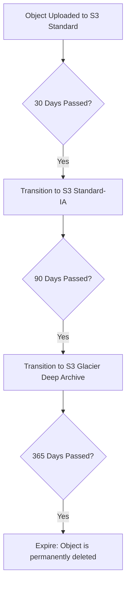

# S3 Lifecycle Automation

When storing logs or backup archives in Amazon S3, you will find that data accumulates rapidly. Keeping years of historical logs in the S3 Standard storage tier is expensive. To optimize costs, AWS allows you to configure **S3 Lifecycle Rules**. 

Lifecycle rules allow you to automate data tier transitions:
1. **Transition**: Move files to cheaper storage tiers (like Standard-Infrequent Access or Glacier) after a certain number of days.
2. **Expiration**: Automatically delete outdated files permanently after they exceed a retention limit.

In this guide, we will learn about S3 storage classes, how to create lifecycle configurations, and how to apply them using Boto3.

---

## S3 Storage Classes Comparison

Here is a summary of the storage tiers you can target in your transition rules:

| Storage Class | Min Storage Days | Retrieval Fee? | Best For | Description |
| :--- | :--- | :--- | :--- | :--- |
| **S3 Standard** | None | No | Active data, hot logs. | Default high-performance storage. |
| **S3 Standard-IA** | 30 days | Yes | Backups, disaster recovery data accessed monthly. | Lower storage cost, but charges a fee for retrieving data. |
| **S3 Glacier Flexible** | 90 days | Yes | Archival logs, audit records. | Very low storage cost. Retrieval takes minutes to hours. |
| **S3 Glacier Deep Archive** | 180 days | Yes | Long-term digital preservation, regulatory logs. | Lowest storage cost. Retrieval takes 12 to 48 hours. |

---

## Object Lifecycle Transition Flow

Here is the path an object takes when managed by a lifecycle policy:



---

## Creating and Applying a Lifecycle Policy

Let us write a script that defines a lifecycle configuration containing a single rule. This rule will:
* Transition files under the prefix `logs/` to S3 Glacier after 30 days.
* Permanently delete (expire) the files after 90 days.

We use `s3_client.put_bucket_lifecycle_configuration()`.

```python
import boto3
from botocore.exceptions import ClientError

bucket_name = "devops-deploy-archive-demo"

# 1. Define the lifecycle configuration rules
lifecycle_config = {
    "Rules": [
        {
            "ID": "ArchiveAndWipeLogs",
            "Status": "Enabled",
            # Apply rule only to files in the 'logs/' folder prefix
            "Filter": {
                "Prefix": "logs/"
            },
            "Transitions": [
                {
                    "Days": 30,
                    "StorageClass": "GLACIER"
                }
            ],
            "Expiration": {
                "Days": 90
            }
        }
    ]
}

s3_client = boto3.client("s3")

try:
    print(f"Applying lifecycle policy to bucket: {bucket_name}...")
    
    # 2. Apply lifecycle rules
    s3_client.put_bucket_lifecycle_configuration(
        Bucket=bucket_name,
        LifecycleConfiguration=lifecycle_config
    )
    print("[SUCCESS] Lifecycle configuration applied.")
    
    # 3. Retrieve configuration to verify it
    print("\nRetrieving active lifecycle configuration...")
    response = s3_client.get_bucket_lifecycle_configuration(Bucket=bucket_name)
    
    rules = response.get("Rules", [])
    for rule in rules:
        print(f"Rule ID: {rule['ID']} | Status: {rule['Status']}")
        print(f"  - Target Prefix: {rule['Filter']['Prefix']}")
        print(f"  - Expiration:    {rule['Expiration']['Days']} days")
        
except ClientError as err:
    print(f"Failed to configure lifecycle: {err}")
```

---

## Deleting Lifecycle Rules

If you need to remove all automation rules and prevent files from transitioning or expiring, you can delete the bucket lifecycle configuration using `delete_bucket_lifecycle_configuration()`.

```python
import boto3
from botocore.exceptions import ClientError

bucket_name = "devops-deploy-archive-demo"
s3_client = boto3.client("s3")

try:
    print(f"Wiping lifecycle configuration from bucket: {bucket_name}...")
    
    # Delete lifecycle config
    s3_client.delete_bucket_lifecycle_configuration(Bucket=bucket_name)
    print("[SUCCESS] Lifecycle configuration removed.")
    
except ClientError as err:
    print(f"Failed to delete lifecycle: {err}")
```

---

## Common Mistakes

Here are some typical pitfalls:

### 1. Specifying transition days shorter than the minimum tier duration
AWS requires data to stay in certain storage classes for a minimum number of days before moving again (e.g. 30 days minimum for Standard-IA, 90 days for Glacier). If you try to create a transition rule like moving objects to Glacier after 5 days and then to Deep Archive after 10 days, AWS will reject the configuration with a `MalformedXML` error.

### 2. Transitioning small files to Glacier
Glacier storage classes add a 32 Kilobyte index header to every archived object. If you transition thousands of tiny 1 Kilobyte files to Glacier, you will end up paying more for the index storage metadata than the actual file bytes. Avoid lifecycle rules for folders containing tiny files; consolidate them into zip archives before uploading.

### 3. Confusing `Prefix` and wildcards in filters
When setting a filter prefix (like `logs/`), S3 matches files that *start* with that prefix. Do not use wildcards (like `logs/*`) inside the Prefix parameter. S3 will interpret the asterisk as a literal character, trying to find files named literally `logs/*...`, making the rule fail to match your files.

---

## Summary

* Optimize S3 storage costs by writing automated Lifecycle Rules.
* Move files to cheaper storage classes over time using Transition rules.
* Delete outdated logs and backup packages automatically using Expiration rules.
* Configure rules using `s3_client.put_bucket_lifecycle_configuration()`.
* Match specific folders by defining the directory name in the `Prefix` filter.
* Query the active automation rules using `get_bucket_lifecycle_configuration()`.
* Remove all active rules from a bucket by calling `delete_bucket_lifecycle_configuration()`.
* Avoid transitioning files smaller than 128 Kilobytes to Glacier to prevent metadata fee overhead.
* Never use wildcards inside filter prefix keys; write literal prefixes (e.g. `"logs/"`) instead.
