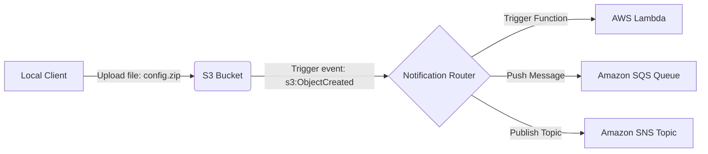

# S3 Event Processing

S3 buckets are often the starting point of automated data pipelines. For example, when a developer uploads a code zip package to S3, you might want to automatically trigger a deployment script. When a system log is uploaded, a parsing tool should process it immediately.

Instead of writing scripts that constantly poll S3 (which is slow and expensive), you can configure **S3 Event Notifications**. S3 can publish notifications to other AWS services (like Lambda, SNS, or SQS) whenever specific events occur (such as `s3:ObjectCreated:*` or `s3:ObjectRemoved:*`).

In this guide, we will learn how to configure bucket notifications and subscribe to S3 events using Boto3.

---

## Notification Destinations Comparison

S3 can publish event notifications to three primary AWS destination services:

| Destination Service | Event Model | Best For | Description |
| :--- | :--- | :--- | :--- |
| **AWS Lambda** | Event-Driven (Serverless) | Image resizing, automated log parsing, virus scans. | Triggers a serverless Python function directly. Fastest reaction time. |
| **Amazon SQS** | Message Queueing | Decoupled background jobs, batch processing. | Places event details in a queue. Multiple worker scripts can pull messages. |
| **Amazon SNS** | Pub/Sub Broadcast | Email/SMS alerts, fan-out workflows. | Publishes event to a topic. Can trigger multiple endpoints or send alerts. |

---

## S3 Event Notification Pipeline

Here is the path an upload event takes when notifications are configured:



---

## Configuring S3 Event Notifications

Let us write a script that configures an S3 bucket to publish notification messages to an SNS (Simple Notification Service) Topic whenever a new file is uploaded under the `deploy/` directory.

We use `s3_client.put_bucket_notification_configuration()`.

```python
import boto3
from botocore.exceptions import ClientError

bucket_name = "devops-deploy-archive-demo"
# The Amazon Resource Name (ARN) of the target SNS topic
sns_topic_arn = "arn:aws:sns:us-east-1:123456789012:deploy-alerts-topic"

# 1. Define the notification configuration payload
notification_config = {
    "TopicConfigurations": [
        {
            "Id": "NewDeploymentTrigger",
            "SnsTopicArn": sns_topic_arn,
            # Trigger rule: File creation events
            "Events": ["s3:ObjectCreated:*"],
            # Apply filter to match only specific directory prefixes and file extensions
            "Filter": {
                "Key": {
                    "FilterRules": [
                        {"Name": "prefix", "Value": "deploy/"},
                        {"Name": "suffix", "Value": ".zip"}
                    ]
                }
            }
        }
    ]
}

s3_client = boto3.client("s3", region_name="us-east-1")

try:
    print(f"Configuring event notifications for bucket: {bucket_name}...")
    
    # 2. Apply configuration
    s3_client.put_bucket_notification_configuration(
        Bucket=bucket_name,
        NotificationConfiguration=notification_config
    )
    print("[SUCCESS] Event notification configuration applied.")
    
    # 3. Retrieve configuration to verify settings
    print("\nRetrieving active notification settings...")
    response = s3_client.get_bucket_notification_configuration(Bucket=bucket_name)
    
    topics = response.get("TopicConfigurations", [])
    for topic in topics:
        print(f"Rule ID: {topic['Id']}")
        print(f"  - Target SNS: {topic['SnsTopicArn']}")
        print(f"  - Event:      {topic['Events']}")
        
except ClientError as err:
    print(f"Notification configuration failed: {err}")
```

---

## Deleting Event Notifications

To remove all triggers and disable notifications on a bucket, pass an empty dictionary to the `NotificationConfiguration` parameter.

```python
import boto3
from botocore.exceptions import ClientError

bucket_name = "devops-deploy-archive-demo"
s3_client = boto3.client("s3", region_name="us-east-1")

try:
    print(f"Disabling all event triggers on: {bucket_name}...")
    
    # Reset configuration using empty dictionary
    s3_client.put_bucket_notification_configuration(
        Bucket=bucket_name,
        NotificationConfiguration={}
    )
    print("[SUCCESS] Event notifications disabled.")
    
except ClientError as err:
    print(f"Failed to reset notifications: {err}")
```

---

## Common Mistakes

Here are some typical pitfalls when configuring S3 events:

### 1. Missing Resource Policies on the destination targets
AWS requires you to grant permission explicitly to the S3 service to publish to your target Lambda, SQS, or SNS. If you configure a bucket policy to send events to an SNS topic, but do not attach a resource policy to the SNS topic allowing `s3.amazonaws.com` to call `sns:Publish`, the `put_bucket_notification_configuration` API call will fail with an `InvalidArgument` or `AccessDenied` error.

### 2. Creating overlapping prefix filters
AWS does not allow you to configure multiple notifications that overlap on the same event type. For example, if you create one rule sending `s3:ObjectCreated` events in `logs/` to SQS, and a second rule sending `s3:ObjectCreated` events in `logs/` to Lambda, AWS will reject the update. You must merge them into a single notification topic structure or separate prefixes.

### 3. Forgetting that S3 notifications are asynchronous
S3 event processing is **eventually consistent** and asynchronous. S3 does not wait for the target service (like your Lambda function) to succeed before confirming the file upload. If your Lambda function crashes due to a bug, the file will still be uploaded successfully, but the event notification will be lost or sent to a Dead Letter Queue (DLQ). Always monitor destination logs.

---

## Summary

* S3 Event Notifications trigger automated pipelines when file changes occur.
* Supported notification targets include AWS Lambda, SQS Queues, and SNS Topics.
* Trigger events using categories like `s3:ObjectCreated:*` or `s3:ObjectRemoved:*`.
* Apply filter rules to match specific directory prefixes and file suffixes (extensions).
* Configure notifications using `s3_client.put_bucket_notification_configuration()`.
* Remove all active triggers by passing an empty configuration dictionary.
* Ensure you configure resource policies on destination targets to allow S3 access.
* Avoid overlapping prefix filters for the same event type in a single bucket.
* Verify event execution by checking logs on target resources (like CloudWatch).
