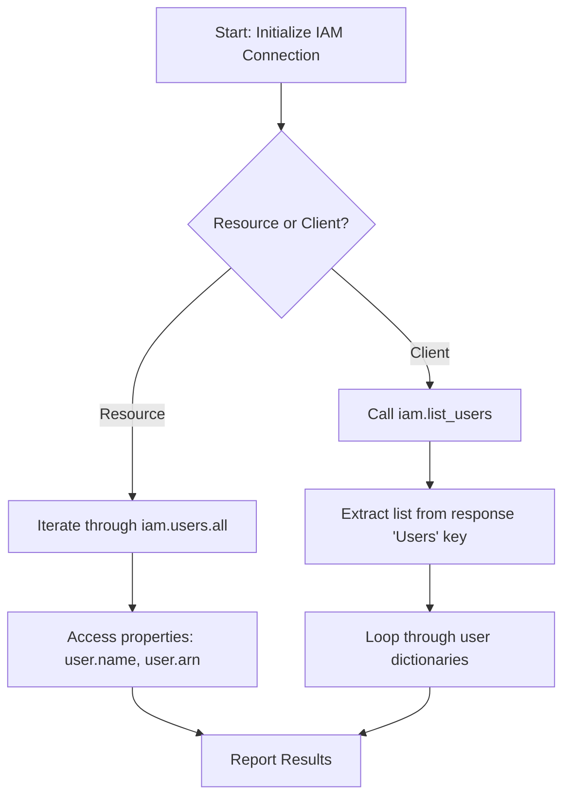

# Listing IAM Users and Roles

AWS Identity and Access Management (IAM) controls authentication and authorization across your AWS account. IAM defines who can access your account (Users) and what permissions they have when executing tasks (Roles). 

In DevOps automation, auditing IAM users and roles is crucial for security compliance. You need scripts to ensure that only authorized users exist and that outdated server access roles are cleaned up.

In this guide, we will learn how to list IAM users and roles using Boto3, and extract their configuration details.

---

## Users vs. Roles Comparison

Here is how IAM Users and IAM Roles compare in AWS:

| Feature | IAM User | IAM Role |
| :--- | :--- | :--- |
| **Identity Type** | A person or interactive service account. | A temporary identity assumed by trusted entities (like EC2 instances or Lambda). |
| **Credentials** | Long-term passwords or Access Keys. | Short-term temporary credentials generated on the fly. |
| **ARNs Prefix** | `arn:aws:iam::<account_id>:user/` | `arn:aws:iam::<account_id>:role/` |
| **Best For** | Local script development, CI/CD integrations. | Cross-account access, EC2 application permissions. |

---

## IAM Query Flow

Here is how Boto3 fetches IAM identity information:



---

## Listing IAM Users (Client)

Let us write a script that queries the low-level IAM client, extracts the user list, and prints their details.

```python
import boto3
from botocore.exceptions import ClientError

# Initialize client
# Note: IAM is a global service; its endpoints are located globally.
# We do not need to specify regional constraints for IAM clients.
iam_client = boto3.client("iam")

try:
    print("Querying account for IAM users...")
    response = iam_client.list_users()
    
    users = response.get("Users", [])
    
    print("\nIAM Users Catalog:")
    print("------------------")
    for user in users:
        username = user["UserName"]
        user_id = user["UserId"]
        arn = user["Arn"]
        created = user["CreateDate"]
        
        print(f"Username: {username:<20} | Created: {created}")
        print(f"  ARN:    {arn}")
        print("-" * 45)
        
    print(f"\nAudit complete. Found {len(users)} users.")
    
except ClientError as err:
    print(f"API query failed: {err}")
```

---

## Listing IAM Roles (Resource)

Now let us write the same script using the high-level Resource interface to list all active IAM Roles in our AWS account.

```python
import boto3
from botocore.exceptions import ClientError

# Initialize IAM resource
iam = boto3.resource("iam")

try:
    print("Listing IAM Roles...")
    print("-------------------")
    
    count = 0
    # Iterate through the roles collection
    # We only print the first 5 roles to keep console output clean
    for role in list(iam.roles.all())[:5]:
        print(f"Role Name: {role.name:<30} | Created: {role.create_date}")
        print(f"  ARN:       {role.arn}")
        print("-" * 55)
        count += 1
        
    print(f"Total roles listed: {count}")
    
except ClientError as err:
    print(f"Resource query failed: {err}")
```

### Expected Output (if no credentials exist)

```text
Listing IAM Roles...
-------------------
Resource query failed: Unable to locate credentials
```

---

## Common Mistakes

Here are some typical gotchas when listing IAM entities:

### 1. Hardcoding regional endpoint lookups for IAM
IAM is a **global** service. Its databases are shared across all regions. If you try to write code that loops through multiple regions (like `boto3.client('iam', region_name=r)`) to scan users, you will query the same global database repeatedly. Query IAM only once per script.

### 2. Forgetting to handle API pagination
If your AWS account contains hundreds of users or roles, `list_users()` will only return the first 100 entries by default. It includes a `IsTruncated=True` key in the response if more items exist. To retrieve all users, you must check for this key and loop using the `Marker` parameter, or use a Boto3 **Paginator**:

```python
# Correct way to paginate users list
paginator = iam_client.get_paginator('list_users')
for page in paginator.paginate():
    for user in page['Users']:
        print(user['UserName'])
```

### 3. Assuming role ARNs match user ARNs
User ARNs and Role ARNs use different path identifiers: `arn:aws:iam::account:user/name` vs `arn:aws:iam::account:role/name`. If you write automation code that parses ARNs, make sure you check the namespace string to identify whether the target resource is a user or role.

---

## Summary

* IAM is a global service that manages identity security in your AWS account.
* IAM Users represent people or long-term service accounts.
* IAM Roles are temporary identities assumed by trusted services like EC2.
* List users using `client.list_users()` or `resource.users.all()`.
* List roles using `client.list_roles()` or `resource.roles.all()`.
* IAM is global; do not loop queries across multiple regions.
* Paginators must be used to list all users if the account holds more than 100 entries.
* Retrieve resource identifiers via the `Arn` property of the retrieved object.
* Always handle `ClientError` to catch permissions issues when querying IAM resources.
