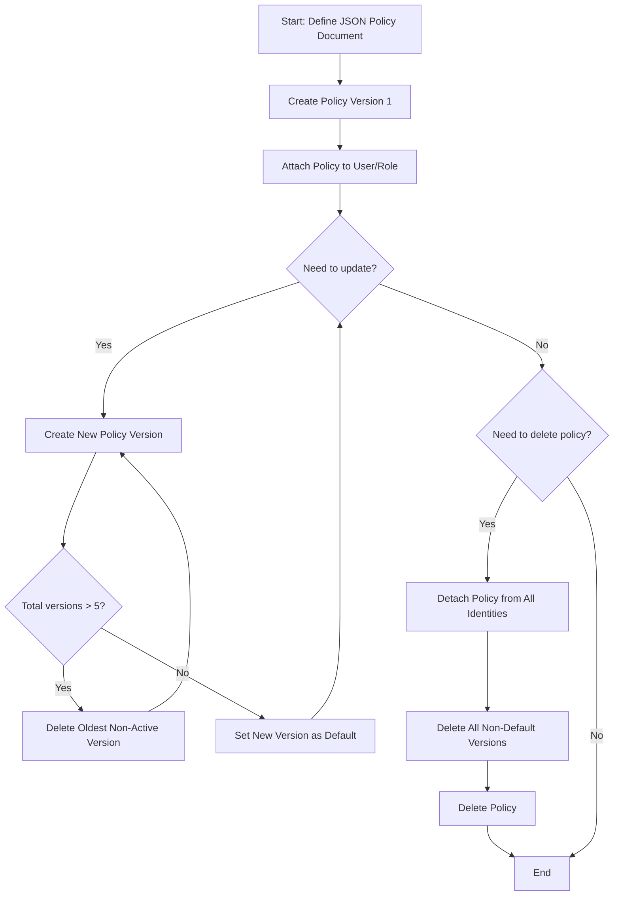

# Managing IAM Policies

In AWS, permissions are defined by policies. An IAM policy is a document (written in JSON format) that lists what actions are allowed or denied on which AWS resources. If you think of an IAM user as a key that gets you into the building, a policy is the list of doors that the key is allowed to unlock.

Many teams run into security problems because they set up permissions manually and forget what they clicked. Automating policy management ensures your systems stay secure. Writing scripts to create, update, and attach policies means only the right permissions are ever granted.

In this guide, we will learn how to create and manage IAM policies using Python and Boto3.

---

## Policy Types Comparison

AWS provides a few different ways to apply policies to identities. Let us look at how they compare:

| Policy Type | Location | Scope | Reuse | Best For |
| :--- | :--- | :--- | :--- | :--- |
| **AWS Managed** | Created/Managed by AWS | Account-wide | Multiple users, groups, or roles | Standard roles like AdministratorAccess or ReadOnlyAccess. |
| **Customer Managed** | Created/Managed by you | Account-wide | Multiple users, groups, or roles | Custom team permissions (e.g., "Read-only access to S3 bucket X"). |
| **Inline** | Embedded directly in an identity | Single user, group, or role | Cannot be shared or reused | Strict 1-to-1 relationships that must never be accidentally detached. |

---

## Policy Lifecycle Workflow

When managing customer managed policies, you must follow a specific lifecycle. You cannot delete a policy if it is still attached to a user, group, or role, and you must manage its versions carefully.

Here is the policy management workflow:



---

## Creating a Customer Managed Policy

Let us write a script that defines a JSON policy document to allow read-only access to a specific S3 bucket, creates it in AWS, and prints the policy ARN.

```python
import boto3
import json
from botocore.exceptions import ClientError

def create_custom_s3_policy(policy_name, bucket_name):
    iam_client = boto3.client('iam')
    
    # Define the policy structure in Python dictionaries
    policy_document = {
        "Version": "2012-10-17",
        "Statement": [
            {
                "Effect": "Allow",
                "Action": [
                    "s3:ListBucket"
                ],
                "Resource": f"arn:aws:s3:::{bucket_name}"
            },
            {
                "Effect": "Allow",
                "Action": [
                    "s3:GetObject",
                    "s3:PutObject"
                ],
                "Resource": f"arn:aws:s3:::{bucket_name}/*"
            }
        ]
    }
    
    try:
        print(f"Creating policy '{policy_name}' for bucket '{bucket_name}'...")
        
        # We must convert the dictionary to a JSON-formatted string
        response = iam_client.create_policy(
            PolicyName=policy_name,
            PolicyDocument=json.dumps(policy_document),
            Description=f"Read-write access to S3 bucket {bucket_name}",
            Tags=[
                {
                    'Key': 'Owner',
                    'Value': 'DevOps-Team'
                }
            ]
        )
        
        policy_arn = response['Policy']['Arn']
        print("Success! Policy has been created.")
        print(f"Policy ARN: {policy_arn}")
        return policy_arn
        
    except ClientError as e:
        error_code = e.response['Error']['Code']
        if error_code == 'EntityAlreadyExists':
            print(f"Error: A policy named '{policy_name}' already exists.")
        else:
            print(f"Failed to create policy: {e}")
        return None

# Run the script for a sample bucket
bucket = "my-app-logs-2026"
policy = "S3AppLogsReadWritePolicy"
created_arn = create_custom_s3_policy(policy, bucket)
```

### Expected Output (Success)
```text
Creating policy 'S3AppLogsReadWritePolicy' for bucket 'my-app-logs-2026'...
Success! Policy has been created.
Policy ARN: arn:aws:iam::123456789012:policy/S3AppLogsReadWritePolicy
```

---

## Real-World Script: Creating, Attaching, and Cleaning Up Policies

In this real-world script, we will automate policy assignment:
1. Create a policy.
2. Attach it to a user.
3. Show how to detach it.
4. Delete the policy when it is no longer needed.

```python
import boto3
from botocore.exceptions import ClientError
import json

def manage_policy_lifecycle(username, policy_name, bucket_name):
    iam_client = boto3.client('iam')
    
    # 1. Prepare JSON Document
    policy_doc = {
        "Version": "2012-10-17",
        "Statement": [{
            "Effect": "Allow",
            "Action": "s3:ListAllMyBuckets",
            "Resource": "*"
        }]
    }
    
    # 2. Create the policy
    policy_arn = None
    try:
        print(f"Step 1: Creating policy '{policy_name}'...")
        response = iam_client.create_policy(
            PolicyName=policy_name,
            PolicyDocument=json.dumps(policy_doc)
        )
        policy_arn = response['Policy']['Arn']
        print(f"   Created policy: {policy_arn}")
    except ClientError as e:
        if e.response['Error']['Code'] == 'EntityAlreadyExists':
            # Retrieve the ARN of the existing policy
            account_id = boto3.client('sts').get_caller_identity()['Account']
            policy_arn = f"arn:aws:iam::{account_id}:policy/{policy_name}"
            print(f"   Policy already exists. Using existing ARN: {policy_arn}")
        else:
            print(f"   Failed to create policy: {e}")
            return False

    # 3. Attach policy to the user
    try:
        print(f"Step 2: Attaching policy to user '{username}'...")
        iam_client.attach_user_policy(
            UserName=username,
            PolicyArn=policy_arn
        )
        print("   Policy attached successfully.")
    except ClientError as e:
        print(f"   Failed to attach policy: {e}")
        return False

    # 4. Detach policy from user
    try:
        print(f"Step 3: Detaching policy from user '{username}'...")
        iam_client.detach_user_policy(
            UserName=username,
            PolicyArn=policy_arn
        )
        print("   Policy detached successfully.")
    except ClientError as e:
        print(f"   Failed to detach policy: {e}")
        return False

    # 5. Delete the policy
    try:
        print(f"Step 4: Deleting policy '{policy_arn}'...")
        iam_client.delete_policy(PolicyArn=policy_arn)
        print("   Policy deleted successfully from account.")
    except ClientError as e:
        print(f"   Failed to delete policy: {e}")
        return False

    return True

# Run the lifecycle process
manage_policy_lifecycle("junior-dev-alice", "TempAccessPolicy", "none")
```

### Expected Output
```text
Step 1: Creating policy 'TempAccessPolicy'...
   Created policy: arn:aws:iam::123456789012:policy/TempAccessPolicy
Step 2: Attaching policy to user 'junior-dev-alice'...
   Policy attached successfully.
Step 3: Detaching policy from user 'junior-dev-alice'...
   Policy detached successfully.
Step 4: Deleting policy 'arn:aws:iam::123456789012:policy/TempAccessPolicy'...
   Policy deleted successfully from account.
```

---

## Common Mistakes

Here are some errors you should watch out for when working with IAM policies:

### 1. Forgetting to Convert Dict to JSON String
The `create_policy` method expects the `PolicyDocument` parameter to be a JSON string, not a Python dictionary. If you pass `PolicyDocument=policy_doc` directly, Boto3 will raise a validation exception. Always use `json.dumps(policy_doc)`.

### 2. Deleting Attached Policies
If you try to delete an IAM policy while it is still attached to users, groups, or roles, AWS will reject the API call with a `DeleteConflictException`. You must query all attachments first, detach them, and then execute the delete command.

### 3. Exceeding Policy Version Limits
AWS customer-managed policies can have a maximum of 5 versions. If you try to create a 6th version using `create_policy_version`, the API will fail. You must clean up older, unused versions using `delete_policy_version` before adding a new one.

### 4. Overlooking the Policy Size Limit
IAM managed policies have a strict size limit (usually 6,144 characters). If you build a script that dynamically appends statements to a single policy, it will eventually crash when the limit is exceeded. Group resources using wildcards or split permissions into multiple smaller policies.

---

## Summary

* IAM policies are JSON documents that define allowed or denied actions on resources.
* Managed policies can be attached to multiple identities, while inline policies belong to a single identity.
* Use `create_policy` to register a new customer managed policy in your AWS account.
* Remember to serialize your Python dictionary to a string using `json.dumps()` before sending it to the API.
* Attach policies to users, roles, or groups using the corresponding `attach_*_policy` API methods.
* Detach policies using `detach_*_policy` before attempting deletion.
* You cannot delete a policy that is currently attached to any identity.
* AWS stores up to 5 versions of a managed policy; old versions must be deleted manually before creating new ones.
* Manage policy sizes carefully, as managed policies have a size limit of 6,144 characters.
