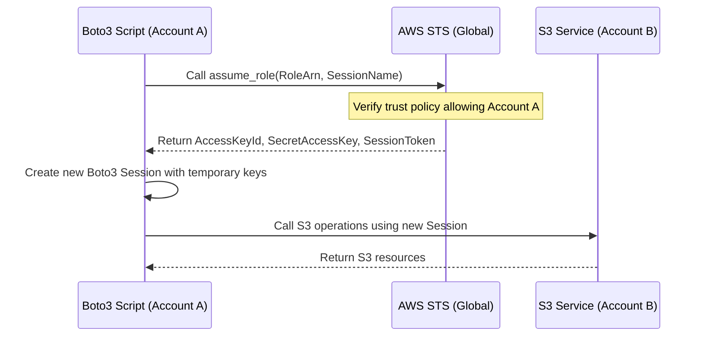

# Assuming IAM Roles

In AWS, we often need to perform actions across different AWS accounts, or give an application temporary permissions without hardcoding access keys. The safest way to do this is by **assuming a role**. 

When you assume a role, you call the AWS Security Token Service (STS) to get temporary security credentials (an Access Key ID, a Secret Access Key, and a Session Token). These credentials expire automatically after a short period (like one hour), meaning you do not have to worry about managing long-term credentials that could be leaked or stolen.

Using roles for all application authentication is the right approach. Let us learn how to use Boto3 and the STS client to assume roles and make API calls with temporary credentials.

---

## Access Credentials Comparison

Let us compare the credentials we use when we authenticate with AWS:

| Feature | Access Keys (IAM User) | Assumed Role Credentials (STS) |
| :--- | :--- | :--- |
| **Credential Type** | Long-term (never expires automatically) | Short-term (expires in 15 mins to 12 hours) |
| **Required Components** | Access Key ID + Secret Access Key | Access Key ID + Secret Access Key + Session Token |
| **Storage Security** | Risk of leak if stored on disk | Safe because credentials expire quickly |
| **Rotation** | Must be rotated manually | Rotates automatically as you request new sessions |
| **Best For** | Local development, CLI initial configuration | Applications running in EC2/Lambda, cross-account access |

---

## Role Assumption Flow

Assuming a role involves three main steps. First, your primary identity requests access. Second, STS verifies your identity and return temporary keys. Third, you use those keys to configure a new Boto3 session.

Here is the authentication sequence:



---

## Verifying Your Current Identity

Before we assume a new role, it is incredibly useful to verify who we currently are. We can use the STS helper method `get_caller_identity` to find our current Account ID, User ARN, and User ID.

Let us write a quick helper function to inspect our identity:

```python
import boto3
from botocore.exceptions import ClientError

def print_current_identity():
    sts_client = boto3.client('sts')
    try:
        response = sts_client.get_caller_identity()
        print("Current Active Identity Details:")
        print(f"  Account ID: {response['Account']}")
        print(f"  Arn:        {response['Arn']}")
        print(f"  User ID:    {response['UserId']}")
        return response
    except ClientError as e:
        print(f"Failed to query caller identity: {e}")
        return None

# Run identity inspection
print_current_identity()
```

### Expected Output
```text
Current Active Identity Details:
  Account ID: 123456789012
  Arn:        arn:aws:iam::123456789012:user/admin-deployer
  User ID:    AIDA1234567890EXAMPLE
```

---

## Basic Role Assumption Script

Let us write a script that calls the STS `assume_role` API. This will retrieve the temporary credentials and print their details.

```python
import boto3
from botocore.exceptions import ClientError

def get_temporary_credentials(role_arn, session_name):
    # Initialize the Security Token Service client
    sts_client = boto3.client('sts')
    
    try:
        print(f"Requesting temporary credentials for role: {role_arn}")
        
        # Call STS to assume the role
        response = sts_client.assume_role(
            RoleArn=role_arn,
            RoleSessionName=session_name,
            DurationSeconds=3600 # 1 hour session duration
        )
        
        # Extract the temporary credentials from response
        credentials = response['Credentials']
        
        print("Success! Temporary credentials received.")
        print(f"Expiration Time: {credentials['Expiration']}")
        
        # Return credentials dictionary
        return {
            'aws_access_key_id': credentials['AccessKeyId'],
            'aws_secret_access_key': credentials['SecretAccessKey'],
            'aws_session_token': credentials['SessionToken']
        }
        
    except ClientError as e:
        print(f"Failed to assume role: {e}")
        return None

# Example usage (Replace with real target role ARN)
target_role = "arn:aws:iam::123456789012:role/CrossAccountS3ReadOnly"
session_label = "DeveloperMigrationSession"

temp_creds = get_temporary_credentials(target_role, session_label)
```

### Expected Output (Success)
```text
Requesting temporary credentials for role: arn:aws:iam::123456789012:role/CrossAccountS3ReadOnly
Success! Temporary credentials received.
Expiration Time: 2026-06-25 09:47:51+00:00
```

---

## Real-World Script: Executing S3 Actions Under an Assumed Role

Once you receive temporary credentials from STS, you cannot just continue using your default client. You must build a new Boto3 `Session` object using the temporary credentials, then create service clients from that session.

Here is a complete cross-account script that assumes a role, prints the assumed caller identity, and lists S3 buckets in the target account.

```python
import boto3
from botocore.exceptions import ClientError

def list_buckets_using_role(role_arn, session_name):
    sts_client = boto3.client('sts')
    
    # 1. Assume the Role
    try:
        print(f"Assuming role '{role_arn}'...")
        sts_response = sts_client.assume_role(
            RoleArn=role_arn,
            RoleSessionName=session_name
        )
        credentials = sts_response['Credentials']
        print("Role assumed. Temporary credentials active.")
    except ClientError as e:
        print(f"Failed to assume role: {e}")
        return False

    # 2. Start a new session with the temporary credentials
    # Note that you MUST supply the aws_session_token along with the keys
    try:
        temp_session = boto3.Session(
            aws_access_key_id=credentials['AccessKeyId'],
            aws_secret_access_key=credentials['SecretAccessKey'],
            aws_session_token=credentials['SessionToken']
        )
        print("New Boto3 session created with temporary keys.")
    except Exception as e:
        print(f"Failed to create session: {e}")
        return False

    # 3. Verify our identity has actually changed
    try:
        temp_sts = temp_session.client('sts')
        identity = temp_sts.get_caller_identity()
        print(f"Confirmed Assumed Identity ARN: {identity['Arn']}")
    except ClientError as e:
        print(f"Failed to check new identity: {e}")

    # 4. Create target service client using the new session
    # Now we are acting with the identity of the assumed role
    try:
        s3_client = temp_session.client('s3')
        print("Listing S3 buckets in target account...")
        response = s3_client.list_buckets()
        
        print("\nBuckets:")
        for bucket in response.get('Buckets', []):
            print(f" - {bucket['Name']}")
            
    except ClientError as e:
        print(f"S3 call failed: {e}")
        return False

    return True

# Example execution
target_role_arn = "arn:aws:iam::987654321098:role/BackupOperatorRole"
list_buckets_using_role(target_role_arn, "BackupCheckScript")
```

### Expected Output
```text
Assuming role 'arn:aws:iam::987654321098:role/BackupOperatorRole'...
Role assumed. Temporary credentials active.
New Boto3 session created with temporary keys.
Confirmed Assumed Identity ARN: arn:aws:sts::987654321098:assumed-role/BackupOperatorRole/BackupCheckScript
Listing S3 buckets in target account...

Buckets:
 - application-backups-east-1
 - db-snapshots-production
```

---

## Line-by-Line Code Breakdown

Let us look closely at how the role assumption process flows in the script above:

1. `sts_client.assume_role(...)`: This calls AWS Security Token Service. It requires a `RoleArn` specifying the role to assume, and a `RoleSessionName` which appears in audit logs.
2. `response['Credentials']`: The API response returns a structure containing `AccessKeyId`, `SecretAccessKey`, `SessionToken`, and `Expiration`.
3. `boto3.Session(...)`: This class initializes a completely separate credentials context. Passing the three STS keys creates a session container with the permissions of the assumed role.
4. `temp_session.client('s3')`: By creating the S3 client from the temporary session container instead of standard `boto3.client()`, we execute S3 requests using the role permissions rather than our original user keys.

---

## Common Mistakes

Here are some common issues that occur when working with assumed roles:

### 1. Missing the Session Token
When creating a Boto3 client using normal IAM users, you only need the Access Key ID and Secret Access Key. However, for assumed roles, you **must** include the `aws_session_token`. If you forget to pass it to `boto3.Session`, your calls will fail with authentication errors.

### 2. Trust Policy Misconfiguration
For your script to assume a role, the target role must have a **Trust Policy** (AssumeRole Policy Document) that explicitly permits your source identity (IAM user or service) to call STS. If the trust policy does not list your source ARN, you will get an `AccessDenied` error.

### 3. Hardcoding Expiration Times
STS allows you to specify session durations using the `DurationSeconds` parameter. The minimum is 15 minutes, and the maximum is up to 12 hours (depending on the role configuration). If you specify a duration that is longer than the maximum configured on the role, the call will fail. Keep this parameter optional or matched to the role limits.

### 4. Reusing Clients After Expiration
Temporary credentials expire. If your Python script runs a long process (like a database migration that takes hours) and reuse the same client initialized at startup, the script will eventually throw access denied errors. For long tasks, refresh credentials before they expire.

---

## Summary

* Assuming a role grants short-term credentials using the AWS Security Token Service (STS).
* Role-based access eliminates the need to manage and rotate long-term credentials.
* Call `assume_role` to retrieve temporary credentials from STS.
* Use `get_caller_identity` to inspect who your session is executing as.
* The response includes an Access Key ID, a Secret Access Key, and a Session Token.
* Create a new `boto3.Session` to apply the temporary credentials.
* Pass the session token parameter `aws_session_token` along with access keys to authenticate.
* Configure the target role's trust policy to permit the source identity to assume it.
* Mind the expiration duration, which defaults to 1 hour but can range from 15 minutes to 12 hours.
* Re-create clients if credentials expire during long-running automated tasks.
