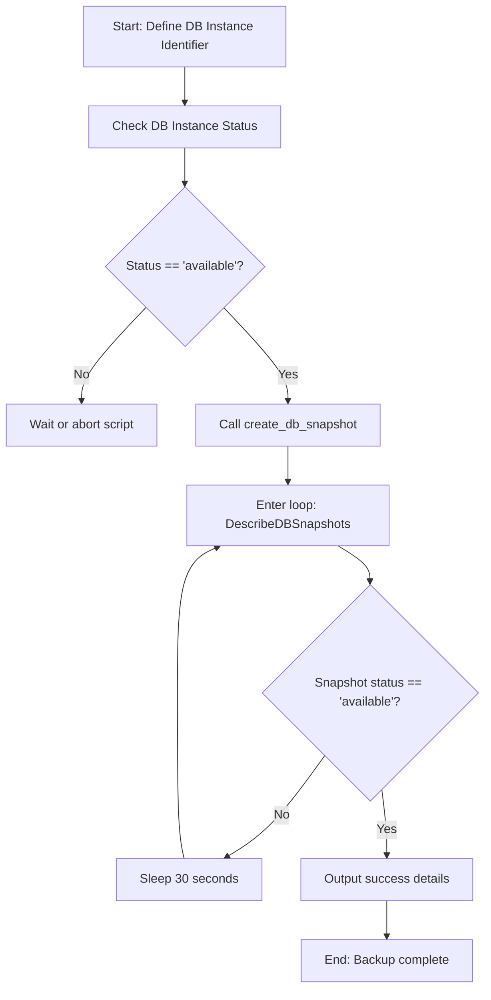

# RDS Automation

AWS Relational Database Service (RDS) makes it easy to set up, operate, and scale a relational database in the cloud. It manages routine database tasks such as provisioning, patching, backup, recovery, failure detection, and repair.

Databases are the heart of your applications — if a database goes down, your service goes down with it. Doing database management manually is risky. Taking snapshots before a deployment, scaling up instances, or auditing public configurations done by hand leaves room for human error. Automating these tasks with Python and Boto3 keeps your database state backed up and secure consistently.

In this guide, we will learn how to describe RDS databases, create backups, and automate database instances using Boto3.

---

## RDS Storage Types Comparison

When automating database provisioning, choosing the correct storage type is critical. Let us compare the three primary storage types:

| Storage Type | Performance Metric | Price | Best For | Risk of Latency |
| :--- | :--- | :--- | :--- | :--- |
| **General Purpose (gp2)** | Baseline 3 IOPS/GB | Low | Small/medium databases, development environments | Medium (burstable IOPS can deplete) |
| **General Purpose (gp3)** | Predictable 3,000 IOPS baseline | Low-Medium | Production databases with steady workloads | Low (independent IOPS scaling) |
| **Provisioned IOPS (io1/io3)** | Up to 256,000 IOPS | High | High-throughput, critical business databases | Zero (guaranteed performance) |

---

## Database Snapshot Workflow

Before executing application migrations or schema updates, you should always take a database snapshot. This allows you to roll back if something fails.

Here is the automation workflow for taking a database backup:



---

## Listing RDS Instances

Let us write a script that queries your AWS account for all active RDS instances, printing their endpoints, status, and database engine type.

```python
import boto3
from botocore.exceptions import ClientError

def list_databases():
    # Initialize the RDS client
    rds_client = boto3.client('rds')
    
    try:
        print("Querying account for RDS instances...")
        response = rds_client.describe_db_instances()
        
        db_instances = response.get('DBInstances', [])
        
        if not db_instances:
            print("No RDS instances found in this region.")
            return []
            
        print("\nRDS Inventory:")
        print("=" * 60)
        for db in db_instances:
            db_id = db['DBInstanceIdentifier']
            engine = db['Engine']
            status = db['DBInstanceStatus']
            
            # Endpoints may not exist if the database is still creating
            endpoint_info = db.get('Endpoint', {})
            address = endpoint_info.get('Address', 'N/A')
            port = endpoint_info.get('Port', 'N/A')
            
            print(f"DB Identifier: {db_id}")
            print(f"  Engine:      {engine}")
            print(f"  Status:      {status}")
            print(f"  Endpoint:    {address}:{port}")
            print("-" * 60)
            
        print(f"\nInventory complete. Found {len(db_instances)} instance(s).")
        return db_instances
        
    except ClientError as e:
        print(f"Failed to describe RDS instances: {e}")
        return []

# Run the listing script
list_databases()
```

### Expected Output (Success)
```text
Querying account for RDS instances...

RDS Inventory:
============================================================
DB Identifier: production-postgres-db
  Engine:      postgres
  Status:      available
  Endpoint:    production-postgres-db.c1234567890.us-east-1.rds.amazonaws.com:5432
------------------------------------------------------------
Inventory complete. Found 1 instance(s).
```

---

## Using Boto3 Built-in RDS Waiters

Instead of writing your own loops with `time.sleep()`, Boto3 has a concept called **Waiters**. Waiters poll the AWS service in the background at regular intervals and stop blocking once a specific state is reached.

Here is how you can use a waiter to wait for a database instance to become active:

```python
import boto3
from botocore.exceptions import ClientError

def wait_for_database_ready(db_instance_id):
    rds_client = boto3.client('rds')
    
    print(f"Waiting for database '{db_instance_id}' to enter 'available' state...")
    
    try:
        # Get the specific waiter for database availability
        waiter = rds_client.get_waiter('db_instance_available')
        
        # This will block the thread for up to 30 minutes (polling every 30 seconds)
        waiter.wait(
            DBInstanceIdentifier=db_instance_id,
            WaiterConfig={
                'Delay': 30,
                'MaxAttempts': 60
            }
        )
        print("Success! Database is available and accepting connections.")
        return True
    except ClientError as e:
        print(f"Waiter failed: {e}")
        return False

# Example invocation
wait_for_database_ready("production-postgres-db")
```

---

## Real-World Script: Creating a Database Backup Snapshot

AWS RDS provides automated daily snapshots, but before making major changes, you should trigger a **manual snapshot**. Manual snapshots are persistent and will not be deleted when the database instance is terminated.

Let us write a script that creates a manual snapshot of an active RDS instance and waits for the snapshot to become ready:

```python
import boto3
import time
from botocore.exceptions import ClientError

def backup_database(db_instance_id, snapshot_id):
    rds_client = boto3.client('rds')
    
    # 1. Trigger the snapshot
    try:
        print(f"Triggering manual snapshot '{snapshot_id}' for database '{db_instance_id}'...")
        response = rds_client.create_db_snapshot(
            DBSnapshotIdentifier=snapshot_id,
            DBInstanceIdentifier=db_instance_id
        )
        print("Snapshot request submitted successfully.")
    except ClientError as e:
        error_code = e.response['Error']['Code']
        if error_code == 'InvalidDBInstanceState':
            print(f"Error: Database '{db_instance_id}' is not in an active state. Cannot backup.")
        elif error_code == 'DBSnapshotAlreadyExists':
            print(f"Error: A snapshot named '{snapshot_id}' already exists.")
        else:
            print(f"Failed to trigger backup: {e}")
        return False

    # 2. Wait for the snapshot to become available
    print("Waiting for snapshot to complete. This can take several minutes...")
    while True:
        try:
            snap_response = rds_client.describe_db_snapshots(
                DBSnapshotIdentifier=snapshot_id
            )
            snapshots = snap_response.get('DBSnapshots', [])
            
            if not snapshots:
                print("Snapshot not found in account yet.")
                time.sleep(15)
                continue
                
            status = snapshots[0]['Status']
            percent = snapshots[0].get('PercentProgress', 0)
            
            print(f"  Current Status: {status} | Progress: {percent}%")
            
            if status == 'available':
                print("\nBackup completed successfully!")
                print(f"Snapshot ARN: {snapshots[0]['DBSnapshotArn']}")
                break
            elif status == 'failed':
                print("\nError: Snapshot creation failed in AWS.")
                return False
                
        except ClientError as e:
            print(f"Error querying snapshot status: {e}")
            
        time.sleep(30) # Wait 30 seconds before polling again
        
    return True

# Example Execution
db_target = "production-postgres-db"
backup_name = "postgres-pre-migration-snapshot"
backup_database(db_target, backup_name)
```

### Expected Output
```text
Triggering manual snapshot 'postgres-pre-migration-snapshot' for database 'production-postgres-db'...
Snapshot request submitted successfully.
Waiting for snapshot to complete. This can take several minutes...
  Current Status: creating | Progress: 10%
  Current Status: creating | Progress: 45%
  Current Status: creating | Progress: 80%
  Current Status: available | Progress: 100%

Backup completed successfully!
Snapshot ARN: arn:aws:rds:us-east-1:123456789012:snapshot:postgres-pre-migration-snapshot
```

---

## Line-by-Line Code Breakdown

Let us analyze how the Boto3 RDS methods work under the hood:

1. `rds_client.describe_db_instances()`: Fetches configurations for all databases. This includes information on instance classes, db engine types, VPC security groups, and endpoint connection records.
2. `db.get('Endpoint', {})`: The endpoint key is absent when a database is in the initial provisioning phase. Always retrieve it safely using `.get()` to avoid raising a `KeyError`.
3. `rds_client.create_db_snapshot(...)`: Starts an asynchronous snapshot operation. This is non-blocking; the API returns immediately with status `creating`.
4. `rds_client.describe_db_snapshots(...)`: Retrieves progress metrics. Polling this method allows us to build terminal waiters that notify engineers once backups are completed.

---

## Common Mistakes

Here are some typical traps developers face when automating RDS:

### 1. Hardcoding Database Credentials in Scripts
When writing scripts to deploy RDS instances, never hardcode the master database password in your Python files. If you do, that password will end up in Git logs. Instead, use the `boto3.client('secretsmanager')` client to fetch a password dynamically at runtime, or prompt the user.

### 2. Forgetting Final Snapshots on Delete
If you try to delete an RDS instance via script using `delete_db_instance` and forget to specify either `SkipFinalSnapshot=True` or `FinalDBSnapshotIdentifier='name'`, the command will fail. For safety, you should always take a final snapshot unless it is a temporary testing database.

### 3. Ignoring Modifying State Wait Times
If you scale up a database instance class (e.g., from `db.t3.medium` to `db.m5.large`), the DB status changes to `modifying`. While modifying, other operations (like triggering a manual snapshot or rebooting) will throw an `InvalidDBInstanceState` exception. Ensure your script validates status before taking action.

### 4. Overlooking Security Groups
When creating a database using `create_db_instance`, forgetting to supply a specific VPC Security Group ID means AWS will assign the default VPC security group. This security group usually blocks all incoming database traffic, causing your applications to hang.

---

## Summary

* AWS RDS automates administrative tasks for relational database engines.
* Automating database snapshots ensures backups exist before system modifications.
* Query RDS configurations using `describe_db_instances`.
* The DB connection hostname is retrieved from the `Endpoint.Address` response attribute.
* Use `create_db_snapshot` to trigger manual, persistent backups.
* Manual database backups persist after database instance deletion.
* Check database backup completion status by polling `describe_db_snapshots`.
* Boto3 waiters like `db_instance_available` can block execution in your code until resources are ready.
* Avoid database password leaks by retrieving admin secrets from Secrets Manager.
* Set final snapshot conditions when calling `delete_db_instance` to prevent deletion failures.
* Check database statuses (must be `available`) before calling modification or backup APIs.
