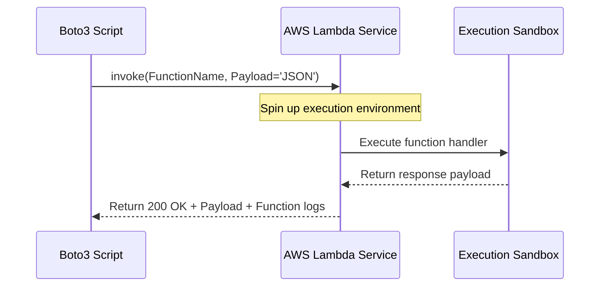

# Lambda Automation

AWS Lambda is a serverless compute service that lets you run code without provisioning or managing servers. You only pay for the compute time you consume—there is no charge when your code is not running. 

Serverless architecture is great because it reduces operational overhead. Instead of running virtual machines 24/7 to process simple jobs (like resizing uploaded images or cleanup cron jobs), you write a Lambda function and AWS handles the rest. Automating the creation, updating, and triggering of Lambda functions using Boto3 lets you build powerful deployment pipelines and event handling systems.

In this guide, we will learn how to list, build, deploy, and trigger AWS Lambda functions using Python.

---

## Server Architecture Comparison

Let us compare traditional EC2 server instances with AWS Lambda serverless functions:

| Feature | EC2 Instance | AWS Lambda |
| :--- | :--- | :--- |
| **Billing Model** | Pay per hour (running or idle) | Pay per invocation (rounded to nearest millisecond) |
| **Scaling** | Manual or Auto Scaling Group (takes minutes) | Automated, instant scale-out (milliseconds) |
| **Maintenance** | Operating system patches, package updates | Managed by AWS (you only write code) |
| **Time Limits** | Unlimited execution | Maximum execution timeout is 15 minutes |
| **Local Disk Storage** | Large (GBs to TBs of EBS storage) | Temporary ephemeral storage (/tmp up to 10GB) |

---

## Lambda Invocation Flow

When you trigger a Lambda function via script, you can execute it **synchronously** (your code waits for a response) or **asynchronously** (Lambda queue accepts the trigger and your code continues immediately).

Here is the synchronous trigger sequence:



---

## Listing Active Lambda Functions

Let us start with a simple script that queries your AWS account for all configured Lambda functions, printing their memory sizes, execution runtimes, and timeouts.

```python
import boto3
from botocore.exceptions import ClientError

def list_lambda_functions():
    # Initialize the Lambda client
    lambda_client = boto3.client('lambda')
    
    try:
        print("Fetching list of Lambda functions...")
        response = lambda_client.list_functions()
        
        functions = response.get('Functions', [])
        
        if not functions:
            print("No Lambda functions found in this region.")
            return []
            
        print("\nLambda Functions Catalog:")
        print("=" * 60)
        for fn in functions:
            name = fn['FunctionName']
            runtime = fn['Runtime']
            memory = fn['MemorySize']
            timeout = fn['Timeout']
            arn = fn['FunctionArn']
            
            print(f"Function Name: {name}")
            print(f"  Runtime:       {runtime}")
            print(f"  Memory Size:   {memory} MB")
            print(f"  Timeout:       {timeout} seconds")
            print(f"  ARN:           {arn}")
            print("-" * 60)
            
        print(f"\nAudit complete. Found {len(functions)} functions.")
        return functions
        
    except ClientError as e:
        print(f"Failed to retrieve Lambda list: {e}")
        return []

# Run the function list script
list_lambda_functions()
```

### Expected Output (Success)
```text
Fetching list of Lambda functions...

Lambda Functions Catalog:
============================================================
Function Name: nightly-cleanup-worker
  Runtime:       python3.9
  Memory Size:   128 MB
  Timeout:       300 seconds
  ARN:           arn:aws:lambda:us-east-1:123456789012:function:nightly-cleanup-worker
------------------------------------------------------------

Audit complete. Found 1 functions.
```

---

## Triggering (Invoking) a Lambda Function

To trigger a Lambda function, you use the `invoke` method. You must pass parameters as a JSON-formatted payload and specify the invocation type.

Here is a script that invokes a database-cleaning function synchronously, passing a target partition key as input:

```python
import boto3
import json
from botocore.exceptions import ClientError

def trigger_lambda(function_name, payload_data):
    lambda_client = boto3.client('lambda')
    
    # 1. Convert Python payload dictionary to JSON bytes
    payload_json = json.dumps(payload_data).encode('utf-8')
    
    try:
        print(f"Invoking function '{function_name}' synchronously...")
        response = lambda_client.invoke(
            FunctionName=function_name,
            InvocationType='RequestResponse', # RequestResponse = Synchronous
            Payload=payload_json
        )
        
        # 2. Parse the invocation status
        status_code = response['StatusCode']
        print(f"HTTP Invocation Status: {status_code}")
        
        # 3. Read the execution payload returned by our function
        # The payload is returned as a streaming body, so we must call .read()
        response_payload = json.loads(response['Payload'].read().decode('utf-8'))
        
        print("\nFunction Response Payload:")
        print(json.dumps(response_payload, indent=2))
        return response_payload
        
    except ClientError as e:
        print(f"Failed to invoke Lambda: {e}")
        return None

# Run the invocation
input_params = {"target_table": "users", "archive_before_days": 30}
trigger_lambda("nightly-cleanup-worker", input_params)
```

### Expected Output
```text
Invoking function 'nightly-cleanup-worker' synchronously...
HTTP Invocation Status: 200

Function Response Payload:
{
  "status": "success",
  "archived_records": 1420,
  "execution_time_seconds": 12.4
}
```

---

## Real-World Script: Programmatic Lambda Zip Packaging and Deployment

In devops pipelines, you frequently need to package your local script code and deploy it to a new Lambda function. To do this, your code must be packaged inside a `.zip` archive before creation.

Here is a script that creates a tiny Lambda source code file locally, packs it into a ZIP archive entirely in memory, and deploys it to a new AWS Lambda function:

```python
import boto3
import io
import zipfile
from botocore.exceptions import ClientError

def create_and_deploy_lambda(function_name, role_arn):
    lambda_client = boto3.client('lambda')
    
    # 1. Write the Python Lambda function handler code string
    lambda_code = """
def lambda_handler(event, context):
    print("Hello from the deployed Lambda code!")
    name = event.get("name", "Stranger")
    return {
        "statusCode": 200,
        "message": f"Hello, {name}! Your serverless code runs perfectly."
    }
"""
    
    # 2. Package code into a zip archive in memory
    zip_buffer = io.BytesIO()
    with zipfile.ZipFile(zip_buffer, 'w', zipfile.ZIP_DEFLATED) as zip_file:
        # Write to virtual file 'index.py'
        zip_file.writestr('index.py', lambda_code)
        
    zip_buffer.seek(0)
    zip_bytes = zip_buffer.read()
    
    # 3. Deploy to AWS Lambda
    try:
        print(f"Deploying new function '{function_name}' to AWS...")
        response = lambda_client.create_function(
            FunctionName=function_name,
            Runtime='python3.9',
            Role=role_arn,
            Handler='index.lambda_handler', # file_name.function_name
            Code={
                'ZipFile': zip_bytes
            },
            Description='Auto-deployed python function helper',
            Timeout=15, # 15 seconds limit
            MemorySize=128 # 128 MB RAM allocation
        )
        print("Success! Lambda function deployed.")
        print(f"Function ARN: {response['FunctionArn']}")
        return True
    except ClientError as e:
        print(f"Deployment failed: {e}")
        return False

# Example variables
# Note: You must provide a valid IAM execution role ARN
execution_role = "arn:aws:iam::123456789012:role/basic-lambda-execution-role"
create_and_deploy_lambda("greeting-service", execution_role)
```

### Expected Output
```text
Deploying new function 'greeting-service' to AWS...
Success! Lambda function deployed.
Function ARN: arn:aws:lambda:us-east-1:123456789012:function:greeting-service
```

---

## Common Mistakes

Here are some errors to watch out for when writing automation scripts for AWS Lambda:

### 1. Sending Python Dictionary Instead of Bytes to Payload
The `Payload` argument in `invoke()` expects a stream of JSON bytes or string bytes, not a raw Python dictionary. If you write `Payload=input_params`, Boto3 will raise a validation exception. Always parse it using `json.dumps(params).encode('utf-8')`.

### 2. Failing to Read the Streaming Payload Response
The response from a synchronous invocation has a `'Payload'` key, but its value is a streaming object (`StreamingBody`). If you try to print it directly, you will get a memory address. You must call `.read()` and decode the output: `response['Payload'].read().decode('utf-8')`.

### 3. Exceeding the 50MB Direct Zip Limit
The `create_function` call with a direct `ZipFile` byte payload is restricted to a maximum archive size of 50 megabytes. If your code and its dependencies (like pandas or numpy) exceed this size, the upload will fail. Instead, upload the zip archive to S3 first, and reference the `S3Bucket` and `S3Key` parameters in your deployment script.

### 4. Missing Lambda Execution Trust Role Configuration
When creating a Lambda function, you must assign it an IAM Role. This role must have a **Trust Policy** allowing the principal service `lambda.amazonaws.com` to assume it. If you assign a standard user role, the deployment script will return a `ValidationException`.

---

## Summary

* AWS Lambda runs code serverless without virtual server administration overhead.
* Payloads and dependencies must be packaged in a `.zip` archive before deployment.
* Retrieve lists of configured functions using `list_functions`.
* Synchronously trigger functions by calling `invoke` with `InvocationType='RequestResponse'`.
* Asynchronously trigger functions by setting `InvocationType='Event'`.
* The `invoke` output payload is a `StreamingBody` and requires reading and decoding.
* Create Lambda functions dynamically using `create_function` with byte arrays or S3 references.
* Ensure execution roles trust `lambda.amazonaws.com` so they can be assumed.
* Watch file sizes; upload deployment packages larger than 50MB to S3 before creating functions.
* Parse invocation input payloads from dictionaries to JSON bytes before calling APIs.
