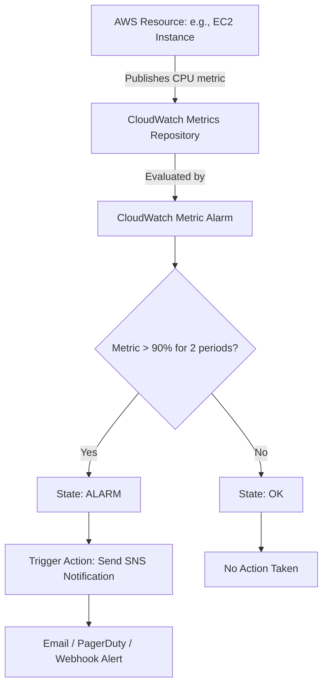

# CloudWatch Automation

Amazon CloudWatch is a monitoring and observability service built for DevOps engineers, developers, site reliability engineers (SREs), and IT managers. It provides data and actionable insights to monitor your applications, respond to system-wide performance changes, and optimize resource utilization.

CloudWatch can save your production systems, but looking at dashboards manually is not enough. You want to automate your monitoring: publish custom metrics from your microservices, dynamically create alarms when new servers spin up, and search logs via script during incident responses.

In this guide, we will learn how to publish custom metrics, create alarms, and fetch log streams using Python and Boto3.

---

## Metrics vs. Logs Comparison

CloudWatch handles two primary types of observability data. Let us look at how they compare:

| Feature | CloudWatch Metrics | CloudWatch Logs |
| :--- | :--- | :--- |
| **Data Format** | Structured, time-ordered numeric data points | Text strings representing timestamped events |
| **Common Use Cases** | CPU utilization, queue depth, error rates | Stack traces, debug logs, access logs |
| **Storage & Retention** | Retained up to 15 months by default | Customizable retention policies (1 day to indefinite) |
| **Query Mechanism** | GetMetricStatistics API / Metric Math | CloudWatch Logs Insights (SQL-like queries) |
| **Automation Triggers** | Directly triggers CloudWatch Alarms | Requires Metric Filters to trigger alarms |

---

## Alarm Trigger Workflow

CloudWatch Alarms evaluate metric data points over a specified window. If the metric crosses a threshold for a set number of periods, the alarm changes state and triggers actions.

Here is the evaluation and notification flow:



---

## Publishing Custom Metrics

Let us write a script that sends a custom performance metric (such as active application user sessions) to CloudWatch. This is useful for monitoring application-level behavior.

```python
import boto3
import random
import time
from botocore.exceptions import ClientError

def publish_user_sessions(sessions_count):
    # Initialize the CloudWatch client
    cw_client = boto3.client('cloudwatch')
    
    try:
        print(f"Publishing custom metric: ActiveSessions = {sessions_count}")
        
        # Put metric data
        cw_client.put_metric_data(
            Namespace='CustomApp/Production',
            MetricData=[
                {
                    'MetricName': 'ActiveSessions',
                    'Dimensions': [
                        {
                            'Name': 'ServerID',
                            'Value': 'web-server-01'
                        },
                        {
                            'Name': 'Environment',
                            'Value': 'Production'
                        }
                    ],
                    'Value': float(sessions_count),
                    'Unit': 'Count'
                }
            ]
        )
        print("Metric published successfully.")
        return True
        
    except ClientError as e:
        print(f"Failed to publish metric: {e}")
        return False

# Publish a random metric value
random_sessions = random.randint(100, 500)
publish_user_sessions(random_sessions)
```

### Expected Output (Success)
```text
Publishing custom metric: ActiveSessions = 342
Metric published successfully.
```

---

## Fetching Logs Programmatically

DevOps pipelines often need to parse logs to verify deployments. Let us write a helper script that pulls the latest log events from a specific CloudWatch Log Group.

```python
import boto3
from botocore.exceptions import ClientError

def fetch_recent_logs(log_group_name, log_stream_name, limit=5):
    logs_client = boto3.client('logs')
    
    try:
        print(f"Querying stream '{log_stream_name}' in group '{log_group_name}'...")
        response = logs_client.get_log_events(
            logGroupName=log_group_name,
            logStreamName=log_stream_name,
            limit=limit,
            startFromHead=False # Get the newest logs
        )
        
        events = response.get('events', [])
        print("\nLog Events:")
        print("-" * 50)
        for event in events:
            timestamp = event['timestamp']
            message = event['message'].strip()
            print(f"[{timestamp}] {message}")
        print("-" * 50)
        return events
        
    except ClientError as e:
        print(f"Failed to read logs: {e}")
        return []

# Run the log fetcher
fetch_recent_logs('/aws/lambda/nightly-cleanup-worker', '2026/06/25/[$LATEST]12345')
```

### Expected Output
```text
Querying stream '2026/06/25/[$LATEST]12345' in group '/aws/lambda/nightly-cleanup-worker'...

Log Events:
--------------------------------------------------
[1782390120000] START RequestId: 8192-3490-1283
[1782390121000] Auditing databases in progress...
[1782390122000] Cleanup complete. Removed 14 stale entries.
[1782390123000] END RequestId: 8192-3490-1283
[1782390123050] REPORT RequestId: 8192-3490-1283 Duration: 3.05 ms
--------------------------------------------------
```

---

## Real-World Script: Creating a High-CPU Alarm for an EC2 Instance

When setting up new servers, you want to automatically attach CPU utilization alarms so you are notified if a server is overloaded.

Here is a script that creates a CloudWatch Alarm that triggers if an EC2 instance's CPU utilization exceeds 85% for two consecutive 5-minute periods:

```python
import boto3
from botocore.exceptions import ClientError

def create_cpu_alarm(instance_id, sns_topic_arn):
    cw_client = boto3.client('cloudwatch')
    
    alarm_name = f"High-CPU-Alarm-{instance_id}"
    
    try:
        print(f"Creating CPU alarm '{alarm_name}' for instance '{instance_id}'...")
        
        cw_client.put_metric_alarm(
            AlarmName=alarm_name,
            AlarmDescription='Trigger alarm when CPU exceeds 85% for 10 minutes',
            ActionsEnabled=True,
            AlarmActions=[
                sns_topic_arn # SNS topic that emails the team
            ],
            MetricName='CPUUtilization',
            Namespace='AWS/EC2',
            Statistic='Average',
            Dimensions=[
                {
                    'Name': 'InstanceId',
                    'Value': instance_id
                }
            ],
            Period=300, # 5 minutes in seconds
            EvaluationPeriods=2, # Check last 2 periods (10 mins total)
            Threshold=85.0, # 85% threshold
            ComparisonOperator='GreaterThanOrEqualToThreshold'
        )
        print("Success! CPU Alarm created and attached successfully.")
        return True
        
    except ClientError as e:
        print(f"Failed to create alarm: {e}")
        return False

# Example Execution variables
target_server = "i-08a123bc45de67f89"
team_alert_sns = "arn:aws:sns:us-east-1:123456789012:OpsTeamAlerts"

create_cpu_alarm(target_server, team_alert_sns)
```

### Expected Output
```text
Creating CPU alarm 'High-CPU-Alarm-i-08a123bc45de67f89' for instance 'i-08a123bc45de67f89'...
Success! CPU Alarm created and attached successfully.
```

---

## Line-by-Line Code Breakdown

Let us look at how the metric and alarm calls interface:

1. `cw_client.put_metric_data(...)`: Publishes custom numeric statistics. Always organize metrics under a distinct namespace (e.g., `CustomApp/Production`) to avoid mixing them with standard AWS metrics.
2. `cw_client.get_log_events(...)`: Reads raw text messages from a specific stream. The logs are returned in chronological order by default, and we set `startFromHead=False` to fetch the most recent log events.
3. `cw_client.put_metric_alarm(...)`: Creates or updates a monitoring alarm. You configure the threshold, metric dimensions, evaluation windows, and attach SNS action ARNs to handle status changes.

---

## Common Mistakes

Here are some pitfalls when working with CloudWatch APIs:

### 1. Missing Dimensions in Alarms
AWS metrics are stored by their unique combination of name and dimensions. If you publish a metric with a dimension `ServerID=web-01` but try to create an alarm that queries the metric without that dimension, the alarm will state `INSUFFICIENT_DATA` because it cannot locate the specific metric series.

### 2. Timezones in Retrieval Requests
When calling `get_metric_statistics` to fetch historical metric data, you must provide start and end timestamps. These timestamps must be timezone-aware UTC datetime objects. Passing naive datetime objects will lead to empty responses or API validation errors.

### 3. Exceeding Log Stream Rate Limits
If you write a script that calls `get_log_events` inside a tight loop without pagination or backoff delay, AWS will throttle your client with a `ProvisionedThroughputExceededException`. Always implement retries or leverage paginators.

### 4. Overlooking Metric Units
When putting custom metrics, matching the unit type (e.g., `Seconds`, `Percent`, `Count`, `Bytes`) is crucial. If you publish values with a unit of `Count` but query the metric expecting `Bytes`, the numbers will fail to render properly on CloudWatch charts.

---

## Summary

* CloudWatch is the central telemetry store for metrics, logs, and alarms in AWS.
* Metrics track structured numerical performance data; logs record raw runtime event messages.
* Use `put_metric_data` to publish custom application metrics like active sessions or queue depths.
* Organize custom metrics under descriptive namespaces to keep dashboard categories clean.
* Use `get_log_events` to retrieve and parse log messages from CloudWatch log streams.
* Configure log queries with `startFromHead=False` to process the most recent log events first.
* Use `put_metric_alarm` to establish performance thresholds for AWS infrastructure.
* Ensure all metrics dimensions align exactly between publishing scripts and alarm monitors.
* Provide timezone-aware UTC datetimes when fetching metric histories via scripts.
* Handle log retrieval throttling by using paginators or adding backoff delays in loops.
