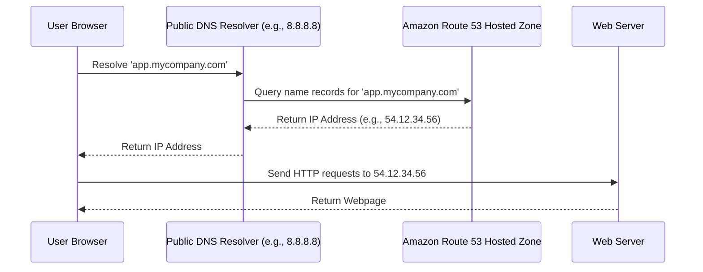

# Route 53 Automation

Amazon Route 53 is a highly available and scalable Domain Name System (DNS) web service. It connects user requests to infrastructure running in AWS (such as EC2 instances, Elastic Load Balancers, or S3 buckets) and can also route users to infrastructure outside of AWS.

DNS is how users find your service. If your DNS records point to the wrong IP addresses, your website is effectively down. During blue-green deployments, or when spinning up dynamic environments for testing, you do not want to update records manually. Automating Route 53 DNS records ensures updates happen instantly and accurately during deployments.

In this guide, we will learn how to list hosted zones and automate record management using Python and Boto3.

---

## DNS Record Types Comparison

When automating DNS, you must choose the correct record type. Let us look at how the most common record types compare:

| Record Type | What it Stands For | Value Format | Common DevOps Use Case | Crucial Rule |
| :--- | :--- | :--- | :--- | :--- |
| **A Record** | Address | IPv4 address (e.g., `192.0.2.1`) | Directing a domain to a static server IP | Must be a valid IPv4 address |
| **CNAME** | Canonical Name | Domain name (e.g., `lb.aws.com`) | Mapping a subdomain to an Elastic Load Balancer | Cannot coexist with other records for the same name |
| **TXT** | Text | Text string (e.g., `"verification-key"`) | Domain ownership validation (SSL, Google/GitHub verification) | Values must be enclosed in double quotes |

---

## DNS Resolution Flow

Route 53 stores records inside **Hosted Zones**. When a client makes a browser request, DNS resolvers contact Route 53 to find the destination resource.

Here is the basic resolution flow:



---

## Listing Hosted Zones

Before modifying records, we must identify which hosted zones exist in our AWS account. Let us write a script that lists all available zones and their zone IDs.

```python
import boto3
from botocore.exceptions import ClientError

def list_dns_hosted_zones():
    # Route 53 is a global service; regional configurations are not required
    route53_client = boto3.client('route53')
    
    try:
        print("Querying account for Route 53 Hosted Zones...")
        response = route53_client.list_hosted_zones()
        
        zones = response.get('HostedZones', [])
        
        if not zones:
            print("No hosted zones found in this AWS account.")
            return []
            
        print("\nActive DNS Hosted Zones:")
        print("=" * 60)
        for zone in zones:
            name = zone['Name']
            zone_id = zone['Id'].split('/')[-1] # Strip the prefix '/hostedzone/'
            type_label = "Private" if zone['Config']['PrivateZone'] else "Public"
            records_count = zone['ResourceRecordSetCount']
            
            print(f"Domain Name: {name}")
            print(f"  Zone ID:    {zone_id}")
            print(f"  Type:       {type_label}")
            print(f"  Records:    {records_count}")
            print("-" * 60)
            
        print(f"\nListing complete. Found {len(zones)} hosted zone(s).")
        return zones
        
    except ClientError as e:
        print(f"Failed to retrieve hosted zones: {e}")
        return []

# Run hosted zone retrieval
list_dns_hosted_zones()
```

### Expected Output (Success)
```text
Querying account for Route 53 Hosted Zones...

Active DNS Hosted Zones:
============================================================
Domain Name: mycompany.com.
  Zone ID:    Z0123456789ABC
  Type:       Public
  Records:    6
------------------------------------------------------------

Listing complete. Found 1 hosted zone(s).
```

---

## Real-World Script: Creating a CNAME Record

To route domain traffic to a newly deployed load balancer, your script needs to insert or update (upsert) a record set.

Here is a script that creates or updates a CNAME record inside a target Hosted Zone:

```python
import boto3
from botocore.exceptions import ClientError

def upsert_cname_record(zone_id, record_name, target_value, ttl=300):
    route53_client = boto3.client('route53')
    
    # 1. Build the change batch structure
    # UPSERT will create the record if missing, or update it if it exists
    change_batch = {
        'Comment': 'Automated DNS updates from deployment script',
        'Changes': [
            {
                'Action': 'UPSERT',
                'ResourceRecordSet': {
                    'Name': record_name,
                    'Type': 'CNAME',
                    'TTL': ttl,
                    'ResourceRecords': [
                        {
                            'Value': target_value
                        }
                    ]
                }
            }
        ]
    }
    
    try:
        print(f"Submitting DNS update for {record_name} -> {target_value}...")
        response = route53_client.change_resource_record_sets(
            HostedZoneId=zone_id,
            ChangeBatch=change_batch
        )
        
        change_info = response['ChangeInfo']
        change_id = change_info['Id']
        status = change_info['Status']
        
        print(f"Request submitted! Change ID: {change_id}")
        print(f"Current Status:   {status}")
        return change_id
        
    except ClientError as e:
        print(f"Failed to update DNS records: {e}")
        return None

# Example variables
# Replace with your actual Route 53 Zone ID and load balancer endpoint
target_zone = "Z0123456789ABC"
subdomain = "app.mycompany.com"
load_balancer_dns = "internal-prod-lb-98765.us-east-1.elb.amazonaws.com"

upsert_cname_record(target_zone, subdomain, load_balancer_dns)
```

### Expected Output
```text
Submitting DNS update for app.mycompany.com -> internal-prod-lb-98765.us-east-1.elb.amazonaws.com...
Request submitted! Change ID: /change/C1234567890ABC
Current Status:   PENDING
```

---

## Waiting for DNS Propagation

After submitting a DNS change, it takes time to sync across AWS's global network. If your CI/CD pipeline needs to run integration tests against the new hostname immediately after updating DNS, you must wait for the change to enter the `INSYNC` status.

Let us write a helper script to wait for propagation:

```python
import boto3
import time
from botocore.exceptions import ClientError

def wait_for_dns_sync(change_id):
    route53_client = boto3.client('route53')
    
    print(f"Waiting for DNS change '{change_id}' to sync globally...")
    
    while True:
        try:
            response = route53_client.get_change(Id=change_id)
            status = response['ChangeInfo']['Status']
            
            print(f"  Current sync status: {status}")
            
            if status == 'INSYNC':
                print("DNS is now globally synchronized and active!")
                return True
                
        except ClientError as e:
            print(f"Failed to query change status: {e}")
            return False
            
        time.sleep(10) # Poll every 10 seconds

# Wait for the sample change to sync
wait_for_dns_sync("/change/C1234567890ABC")
```

### Expected Output
```text
Waiting for DNS change '/change/C1234567890ABC' to sync globally...
  Current sync status: PENDING
  Current sync status: PENDING
  Current sync status: INSYNC
DNS is now globally synchronized and active!
```

---

## Line-by-Line Code Breakdown

Let us analyze how the DNS update APIs process parameters:

1. `route53_client.list_hosted_zones()`: Returns list metadata. Zone IDs in the response are returned as path strings (e.g., `/hostedzone/Z0123456789ABC`). We split this path to extract the raw alphanumeric Zone ID.
2. `change_resource_record_sets(...)`: This method executes transactional updates. You supply a list of actions (`CREATE`, `DELETE`, or `UPSERT`) that execute atomically.
3. `'Action': 'UPSERT'`: A senior best practice. Unlike `CREATE`, which returns a failure error if the record name already exists, `UPSERT` updates the target value in-place, preventing script crashes on subsequent runs.
4. `route53_client.get_change(Id=change_id)`: Checks the propagation state. When the status changes from `PENDING` to `INSYNC`, it means the DNS configuration has been applied across Route 53's global endpoints.

---

## Common Mistakes

Here are some typical traps developers face when automating Route 53 DNS:

### 1. Missing the Trailing Dot in Domain Names
AWS Route 53 requires domain names to be fully qualified, meaning they must end with a trailing dot (e.g., `mycompany.com.`). If your scripts compare `mycompany.com` directly to `zone['Name']` (which is returned as `mycompany.com.`), string comparisons will fail.

### 2. Forgetting TXT Record Double Quotes
When creating TXT records (used for verification), the text value **must** contain double quotes inside the API payload string (e.g., `'"my-verification-code"'` or `'"v=spf1 include:_spf.google.com ~all"'`). If you pass a plain string, AWS will throw an `InvalidInput` exception.

### 3. Deleting Non-Existent Records
If your script runs a cleanup task that calls `DELETE` for a record set, the record name, type, and target value in the payload must match the existing record exactly. If there is a slight mismatch, Route 53 will reject the deletion transaction.

### 4. Overlooking DNS Cache (TTL) Propagation
When testing scripts that update DNS records, you might notice changes do not show up immediately in your terminal or browser. This is due to Time-to-Live (TTL) caching. Keep TTL values small (like 60 seconds) in deployment scripts to enable fast failover testing.

---

## Summary

* Amazon Route 53 is AWS's managed DNS service that resolves domain names to IP endpoints.
* Hosted Zones store DNS records for domain spaces; they can be public or private VPC-scoped.
* Use `list_hosted_zones` to locate DNS zones and parse their alphanumeric zone IDs.
* Use `change_resource_record_sets` to execute creations, updates, and deletions of records.
* Prefer using `UPSERT` actions in scripts to prevent errors when re-creating existing DNS records.
* Use `get_change` to block pipeline execution until your DNS configuration changes are `INSYNC`.
* Ensure domain names in comparison scripts account for the trailing dot returned by AWS.
* Always wrap TXT record values in double quotes within your API payload strings.
* Deletion operations require exact matches of names, types, and values to succeed.
* Set appropriate TTL values to manage how long DNS resolvers cache record responses.
* Route 53 is a global service; regional connection parameters are not required in clients.
