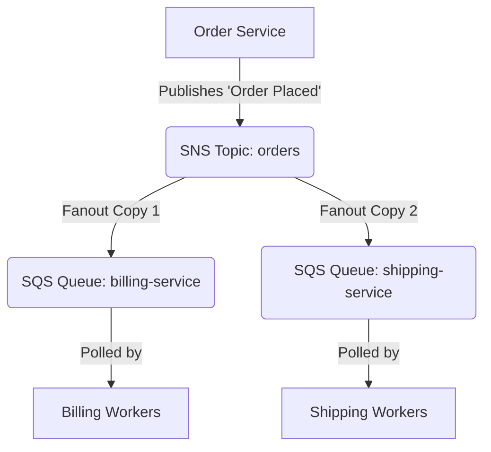

# SNS and SQS Automation

Modern cloud architectures rely on microservices that communicate asynchronously. AWS provides two key services for this: **Simple Notification Service (SNS)** and **Simple Queue Service (SQS)**. SNS is a publish/subscribe (pub/sub) service, whereas SQS is a message queuing service.

Decoupling your services is a key design principle. If your web app calls your payment database directly and synchronously, a database slowdown will crash the web app. By putting a message queue between them, your systems become resilient to traffic spikes. Combining SNS and SQS lets you build a "fanout" pattern, where one event triggers multiple independent workflows.

In this guide, we will write Python scripts using Boto3 to publish alerts to SNS and process message queues with SQS.

---

## SNS vs. SQS Comparison

Let us look at how SNS and SQS compare:

| Feature | Amazon SNS | Amazon SQS |
| :--- | :--- | :--- |
| **Communication Pattern** | Publish / Subscribe (One-to-Many) | Message Queue (One-to-One) |
| **Delivery Model** | Push (AWS immediately delivers to subscribers) | Pull (Workers poll the queue to retrieve messages) |
| **Message Durability** | Temporary (lost if no subscriber is attached) | Durable (retained up to 14 days in queue) |
| **Common Use Cases** | Email notifications, system-wide event broadcasting | Decoupling background workers, scaling batch processing |
| **Consumer Actions** | Passive reception of messages | Must actively delete message after processing |

---

## The Fanout Integration Pattern

A common design pattern is to publish an event to an SNS topic, which then automatically routes (fans out) the message to multiple SQS queues for parallel processing by different services.

Here is the flow of messages:



---

## Publishing to an SNS Topic

Let us write a script that initializes the SNS client, creates an SNS Topic, and publishes a message to it.

```python
import boto3
from botocore.exceptions import ClientError

def publish_sns_alert(topic_name, subject, message_body):
    sns_client = boto3.client('sns')
    
    # 1. Create the topic (creates if missing, returns existing details if it exists)
    try:
        print(f"Creating or locating SNS topic: {topic_name}")
        topic_response = sns_client.create_topic(Name=topic_name)
        topic_arn = topic_response['TopicArn']
        print(f"Topic ARN: {topic_arn}")
        
    except ClientError as e:
        print(f"Failed to create topic: {e}")
        return None

    # 2. Publish a message to the topic
    try:
        print(f"Publishing alert message to topic...")
        response = sns_client.publish(
            TopicArn=topic_arn,
            Message=message_body,
            Subject=subject
        )
        message_id = response['MessageId']
        print(f"Success! Message sent. Message ID: {message_id}")
        return message_id
        
    except ClientError as e:
        print(f"Failed to publish message: {e}")
        return None

# Run the publisher
alert_subject = "CRITICAL: Database Disk Space"
alert_body = "Warning: Disk space on production-db is at 92%. Please investigate."
publish_sns_alert("system-alerts", alert_subject, alert_body)
```

### Expected Output (Success)
```text
Creating or locating SNS topic: system-alerts
Topic ARN: arn:aws:sns:us-east-1:123456789012:system-alerts
Publishing alert message to topic...
Success! Message sent. Message ID: a1b2c3d4-5678-90ab-cdef-111112222233
```

---

## Polling and Deleting Messages from SQS

Unlike SNS, messages in SQS stay in the queue until a consumer pulls them and explicitly deletes them. If your worker fails to delete a message, AWS assumes processing failed and puts the message back in the queue after a "Visibility Timeout" period.

Let us write a worker script that polls a queue for messages, simulates processing, and then deletes them.

```python
import boto3
import json
from botocore.exceptions import ClientError

def process_queue_messages(queue_name):
    sqs_client = boto3.client('sqs')
    
    # 1. Retrieve the Queue URL by name
    try:
        url_response = sqs_client.get_queue_url(QueueName=queue_name)
        queue_url = url_response['QueueUrl']
    except ClientError as e:
        print(f"Failed to get queue URL: {e}")
        return False

    # 2. Poll messages from SQS
    # We use Long Polling by setting WaitTimeSeconds to retrieve messages efficiently
    print(f"Polling SQS queue '{queue_name}' for messages...")
    try:
        response = sqs_client.receive_message(
            QueueUrl=queue_url,
            MaxNumberOfMessages=5,
            WaitTimeSeconds=10 # Long polling wait time
        )
        
        messages = response.get('Messages', [])
        if not messages:
            print("No messages found in queue.")
            return True
            
        print(f"Retrieved {len(messages)} message(s). Processing...")
        
        for msg in messages:
            body = msg['Body']
            receipt_handle = msg['ReceiptHandle']
            
            # Print message content
            print(f"\nMessage Received: {body}")
            
            # 3. Delete the message to tell SQS it was processed successfully
            print("Deleting message from queue...")
            sqs_client.delete_message(
                QueueUrl=queue_url,
                ReceiptHandle=receipt_handle
            )
            print("Message deleted successfully.")
            
        return True
        
    except ClientError as e:
        print(f"Error processing queue: {e}")
        return False

# Run the queue processor
process_queue_messages("billing-service-queue")
```

### Expected Output
```text
Polling SQS queue 'billing-service-queue' for messages...
Retrieved 1 message(s). Processing...

Message Received: {"order_id": "99823", "amount": 149.99}
Deleting message from queue...
Message deleted successfully.
```

---

## Real-World Script: Creating a Temporary Task Queue

In automated test runs, you often need to spin up a temporary queue, send work payloads, verify worker execution, and then destroy the queue to avoid charging your AWS account.

Here is a script that automates the lifecycle of a task queue:

```python
import boto3
import time
from botocore.exceptions import ClientError

def temporary_queue_demo():
    sqs_client = boto3.client('sqs')
    queue_name = "integration-test-queue"
    
    # 1. Create SQS Queue
    try:
        print(f"Step 1: Creating SQS Queue '{queue_name}'...")
        response = sqs_client.create_queue(
            QueueName=queue_name,
            Attributes={
                'ReceiveMessageWaitTimeSeconds': '20', # Default to long polling
                'MessageRetentionPeriod': '3600'      # Retain message for only 1 hour
            }
        )
        queue_url = response['QueueUrl']
        print(f"   Created Queue URL: {queue_url}")
    except ClientError as e:
        print(f"   Failed to create queue: {e}")
        return

    # 2. Send a message payload
    try:
        print("Step 2: Sending test task message...")
        sqs_client.send_message(
            QueueUrl=queue_url,
            MessageBody='{"task": "build-docker-image", "tag": "v1.0.4"}'
        )
        print("   Message sent successfully.")
    except ClientError as e:
        print(f"   Failed to send message: {e}")

    # 3. Wait and clean up by deleting the queue
    try:
        print("Step 3: Deleting the temporary queue...")
        sqs_client.delete_queue(QueueUrl=queue_url)
        print("   Queue deleted successfully.")
    except ClientError as e:
        print(f"   Failed to delete queue: {e}")

# Run the lifecycle demo
temporary_queue_demo()
```

### Expected Output
```text
Step 1: Creating SQS Queue 'integration-test-queue'...
   Created Queue URL: https://sqs.us-east-1.amazonaws.com/123456789012/integration-test-queue
Step 2: Sending test task message...
   Message sent successfully.
Step 3: Deleting the temporary queue...
   Queue deleted successfully.
```

---

## Common Mistakes

Here are some pitfalls when working with messaging automation:

### 1. Forgetting to Delete Messages in SQS
A major beginner mistake is thinking that `receive_message` deletes the message from the queue. It does not! If your code does not call `delete_message`, the exact same message will reappear in the queue once the visibility timeout expires, leading to duplicate processing.

### 2. Not Utilizing Long Polling
By default, SQS requests use short polling, which queries only a subset of AWS servers and returns immediately (often returning empty results even if there are messages in the queue). Always set `WaitTimeSeconds` (between 1 and 20) to enable long polling, which cuts API costs and reduces empty responses.

### 3. Exceeding SQS Message Size Limits
SQS has a strict message size limit of 256KB. If you try to send large files or large JSON payloads (such as raw database dumps) through SQS, the client will throw an error. Instead, write the payload to an S3 bucket and send the S3 URL in the SQS message.

### 4. Missing Queue Policy for SNS Subscriptions
When configuring an SNS topic to route messages to an SQS queue, you must attach an IAM policy to the SQS queue that permits the SNS service ARN to call `sqs:SendMessage`. Without this access policy, SNS will silently drop messages.

---

## Summary

* Asynchronous messaging decouples application architectures and prevents service outages.
* SNS is a push-based pub/sub broadcast service; SQS is a pull-based point-to-point queue.
* The fanout pattern routes a single SNS publication to multiple SQS subscriber queues.
* Use `sns_client.publish` to broadcast event messages to SNS topics.
* Use `sqs_client.receive_message` to retrieve waiting payloads from SQS queues.
* Enable Long Polling by setting `WaitTimeSeconds` to reduce costs and empty responses.
* Call `delete_message` with the message's `ReceiptHandle` to permanently remove it from queues.
* Messages remain in queues up to 14 days, allowing systems to recover from outages without data loss.
* SQS has a maximum message size limit of 256KB; use S3 to store large objects instead.
* Set SQS Access Policies to permit SNS subscription endpoints to route messages to queues.
