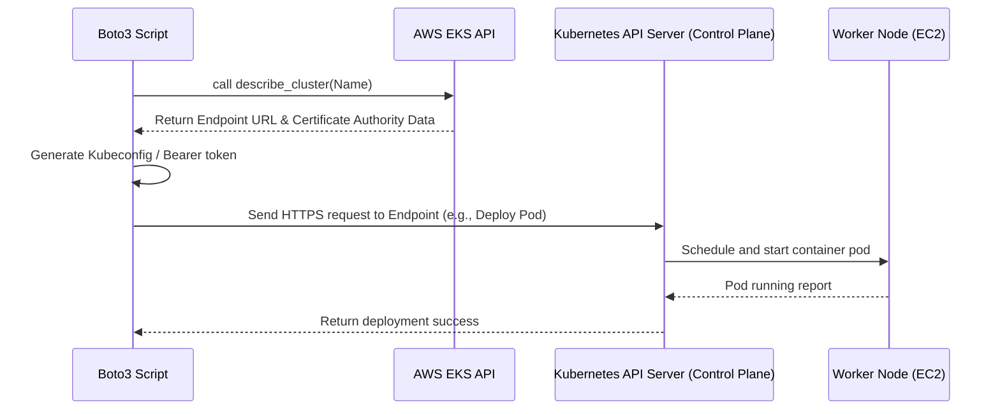

# EKS Automation

Amazon Elastic Kubernetes Service (Amazon EKS) is a managed service that makes it easy for you to run Kubernetes on AWS without needing to install, operate, and maintain your own Kubernetes control plane or nodes.

Kubernetes is the standard for container orchestration in modern DevOps. Managing clusters is complex, though. If you provision clusters manually, you end up with inconsistent network configurations and outdated Kubernetes versions. Automating EKS cluster audits and inspections with Python and Boto3 lets you maintain strict security compliance and verify cluster health.

In this guide, we will learn how to interact with EKS control planes, describe active clusters, and audit their configurations using Boto3.

---

## Kubernetes Hosting Comparison

Let us compare running self-managed Kubernetes on AWS EC2 instances with using the managed Amazon EKS service:

| Feature | Self-Managed Kubernetes (EC2) | Amazon EKS |
| :--- | :--- | :--- |
| **Control Plane Management** | Manual (You install control plane components on EC2) | Automated (Managed, multi-AZ, and highly available control plane) |
| **Upgrade Complexity** | High (Manually draining nodes and updating binaries) | Low (Triggered via API / AWS console) |
| **Pricing** | Only pay for the EC2 resources consumed | Flat rate of $0.10 per hour per cluster + resource costs |
| **AWS Integration** | Manual setup required for IAM and VPC routing | Native integration with IAM, VPC networking, and ELB |
| **Control Plane SLA** | None (You manage availability) | 99.95% uptime SLA provided by AWS |

---

## EKS Architecture Integration

EKS manages the Kubernetes control plane. To deploy applications (like Pods and Services) to Kubernetes, your automation tools must first call the AWS EKS API to obtain the cluster connection details and credentials.

Here is how automation tools connect to EKS:



---

## Listing EKS Clusters

Let us write a simple script that queries your AWS region for all active EKS clusters and lists their names.

```python
import boto3
from botocore.exceptions import ClientError

def list_eks_clusters():
    # Initialize the EKS client
    eks_client = boto3.client('eks')
    
    try:
        print("Querying region for Amazon EKS clusters...")
        response = eks_client.list_clusters()
        
        clusters = response.get('clusters', [])
        
        if not clusters:
            print("No EKS clusters found in this region.")
            return []
            
        print("\nActive EKS Clusters:")
        print("=" * 40)
        for cluster_name in clusters:
            print(f" - {cluster_name}")
        print("=" * 40)
        
        print(f"Query complete. Found {len(clusters)} cluster(s).")
        return clusters
        
    except ClientError as e:
        print(f"Failed to list EKS clusters: {e}")
        return []

# Run EKS listing
list_eks_clusters()
```

### Expected Output (Success)
```text
Querying region for Amazon EKS clusters...

Active EKS Clusters:
========================================
 - production-microservices-cluster
 - staging-testing-cluster
========================================
Query complete. Found 2 cluster(s).
```

---

## Auditing EKS Managed Node Groups

EKS clusters are connected to EC2 instances through **Node Groups**. If these worker nodes are degraded or run mismatching versions, your applications will fail. Let us write a helper function that lists and describes all nodegroups in a cluster to audit their health.

```python
import boto3
from botocore.exceptions import ClientError

def audit_cluster_nodegroups(cluster_name):
    eks_client = boto3.client('eks')
    
    try:
        print(f"Retrieving nodegroups for cluster '{cluster_name}'...")
        response = eks_client.list_nodegroups(clusterName=cluster_name)
        nodegroups = response.get('nodegroups', [])
        
        if not nodegroups:
            print("  No managed node groups found in this cluster.")
            return
            
        for ng_name in nodegroups:
            ng_detail = eks_client.describe_nodegroup(
                clusterName=cluster_name,
                nodegroupName=ng_name
            )['nodegroup']
            
            status = ng_detail['status']
            ami_type = ng_detail['amiType']
            instance_types = ng_detail['instanceTypes']
            
            print(f"  Node Group: {ng_name}")
            print(f"    Status:         {status}")
            print(f"    AMI Type:       {ami_type}")
            print(f"    Instance Types: {instance_types}")
            print("    " + "-" * 30)
            
    except ClientError as e:
        print(f"  Failed to query nodegroups: {e}")

# Audit nodegroups for our production cluster
audit_cluster_nodegroups("production-microservices-cluster")
```

### Expected Output
```text
Retrieving nodegroups for cluster 'production-microservices-cluster'...
  Node Group: production-cpu-workers
    Status:         ACTIVE
    AMI Type:       AL2_x86_64
    Instance Types: ['t3.medium', 't3.large']
    ------------------------------
```

---

## Real-World Script: EKS Version and Security Audit

AWS updates EKS versions regularly. One important responsibility is making sure all EKS clusters run supported Kubernetes versions and have public endpoint access restricted.

Let us write an audit script that retrieves detailed configurations for all EKS clusters and checks if their version is outdated (< 1.28) or if their API endpoint is exposed to the public internet without IP restrictions:

```python
import boto3
from botocore.exceptions import ClientError

def audit_eks_security_and_versions():
    eks_client = boto3.client('eks')
    
    # 1. Fetch cluster list
    try:
        cluster_names = eks_client.list_clusters().get('clusters', [])
    except ClientError as e:
        print(f"Failed to access EKS: {e}")
        return

    print("Starting EKS compliance audit...")
    print("=" * 60)
    
    for name in cluster_names:
        try:
            # 2. Describe each cluster
            response = eks_client.describe_cluster(name=name)
            cluster = response['cluster']
            
            version = cluster['version']
            status = cluster['status']
            endpoint = cluster['endpoint']
            
            # Extract networking details
            vpc_config = cluster['resourcesVpcConfig']
            public_access = vpc_config.get('endpointPublicAccess', True)
            private_access = vpc_config.get('endpointPrivateAccess', False)
            
            print(f"Cluster Name: {name}")
            print(f"  Status:       {status}")
            print(f"  Version:      Kubernetes v{version}")
            
            # Audit Check 1: Check Kubernetes Version support
            # (Assuming v1.28 is the minimum desired version)
            version_float = float(version)
            if version_float < 1.28:
                print("  WARNING: Version is outdated! Plan an upgrade immediately.")
            else:
                print("  Status: Version is compliant.")
                
            # Audit Check 2: Check API Server Network Access
            if public_access and not private_access:
                print("  WARNING: EKS Endpoint has PUBLIC access enabled, but PRIVATE is disabled.")
                print("           Best practice is to enable private access for worker nodes.")
            elif public_access and vpc_config.get('publicAccessCidrs') == ['0.0.0.0/0']:
                print("  WARNING: Endpoint is publicly open to the entire internet (0.0.0.0/0).")
            else:
                print("  Status: Network configuration meets baseline security rules.")
                
            print(f"  Endpoint URL: {endpoint}")
            
            # Audit nodegroups as well
            audit_cluster_nodegroups(name)
            print("-" * 60)
            
        except ClientError as e:
            print(f"Failed auditing cluster '{name}': {e}")
            
    print("\nAudit process complete.")

# Run the audit script
audit_eks_security_and_versions()
```

### Expected Output
```text
Starting EKS compliance audit...
============================================================
Cluster Name: production-microservices-cluster
  Status:       ACTIVE
  Version:      Kubernetes v1.29
  Status: Version is compliant.
  Status: Network configuration meets baseline security rules.
  Endpoint URL: https://A1B2C3D4E5.gr7.us-east-1.eks.amazonaws.com
Retrieving nodegroups for cluster 'production-microservices-cluster'...
  Node Group: production-cpu-workers
    Status:         ACTIVE
    AMI Type:       AL2_x86_64
    Instance Types: ['t3.medium', 't3.large']
    ------------------------------
------------------------------------------------------------
Cluster Name: staging-testing-cluster
  Status:       ACTIVE
  Version:      Kubernetes v1.25
  WARNING: Version is outdated! Plan an upgrade immediately.
  WARNING: Endpoint is publicly open to the entire internet (0.0.0.0/0).
  Endpoint URL: https://F6G7H8I9J0.gr7.us-east-1.eks.amazonaws.com
Retrieving nodegroups for cluster 'staging-testing-cluster'...
  No managed node groups found in this cluster.
------------------------------------------------------------

Audit process complete.
```

---

## Line-by-Line Code Breakdown

Let us look closely at how the EKS APIs communicate cluster parameters:

1. `eks_client.list_clusters()`: Fetches a list of EKS cluster names in the current region.
2. `eks_client.describe_cluster(name=...)`: Retrieves detailed status metadata. Note that cluster creation is asynchronous; status values include `CREATING`, `ACTIVE`, `DELETING`, and `FAILED`.
3. `eks_client.list_nodegroups(clusterName=...)`: Fetches a list of Managed Node Groups connected to the cluster.
4. `eks_client.describe_nodegroup(...)`: Queries node health status, scaling config boundaries, AMI configurations, and instance types.
5. `cluster['certificateAuthority']['data']`: The base64-encoded Certificate Authority data. This data is critical; clients need it to establish trusted SSL handshakes with the Kubernetes API server.

---

## Common Mistakes

Here are some pitfalls to avoid when writing automation scripts for EKS:

### 1. Confusing EKS API Calls with Kubernetes API Calls
EKS APIs are only for managing cluster infrastructure control planes (e.g., updating version settings, listing clusters, or managing nodegroups). If you want to create Pods or Deployments, you must use a Kubernetes API client library (like the official `kubernetes` python client) or `kubectl`, not Boto3.

### 2. Assuming Fast Cluster Creation
Creating an EKS cluster takes between 10 and 20 minutes because AWS is provisioning redundant virtual machines in the background. If you write a script that calls `create_cluster` and immediately attempts to call S3 or deploy code, it will fail. You must poll `describe_cluster` and wait until status becomes `ACTIVE`.

### 3. Ignoring VPC Subnet IP Capacity
EKS requires subnets with enough available IP addresses (a minimum of 6 free IPs per subnet, but more is highly recommended) to run cluster interfaces. If your script provisions EKS in a subnet that is nearly depleted, the cluster creation will fail after 15 minutes with a `ResourceLimitExceeded` error.

### 4. Missing Cluster IAM Role Permissions
To create a cluster, EKS needs permission to create network interfaces and load balancers on your behalf. This requires passing a role ARN to `create_cluster`. If the IAM role lacks the standard `AmazonEKSClusterPolicy` managed policy, EKS will fail to initialize.

---

## Summary

* Amazon EKS provides managed, highly available Kubernetes control planes on AWS.
* EKS client APIs in Boto3 manage the cluster control plane infrastructure, not inside-the-cluster Pod resources.
* Use `list_clusters` to get the names of EKS clusters running in a region.
* Use `describe_cluster` to fetch statuses, versions, connection endpoints, and network details.
* Keep EKS clusters updated by auditing Kubernetes versions returned by Boto3.
* Audit connected worker node infrastructure using `list_nodegroups` and `describe_nodegroup`.
* Check EKS cluster status (which must be `ACTIVE`) before attempting to connect to its endpoints.
* Leverage `endpointPublicAccess` and `publicAccessCidrs` properties to audit cluster API visibility.
* Use EKS Certificate Authority data to authenticate external deployment tooling securely.
* Creating EKS clusters is slow; implement loops or waiters to check status transitions.
* Ensure IAM roles assigned to clusters contain permissions for AWS network resources.
