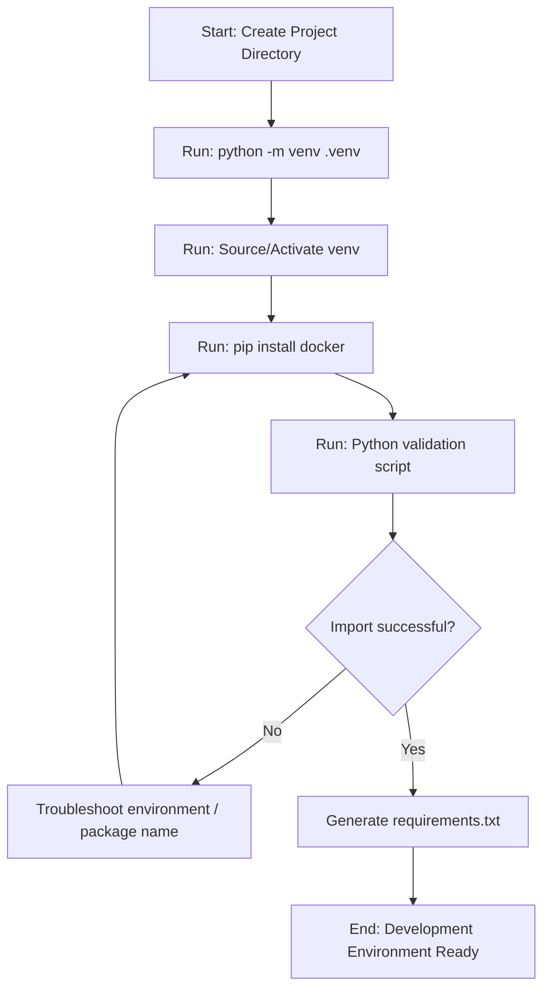

# Installing the Docker SDK

Before we can control Docker with Python, we must install the correct library and configure our development environment. In the Python ecosystem, we use package managers like `pip` to install libraries. However, because Docker automation scripts often run in shared server environments, we must also set up virtual environments to prevent package dependency conflicts.

How you set up your Python environment really matters. If you install packages globally on a server, you will eventually break system-level tools. Always isolate your project dependencies using virtual environments.

In this guide, we will learn how to install the Docker SDK for Python, verify the installation, and avoid common environment pitfalls.

---

## Package Managers Comparison

Python projects use different tools to manage dependencies. Let us compare the three most common methods to install and maintain the Docker SDK:

| Package Manager | Installation Command | Lockfile Used | Best For | Complexity |
| :--- | :--- | :--- | :--- | :--- |
| **pip + venv** | `pip install docker` | `requirements.txt` | Quick scripts, lightweight Docker containers | Low (standard library tool) |
| **Pipenv** | `pipenv install docker` | `Pipfile.lock` | Applications requiring simple dependency locking | Medium (manages venv automatically) |
| **Poetry** | `poetry add docker` | `poetry.lock` | Complex libraries, packaging production services | High (powerful package manager) |

---

## Installation and Verification Workflow

Setting up the project involves creating a virtual environment, activating it, installing the official library, and running a verification import script.

Here is the setup lifecycle:



---

## Verifying Package Installation Programmatically

Once you have run the installation command, you should verify that Python can import the library and that it is running a modern version of the SDK. Let us write a script that does this programmatically.

```python
import sys

def verify_library_install():
    print("Checking system path for Docker SDK...")
    
    try:
        # Attempt to import the official docker library
        import docker
        
        # Access the package version attribute
        sdk_version = docker.__version__
        print("Success! Docker SDK is installed and ready.")
        print(f"  Installed version: {sdk_version}")
        print(f"  Python Executable: {sys.executable}")
        
        # Check if version is outdated (best practice is 6.x or newer)
        version_parts = [int(x) for x in sdk_version.split('.')[:2]]
        if version_parts[0] < 6:
            print("  NOTE: You are running an older version of the SDK. Consider upgrading.")
        else:
            print("  Status: SDK version is up to date.")
            
        return True
        
    except ImportError:
        print("\n[ERROR] Docker SDK is NOT installed in this Python environment.")
        print("Please run one of the following commands in your terminal:")
        print("  Using pip:    pip install docker")
        print("  Using poetry: poetry add docker")
        return False

# Run the validation
verify_library_install()
```

### Expected Output (Success)
```text
Checking system path for Docker SDK...
Success! Docker SDK is installed and ready.
  Installed version: 6.1.3
  Python Executable: c:\Users\patel\Github\devops\devops\.venv\Scripts\python.exe
  Status: SDK version is up to date.
```

---

## Remote Daemon Access Configuration (Optional)

In some setups, your Python script will execute on a machine separate from where the Docker containers actually run. To connect remotely, you must configure the remote Docker daemon to listen on a TCP port rather than a local file socket.

> [!WARNING]
> Exposing the Docker daemon over plain TCP without security (TLS) is a massive security risk. Anyone with access to the port can gain root-level control of your host system.

To secure this connection, you must generate SSL/TLS certificates and point your environment to them:

```bash
# 1. Edit docker configuration daemon (/etc/docker/daemon.json)
{
  "hosts": ["unix:///var/run/docker.sock", "tcp://0.0.0.0:2376"],
  "tlsverify": true,
  "tlscacert": "/etc/docker/certs/ca.pem",
  "tlscert": "/etc/docker/certs/server-cert.pem",
  "tlskey": "/etc/docker/certs/server-key.pem"
}
```

Once configured, your Python script can connect remotely using a custom configuration TLS connection client:

```python
import docker

def connect_remote_docker_tls(host_url, cert_dir):
    try:
        print(f"Connecting to remote Docker host: {host_url}...")
        
        # Configure TLS using Boto3/Docker custom configuration
        tls_config = docker.tls.TLSConfig(
            client_cert=(f'{cert_dir}/cert.pem', f'{cert_dir}/key.pem'),
            ca_cert=f'{cert_dir}/ca.pem',
            verify=True
        )
        
        # Initialize client with TLS
        client = docker.DockerClient(
            base_url=host_url,
            tls=tls_config
        )
        
        print("Successfully connected remotely over TLS!")
        print(f"Server version: {client.version()['Version']}")
        client.close()
        return True
    except Exception as e:
        print(f"Failed remote TLS connection: {e}")
        return False

# Example usage
# connect_remote_docker_tls("https://192.168.1.100:2376", "/path/to/certs")
```

---

## Real-World Script: Dependency Isolation Setup Helper

In automated shell pipelines, you want a script that validates the current Python environment before executing Docker management code. This script verifies the environment and automatically creates a `requirements.txt` file if it is missing.

```python
import os
import sys
import subprocess

def setup_environment_audit():
    print("Executing Python environment sanity check...")
    
    # 1. Verify if we are running inside a virtual environment
    # Standard Python sets sys.prefix equal to sys.base_prefix if no venv is active
    in_venv = sys.prefix != sys.base_prefix
    
    print(f"Virtual Environment Active: {in_venv}")
    if not in_venv:
        print("  WARNING: You are running this script globally.")
        print("           It is highly recommended to isolate dependencies in a virtual environment.")
        
    # 2. Check for docker package
    try:
        import docker
        print(f"  Confirmed docker package availability (v{docker.__version__})")
    except ImportError:
        print("  Missing dependency: 'docker' package not found. Attempting to install...")
        try:
            subprocess.check_call([sys.executable, "-m", "pip", "install", "docker"])
            print("  Successfully installed docker package.")
        except subprocess.CalledProcessError as e:
            print(f"  Installation failed: {e}")
            return False

    # 3. Create requirements.txt if it does not exist
    requirements_file = "requirements.txt"
    if not os.path.exists(requirements_file):
        print(f"Generating default {requirements_file}...")
        try:
            import docker
            with open(requirements_file, "w") as f:
                f.write(f"docker=={docker.__version__}\n")
            print("  Created requirements.txt successfully.")
        except Exception as e:
            print(f"  Failed to write file: {e}")
            
    print("Environment setup audit complete.")
    return True

# Run environmental audit
setup_environment_audit()
```

### Expected Output
```text
Executing Python environment sanity check...
Virtual Environment Active: True
  Confirmed docker package availability (v6.1.3)
Environment setup audit complete.
```

---

## Line-by-Line Code Breakdown

Let us analyze how Python handles these module imports:

1. `import docker`: This imports the library namespace. If the package was not installed or installed in a different Python path, Python throws an `ImportError`.
2. `docker.__version__`: Metadata attribute exposing the version of the installed package. Helpful for checking feature support at runtime.
3. `sys.prefix != sys.base_prefix`: Checks if Python is executing from an isolated directory (virtual environment).
4. `subprocess.check_call(...)`: Calls `pip` package installation commands dynamically from within the running Python process if a library is missing.

---

## Common Mistakes

Here are some typical traps developers face when installing the Docker SDK:

### 1. Naming Your Script `docker.py`
This is a classic rookie mistake. If you name your script `docker.py` and run `python docker.py`, when Python hits `import docker`, it will import **your own script file** instead of the official library. You will get a cryptic error like `AttributeError: module 'docker' has no attribute 'from_env'`. Never name your script files the same name as imported libraries.

### 2. Confusing Python `docker` package with `docker-compose`
The `docker` package allows you to control single containers and images. It does *not* include the high-level Docker Compose features out of the box unless you use a separate orchestrator or write custom wrapper scripts. Do not expect to call `client.compose` directly.

### 3. Installing Globally Without Sudo on Linux
If you try to run `pip install docker` on a Linux server outside of a virtual environment, the system will block the installation due to permissions errors. Using `sudo pip install` is dangerous because it can overwrite critical OS python tools. Always use a virtual environment: `python3 -m venv venv && source venv/bin/activate && pip install docker`.

### 4. Running Outdated Pip Version
Older versions of `pip` may fail to locate newer wheels of the `docker` package, leading to compile failures of underlying dependencies (like cryptographical libraries). Always run `pip install --upgrade pip` before installing new packages.

---

## Summary

* Standardize installation using virtual environments to protect system python tools.
* Use `pip install docker` to install the official Docker SDK library.
* Avoid installing the deprecated `docker-py` package to prevent namespace collisions.
* Verify the package version programmatically by reading the `docker.__version__` property.
* Exposing Docker daemons over TCP port 2376 requires setting up TLS verification.
* Configure clients remotely using `docker.tls.TLSConfig` object credentials.
* Detect virtual environments at runtime by comparing `sys.prefix` and `sys.base_prefix`.
* Never name your own Python files `docker.py` as it shadows the library namespace.
* Generate a `requirements.txt` file to lock dependency versions for production deployments.
* Keep `pip` upgraded to prevent compilation failures during library installations.
