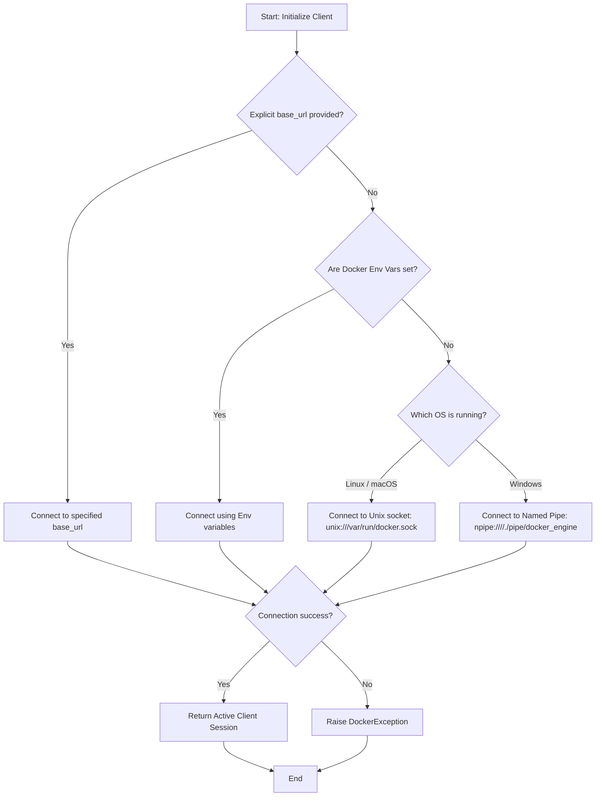

# Connecting to Docker

To control Docker using Python, your script must establish a connection channel to the Docker daemon. The Docker daemon acts as a server that listens for API requests. You can connect to this server locally using Unix sockets (Linux/macOS) or Named Pipes (Windows), or remotely over a network connection using TCP.

Connection failures are the most common issues you will hit when deploying Docker automation scripts. A script that works fine on your laptop can crash on a CI/CD build agent simply because the build agent cannot find or access the Docker socket. Handling connection fallbacks gracefully is what makes scripts reliable.

In this guide, we will learn how to connect to the Docker daemon using different connection channels.

---

## Connection Methods Comparison

The Docker SDK provides two primary ways to initialize a connection client. Let us compare them:

| Connection Method | Instantiation Code | How it Resolves Parameters | Best For | Code Flexibility |
| :--- | :--- | :--- | :--- | :--- |
| **Environment Connection** | `docker.from_env()` | Reads environment variables (`DOCKER_HOST`, `DOCKER_CERT_PATH`, etc.) | Standard scripts running on developer laptops or inside containers | Low (depends on system environment setup) |
| **Explicit Client** | `docker.DockerClient(base_url=...)` | Parameters are passed directly to the constructor in code | Connecting to remote servers or custom socket paths | High (can resolve paths dynamically) |

---

## Connection Resolution Flow

When you initialize a client, the SDK resolves which socket or network interface to connect to. If you do not provide parameters, it follows a strict resolution sequence.

Here is the connection resolution flowchart:



---

## Basic Connection Configurations

Let us write a script that demonstrates the three different ways to instantiate a Docker client: environment configuration, direct local socket, and remote TCP.

```python
import sys
import docker
from docker.errors import DockerException

def connect_via_env():
    print("Method 1: Connecting using environment variables...")
    try:
        client = docker.from_env()
        print(f"  Connected successfully! Host Version: {client.version()['Version']}")
        client.close()
        return True
    except DockerException as e:
        print(f"  Method 1 failed: {e}")
        return False

def connect_via_socket():
    print("Method 2: Connecting using direct local socket path...")
    # Determine default socket base on Operating System
    socket_url = "npipe:////./pipe/docker_engine" if sys.platform == 'win32' else "unix://var/run/docker.sock"
    
    try:
        client = docker.DockerClient(base_url=socket_url)
        print(f"  Connected successfully via {socket_url}! Host Version: {client.version()['Version']}")
        client.close()
        return True
    except DockerException as e:
        print(f"  Method 2 failed: {e}")
        return False

def connect_via_tcp():
    print("Method 3: Connecting using explicit TCP endpoint...")
    # Connecting to an unencrypted development daemon running on localhost
    tcp_url = "tcp://127.0.0.1:2375"
    
    try:
        client = docker.DockerClient(base_url=tcp_url, timeout=5)
        print(f"  Connected successfully via TCP! Host Version: {client.version()['Version']}")
        client.close()
        return True
    except DockerException as e:
        print(f"  Method 3 failed (standard if TCP access is disabled): {e}")
        return False

# Run connection checks
connect_via_env()
print("-" * 50)
connect_via_socket()
print("-" * 50)
connect_via_tcp()
```

### Expected Output
```text
Method 1: Connecting using environment variables...
  Connected successfully! Host Version: 24.0.7
--------------------------------------------------
Method 2: Connecting using direct local socket path...
  Connected successfully via unix://var/run/docker.sock! Host Version: 24.0.7
--------------------------------------------------
Method 3: Connecting using explicit TCP endpoint...
  Method 3 failed (standard if TCP access is disabled): Connection refused
```

---

## Configuring Secure TLS Connections Explicitly

When exposing Docker over the network, you must encrypt the connection. The SDK allows you to define certificate authorities, client certificates, and verify keys explicitly in the client parameters.

Here is how you write a secure remote connection initialization function:

```python
import docker
import os

def connect_to_secure_remote_daemon(ip_address, certs_folder_path):
    print(f"Initializing secure TLS connection to {ip_address}...")
    
    # 1. Define paths to generated SSL certificates
    ca_cert = os.path.join(certs_folder_path, 'ca.pem')
    client_cert = os.path.join(certs_folder_path, 'cert.pem')
    client_key = os.path.join(certs_folder_path, 'key.pem')
    
    # 2. Build the TLS configuration object
    try:
        tls_config = docker.tls.TLSConfig(
            client_cert=(client_cert, client_key),
            ca_cert=ca_cert,
            verify=True
        )
        
        # 3. Create the client pointing to secure port 2376
        client = docker.DockerClient(
            base_url=f"https://{ip_address}:2376",
            tls=tls_config,
            timeout=10
        )
        
        print("Success! TLS Handshake complete.")
        client.ping()
        client.close()
        return True
        
    except FileNotFoundError as e:
        print(f"Failed to find local certificate files: {e}")
        return False
    except Exception as e:
        print(f"Security handshake failed: {e}")
        return False
```

---

## Real-World Script: Fallback Connection Manager

In complex DevOps pipeline deployments, your script may run inside a Kubernetes pod, a runner VM, or a local machine. You need a robust helper function that tries local connections first and falls back to system environments automatically.

Here is a script that implements this fallback logic:

```python
import sys
import docker
from docker.errors import DockerException

def get_robust_docker_client():
    print("Initiating robust connection sequence...")
    
    # 1. First choice: try environment variables (often configured in CI/CD)
    try:
        print("Trying environment configurations...")
        client = docker.from_env()
        # Trigger a test call to confirm connectivity
        client.ping()
        print("-> Connection established using environment settings.")
        return client
    except (DockerException, Exception) as e:
        print(f"   Environment connection unavailable: {e}")

    # 2. Second choice: try system-default local sockets
    default_socket = "npipe:////./pipe/docker_engine" if sys.platform == 'win32' else "unix:///var/run/docker.sock"
    try:
        print(f"Trying system-default socket path: {default_socket}...")
        client = docker.DockerClient(base_url=default_socket, timeout=5)
        client.ping()
        print("-> Connection established using local system socket.")
        return client
    except (DockerException, Exception) as e:
        print(f"   Local socket connection failed: {e}")

    # 3. If all fail, return None
    print("CRITICAL: All Docker connection channels failed!")
    return None

# Test the connection manager
active_client = get_robust_docker_client()

if active_client:
    version_data = active_client.version()
    print(f"\nConnected to Docker Engine v{version_data['Version']} (API v{version_data['ApiVersion']})")
    # Clean up connection
    active_client.close()
else:
    print("\nCould not start client. Please ensure Docker service is running.")
```

### Expected Output
```text
Initiating robust connection sequence...
Trying environment configurations...
-> Connection established using environment settings.

Connected to Docker Engine v24.0.7 (API v1.43)
```

---

## Line-by-Line Code Breakdown

Let us analyze how Boto3/Docker Client establishes socket communication:

1. `client.ping()`: A senior engineer's best practice. The client constructor does *not* immediately query the Docker daemon. It merely sets up configurations. To verify the connection is actually alive, you must call a lightweight API method like `client.ping()`.
2. `base_url`: Accepts the target endpoint path. The prefix determines the protocol: `unix://` for Unix domain sockets, `npipe://` for Windows named pipes, and `tcp://` for network streams.
3. `timeout`: Set in seconds. When connecting to TCP endpoints, specify a low timeout (like 5 seconds) to prevent your script from freezing indefinitely if the target server is down.

---

## Common Mistakes

Here are some pitfalls when connecting to the Docker daemon:

### 1. Assuming `DockerClient()` Validates Connections Instantly
Simply writing `client = docker.DockerClient(base_url="tcp://invalid-ip:2375")` will NOT raise an error immediately. The SDK only establishes connections when you attempt to perform an operation (like listing containers). Always trigger `client.ping()` immediately after initialization to check for connectivity errors.

### 2. Passing Raw Windows Paths
Windows Named Pipes require the format `npipe:////./pipe/docker_engine`. A common mistake is writing standard backslash characters (e.g., `npipe://\\.\pipe\docker_engine`), which Python treats as escape sequences, resulting in invalid path errors. Always use double forward slashes or raw strings.

### 3. Exposing TCP Port 2375 Publicly
Port 2375 is the default port for **unencrypted** Docker daemon access. If you expose this port to the internet on a cloud virtual machine, anyone can connect and launch malicious containers. Always restrict access using firewalls or use port 2376 with TLS certification.

### 4. Forgetting to call `client.close()`
Every time you instantiate a client, Python allocates network sockets or socket files. If your scripts initialize clients inside loops without calling `client.close()`, you will leak file descriptors, eventually causing the host machine to block new connections.

---

## Summary

* The Docker client connects locally via Unix sockets, Windows Named Pipes, or remotely via TCP.
* Standard initialization is done using `docker.from_env()`, which reads system variable files.
* Direct connection parameters can be specified by passing a `base_url` to the `DockerClient` class.
* Use `client.ping()` to verify that the Docker daemon is responding to API requests.
* Unix sockets on Linux are located by default at `unix:///var/run/docker.sock`.
* Windows named pipes use the path structure `npipe:////./pipe/docker_engine`.
* Set connection timeout limits on TCP sockets to prevent scripts from freezing on failures.
* Keep TCP connection port 2375 secure behind local networks or private firewalls.
* Expose port 2376 with TLS certificates for secure remote network connections.
* Always clean up socket files and connections by executing `client.close()` on termination.
