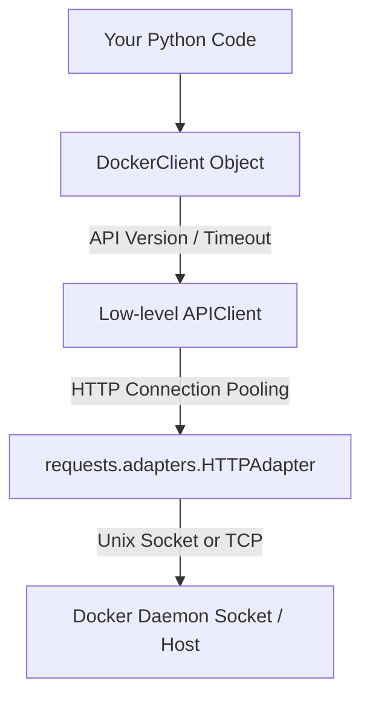

# Docker Client Configuration

Once you can connect to the Docker daemon, you need to configure your client properties. In simple scripts, the default settings work fine. But in production DevOps environments—where you might pull multi-gigabyte images, run concurrent container tasks, or query older legacy Docker hosts—default values will cause your scripts to fail or time out.

You have probably seen developers debug timeout errors by randomly throwing `sleep` calls at their script. The real fix is configuring your Docker client object properly: setting custom API versions, increasing network timeouts, scaling HTTP connection pools, and setting up automatic retries.

In this guide, we will learn how to tune your Docker client configuration for stability and performance.

---

## Client Configurations Comparison

Let us compare the default Docker client configuration with a custom production-ready client setup:

| Configuration Parameter | Default Setting | Custom Production Setting | Why it matters |
| :--- | :--- | :--- | :--- |
| **API Version** | `auto` (highest version matches host) | Explicit (e.g., `'1.41'`) | Prevents script crashes when Docker daemon upgrades |
| **Timeout** | 60 seconds | 300+ seconds | Prevents termination during long image downloads |
| **Connection Pool Size** | 10 sockets | 50+ sockets | Prevents bottlenecks during concurrent API operations |
| **User Agent** | Default Docker SDK string | Custom label (e.g., `DevOps-Deployer-v2`) | Identifies your client requests in Docker system audits |

---

## The Client Configuration Layer

The Docker SDK client sits on top of standard Python HTTP networking modules. When you define configuration parameters on the client, they propagate down to the HTTP connection adapter layer.

Here is the configuration layout:



---

## Configuring Custom Timeouts and Versions

Let us write a script that explicitly pins the API version to support legacy engines and increases network timeout limits to survive slow networks.

```python
import docker
from docker.errors import DockerException

def initialize_custom_client():
    # 1. Define explicit target properties
    target_api_version = "1.41"  # Pin to Docker API version 1.41
    timeout_seconds = 300        # Increase timeout to 5 minutes
    
    try:
        print(f"Initializing client (API Version: {target_api_version}, Timeout: {timeout_seconds}s)...")
        
        # Instantiate client with custom parameters
        client = docker.from_env(
            version=target_api_version,
            timeout=timeout_seconds
        )
        
        # Query client specs to confirm settings
        print("Connection successful! Client Configurations:")
        print(f"  Client API Version: {client.api.api_version}")
        
        # Test query to host
        host_version = client.version()
        print(f"  Server API Version: {host_version['ApiVersion']}")
        print(f"  Server OS:          {host_version['Os']}")
        
        client.close()
        return True
        
    except DockerException as e:
        print(f"Failed to configure custom client: {e}")
        return False

# Run custom client initialization
initialize_custom_client()
```

### Expected Output (Success)
```text
Initializing client (API Version: 1.41, Timeout: 300s)...
Connection successful! Client Configurations:
  Client API Version: 1.41
  Server API Version: 1.43
  Server OS:          linux
```

---

## Configuring Automatic Request Retries

In network-heavy systems, transient connection hiccups can cause scripts to fail randomly. You can configure the Docker client's HTTP adapter to automatically retry failed requests.

Let us write a script that attaches custom retry policies using transport adapters:

```python
import docker
from requests.adapters import HTTPAdapter
from urllib3.util import Retry

def create_client_with_retries():
    try:
        print("Creating client with automatic retry adapters...")
        client = docker.from_env()
        
        # 1. Define the retry policy rules
        retry_policy = Retry(
            total=3,                # Retry 3 times before giving up
            backoff_factor=1,       # Wait 1s, 2s, 4s between retries
            status_forcelist=[500, 502, 503, 504], # Retry on server-side errors
            raise_on_status=False
        )
        
        # 2. Build the HTTP Adapter with this policy
        adapter = HTTPAdapter(max_retries=retry_policy)
        
        # 3. Mount the adapter to both HTTP and HTTPS schemas
        client.api.mount('http://', adapter)
        client.api.mount('https://', adapter)
        
        print("Retry adapter mounted successfully.")
        # Execute query to test
        print(f"Docker Host Ping: {client.ping()}")
        
        client.close()
        return True
    except Exception as e:
        print(f"Failed mounting retry adapter: {e}")
        return False

create_client_with_retries()
```

### Expected Output
```text
Creating client with automatic retry adapters...
Retry adapter mounted successfully.
Docker Host Ping: True
```

---

## Real-World Script: High-Concurrency Connection Pooling

If you write a Python script that monitors dozens of containers in parallel using threads or greenlets, the default HTTP connection pool of 10 will choke. Your requests will wait for available connections, causing latency.

Here is a script that configures a custom high-performance Docker client with scaled connection pooling:

```python
import docker
from docker.errors import DockerException
import urllib3

def create_high_performance_client():
    print("Building high-performance Docker client...")
    
    # 1. Define pool configurations
    max_connections = 50  # Allow up to 50 concurrent sockets in the pool
    
    try:
        # Create client with scaled connection pool
        client = docker.from_env(
            max_pool_size=max_connections
        )
        
        # 2. Verify client metrics
        info = client.info()
        print("Success! High-concurrency client running.")
        print(f"  Active Sockets Pool Size: {max_connections}")
        print(f"  Running Containers Count: {info.get('ContainersRunning', 0)}")
        
        # Perform some concurrent resource audits (Simulated pool test)
        containers = client.containers.list(all=True)
        print(f"  Scanned {len(containers)} containers using connection pool.")
        
        client.close()
        return True
        
    except DockerException as e:
        print(f"Failed to initialize pool client: {e}")
        return False

# Run pool deployment
create_high_performance_client()
```

### Expected Output
```text
Building high-performance Docker client...
Success! High-concurrency client running.
  Active Sockets Pool Size: 50
  Running Containers Count: 4
  Scanned 12 containers using connection pool.
```

---

## Line-by-Line Code Breakdown

Let us analyze how custom configurations apply to the SDK:

1. `docker.from_env(version='1.41')`: Instructs the client to use a specific version schema. This is highly useful for backwards compatibility; if your host daemon upgrades its version, your script still uses the version it was tested on.
2. `timeout=300`: Configures the maximum duration in seconds that the socket waits for a response from the daemon. Long operations (like pulling a 4GB Docker image or waiting for a massive database container to start) need large timeouts.
3. `max_pool_size=50`: Configures the underlying `urllib3` connection adapter. This determines how many HTTP socket connections can remain open simultaneously to handle parallel multi-threaded queries.
4. `client.api.mount('http://', adapter)`: Mounts a custom transport adapter, allowing you to intercept and decorate outgoing requests with custom connection pooling, certificates, or retry mechanisms.

---

## Common Mistakes

Here are some pitfalls when configuring Docker clients:

### 1. Setting Timeout Limits Too Low
If your automation scripts build large Dockerfiles or download heavy base images, a small timeout (like 10 seconds) will raise a `ReadTimeoutError` during `client.images.pull()`. Always keep timeout limits large for script routines that modify filesystem states.

### 2. Requesting Unmatched API Versions
If you pin a client version to `'1.45'` but the target server host only supports up to `'1.41'`, the client will throw a `docker.errors.InvalidArgument` or connection error because the server cannot parse the newer API requests. Always pin to versions equal to or lower than your daemon version.

### 3. Creating Multiple Clients inside Loops
If you write a monitoring loop that iterates every 5 seconds, do not call `docker.from_env()` inside the loop. Each call creates new connection adapters and thread pools. Initialize a single client object outside the loop, use it repeatedly, and close it when the loop terminates.

### 4. Overlooking Custom User Agents
When auditing API logs on enterprise Docker hosts, you will see generic User-Agent strings. If your automated scripts do not configure custom identity labels or headers, identifying which server or worker triggered a critical resource deletion is difficult.

### 5. Ignoring HTTP Proxy Configurations
If your build server runs behind an enterprise HTTP proxy, the Docker SDK might attempt to route local socket commands through the proxy server. This causes connection timeouts or proxy routing failures. Ensure you set the `NO_PROXY` environment variable for localhost, `/var/run/docker.sock`, or configure your client session to bypass proxies.

---

## Summary

* Customizing client parameters prevents script timeouts during heavy image operations.
* Explicitly pinning the client API version maintains compatibility when hosts are upgraded.
* Use `docker.from_env(version='X.XX')` to enforce version consistency.
* Configure custom timeouts in seconds to prevent connection drops during long operations.
* Increase connection pool sizes (`max_pool_size`) when executing threaded, parallel queries.
* Mount transport adapters (`HTTPAdapter`) to handle automated retries for transient networking failures.
* Avoid initializing new clients inside loops to prevent system resource leaks.
* Pin API versions lower than or equal to the host daemon version to prevent failures.
* Reuse a single global client across your application code instead of spawning multiple clients.
* Always execute `client.close()` to cleanly terminate connection pools.
