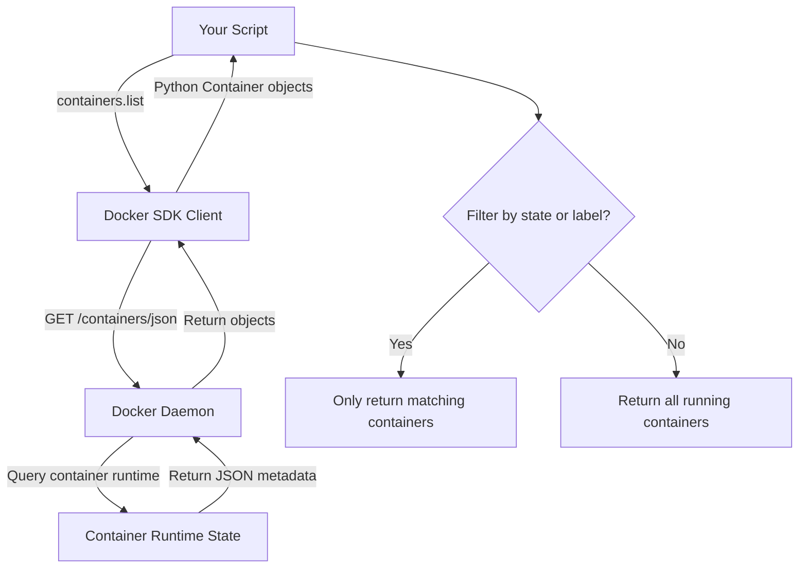

# Listing Containers

One of the first things you will do with Docker automation is list containers. In any DevOps workflow—health checks, cleanup scripts, deployment monitors—you need to see what is running, what has exited, and which containers belong to which service.

Container listing is something you will do constantly. Whether you are confirming a deployment landed, auditing a server for ghost containers, or writing a script that restarts crashed workers, it all starts with reading the container list. The Docker SDK makes this clean and fast.

In this guide, we will learn how to list containers using the Python Docker SDK, filter them, and extract useful attributes.

---

## Container State Comparison

Docker containers can be in several lifecycle states. Understanding these states is critical when filtering your listings:

| State | What it means | Still using resources? | Typical Cause |
| :--- | :--- | :--- | :--- |
| **running** | Container is actively executing | Yes (CPU + memory) | Started with `docker run` or SDK |
| **exited** | Finished execution and stopped | No (only disk for logs) | Process inside completed or crashed |
| **paused** | Frozen in place, process suspended | Yes (memory) | Developer paused for debugging |
| **restarting** | Crashed and Docker daemon is retrying | Yes (momentary) | Restart policy triggered by failure |
| **created** | Allocated but never started | No (only disk) | Created without being started |

---

## Container Listing Workflow

When you call `client.containers.list()`, the SDK queries the Docker daemon for the container registry and returns a list of Container objects with full metadata.



---

## Listing Only Running Containers

By default, `client.containers.list()` returns only containers that are currently running. Let us write a script that lists them with useful details.

```python
import docker
from docker.errors import DockerException

def list_running_containers():
    try:
        client = docker.from_env()
        print("Fetching running containers...")
        
        # By default, only running containers are returned
        containers = client.containers.list()
        
        if not containers:
            print("No containers are currently running.")
            client.close()
            return []

        print(f"\nRunning Containers ({len(containers)} total):")
        print("=" * 65)
        for c in containers:
            cid = c.short_id
            name = c.name
            image = c.image.tags[0] if c.image.tags else c.image.short_id
            status = c.status
            
            print(f"ID: {cid}  Name: {name:<25} Image: {image:<25} Status: {status}")
        print("=" * 65)
        
        client.close()
        return containers

    except DockerException as e:
        print(f"Failed to list containers: {e}")
        return []

list_running_containers()
```

### Expected Output
```text
Fetching running containers...

Running Containers (3 total):
=================================================================
ID: a1b2c3  Name: web-app-prod             Image: nginx:latest               Status: running
ID: d4e5f6  Name: redis-cache              Image: redis:alpine               Status: running
ID: g7h8i9  Name: postgres-db              Image: postgres:15                Status: running
=================================================================
```

---

## Listing All Containers (Including Stopped)

To see every container on the host, including ones that have exited, pass `all=True`.

```python
import docker
from docker.errors import DockerException
from datetime import datetime

def list_all_containers():
    try:
        client = docker.from_env()
        
        # all=True includes exited, paused, created containers
        containers = client.containers.list(all=True)
        
        print(f"Total containers on host (all states): {len(containers)}\n")
        
        running = [c for c in containers if c.status == 'running']
        exited  = [c for c in containers if c.status == 'exited']
        other   = [c for c in containers if c.status not in ('running', 'exited')]
        
        print(f"  Running:  {len(running)}")
        print(f"  Exited:   {len(exited)}")
        print(f"  Other:    {len(other)}")
        
        if exited:
            print("\nExited containers (candidates for cleanup):")
            for c in exited:
                image = c.image.tags[0] if c.image.tags else c.image.short_id
                print(f"  - {c.name:<30} | Image: {image}")
        
        client.close()
        return containers

    except DockerException as e:
        print(f"Error listing containers: {e}")
        return []

list_all_containers()
```

### Expected Output
```text
Total containers on host (all states): 7

  Running:  3
  Exited:   3
  Other:    1

Exited containers (candidates for cleanup):
  - old-migration-runner           | Image: flyway:latest
  - test-api-smoke-runner          | Image: python:3.9-slim
  - failed-build-worker            | Image: node:18-alpine
```

---

## Real-World Script: Filtering Containers by Label

In production environments, you tag containers with labels when starting them (e.g., `environment=production`). This lets your scripts isolate only the containers you care about.

```python
import docker
from docker.errors import DockerException

def list_by_label(label_key, label_value):
    try:
        client = docker.from_env()
        
        # Filters accept a dict of label key-value pairs
        filter_str = f"{label_key}={label_value}"
        containers = client.containers.list(
            all=True,
            filters={"label": filter_str}
        )
        
        print(f"Containers with label '{filter_str}': {len(containers)} found")
        for c in containers:
            print(f"  - {c.name} [{c.status}]")
        
        client.close()
        return containers

    except DockerException as e:
        print(f"Failed: {e}")
        return []

# Find all production containers
list_by_label("environment", "production")
```

### Expected Output
```text
Containers with label 'environment=production': 2 found
  - web-app-prod [running]
  - redis-cache [running]
```

---

## Common Mistakes

### 1. Forgetting `all=True` When Looking for Stopped Containers
The default call `client.containers.list()` silently skips exited containers. If your cleanup script reports "no containers found" but you know they exist, this is almost always the cause.

### 2. Accessing `.image.tags` Without Checking for Empty Lists
Images built locally without a tag (e.g., intermediate build layers) have an empty tags list. Accessing `c.image.tags[0]` directly will throw an `IndexError`. Always guard with `c.image.tags[0] if c.image.tags else c.image.short_id`.

### 3. Confusing Container Name and ID
`c.name` returns the human-readable name (like `web-app-prod`). `c.id` returns the full 64-character hex ID. `c.short_id` returns the first 12 characters. When stopping or removing containers via script, use the full `c.id` for precision.

### 4. Filtering by Name Uses Partial Matches
The `filters={"name": "web"}` filter does substring matching, not exact matching. It will return any container whose name contains the string "web". If you want an exact match, filter the SDK results yourself in Python after retrieving the list.

---

## Summary

* `client.containers.list()` returns only running containers by default.
* Pass `all=True` to include exited, paused, created, and restarting containers.
* Container objects carry `.name`, `.short_id`, `.status`, `.image`, and `.labels` attributes.
* Use `filters={"label": "key=value"}` to target containers by labels set at start time.
* Use `filters={"status": "exited"}` to target only containers in a specific state.
* Always check that `c.image.tags` is non-empty before indexing into it.
* Use `c.id` (full ID) when performing operations like stop or remove to avoid ambiguity.
* Container name filters match substrings, not exact names — filter in Python for precision.
* Running state containers consume CPU and memory; exited containers only use disk.
* Build your listing scripts to drive cleanup, health-check, and deployment verification automation.
