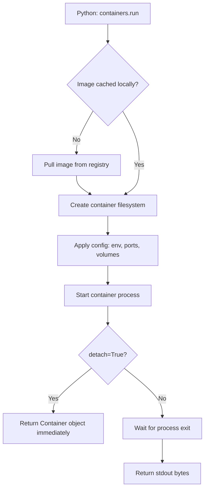

# Running Containers

Starting a container is one of the most common automation tasks. In a CI/CD pipeline you might spin up a test database, run a build step inside an isolated container, or launch a temporary service. Doing this from Python keeps your entire deployment logic in one place and makes it easy to capture output, check exit codes, and clean up afterward.

The SDK lets you start containers with precise resource limits and environment variables baked right into your Python code. No more long `docker run` commands where one missing flag breaks everything.

In this guide we will learn how to run containers programmatically using the Docker SDK, control their lifecycle, and handle output.

---

## Container Run Modes Comparison

The SDK's `containers.run()` method has two primary execution modes:

| Mode | `detach` value | Blocks script? | Returns | Best For |
| :--- | :--- | :--- | :--- | :--- |
| **Foreground (attached)** | `False` (default) | Yes — waits until container exits | Byte output from stdout/stderr | Running one-shot commands, tests |
| **Background (detached)** | `True` | No — returns immediately | Container object | Long-running services, daemons |

---

## How Container Startup Works

When you call `containers.run()`, the SDK sends a create-then-start request to the Docker daemon. The daemon pulls the image if it is not cached locally, sets up the network and filesystem layers, and starts the process inside the container.



---

## Running a One-Shot Command Container

The simplest use case is running a container that executes a command and exits. This is great for quick jobs: generating a file, running a database migration, or testing a network connection.

```python
import docker
from docker.errors import ContainerError, ImageNotFound, DockerException

def run_one_shot(image, command):
    try:
        client = docker.from_env()
        print(f"Running: '{command}' inside image '{image}'...")
        
        # Foreground mode: wait for exit, capture output
        output = client.containers.run(
            image=image,
            command=command,
            remove=True   # Automatically delete container after it exits
        )
        
        # Output is returned as bytes — decode to string
        result = output.decode('utf-8').strip()
        print("Container completed. Output:")
        print(result)
        
        client.close()
        return result

    except ContainerError as e:
        print(f"Container exited with non-zero code: {e.exit_status}")
        print(f"Stderr: {e.stderr.decode()}")
    except ImageNotFound:
        print(f"Image '{image}' was not found locally or in the registry.")
    except DockerException as e:
        print(f"Docker error: {e}")
    return None

# Run a quick hostname check
run_one_shot("alpine:latest", "hostname")
```

### Expected Output
```text
Running: 'hostname' inside image 'alpine:latest'...
Container completed. Output:
7b3f2a91c4d0
```

---

## Running a Detached Service Container

For long-running services (web servers, databases, queues), use `detach=True`. The call returns immediately with a Container object you can monitor or stop later.

```python
import docker
from docker.errors import DockerException

def start_nginx_service():
    try:
        client = docker.from_env()
        print("Starting nginx web server in the background...")
        
        container = client.containers.run(
            image="nginx:alpine",
            name="dev-nginx",
            detach=True,
            ports={"80/tcp": 8080},      # Map container port 80 to host port 8080
            environment={
                "NGINX_HOST": "localhost",
                "NGINX_PORT": "80"
            },
            labels={"environment": "development", "managed-by": "python-sdk"}
        )
        
        # Reload the container object to get updated status
        container.reload()
        print(f"Container started!")
        print(f"  Container ID:   {container.short_id}")
        print(f"  Container Name: {container.name}")
        print(f"  Status:         {container.status}")
        
        client.close()
        return container.id

    except DockerException as e:
        print(f"Failed to start container: {e}")
        return None

start_nginx_service()
```

### Expected Output
```text
Starting nginx web server in the background...
Container started!
  Container ID:   3f8c21a
  Container Name: dev-nginx
  Status:         running
```

---

## Real-World Script: Running a Temporary Test Database

In CI pipelines, you need a fresh database for every test run. Here is a script that starts a PostgreSQL container, waits for it to become healthy, and confirms the port is reachable.

```python
import docker
import time
from docker.errors import DockerException

def start_test_database():
    client = docker.from_env()
    container = None
    
    try:
        print("Starting PostgreSQL test database...")
        container = client.containers.run(
            image="postgres:15-alpine",
            name="test-postgres",
            detach=True,
            remove=True,           # Auto-remove on stop
            ports={"5432/tcp": 5433},
            environment={
                "POSTGRES_USER":     "testuser",
                "POSTGRES_PASSWORD": "testpass",
                "POSTGRES_DB":       "testdb"
            }
        )
        
        # Give PostgreSQL time to initialise
        print("Waiting for database to initialise (10 seconds)...")
        time.sleep(10)
        
        container.reload()
        print(f"Database container status: {container.status}")
        print("Test database is ready. Run your tests now.")
        return container

    except DockerException as e:
        print(f"Failed to start database: {e}")
        if container:
            container.stop()
        return None

db = start_test_database()
```

### Expected Output
```text
Starting PostgreSQL test database...
Waiting for database to initialise (10 seconds)...
Database container status: running
Test database is ready. Run your tests now.
```

---

## Common Mistakes

### 1. Forgetting `remove=True` and Accumulating Ghost Containers
Every call to `containers.run()` creates a new container. If you run tests in a loop without `remove=True`, you will accumulate hundreds of stopped containers, filling your disk with logs and overlay filesystem layers.

### 2. Accessing Output Before the Container Exits
In foreground mode, `containers.run()` blocks until the container exits. If you try to read output during execution (e.g., streaming progress), use `stream=True` and iterate the generator returned instead of collecting bytes.

### 3. Port Conflicts When Container Name Already Exists
If you run `containers.run(name="dev-nginx", ...)` and a container with that name already exists (even stopped), Docker raises a `409 Conflict` error. Always check for and remove the old container before starting a new one with the same name.

### 4. Missing Environment Variable Quotes in Command Strings
When passing commands as a list vs. a string, argument parsing behaves differently. Use a Python list (`command=["sh", "-c", "echo $MY_VAR"]`) for shell commands so environment variable expansion works correctly inside the container.

---

## Summary

* `client.containers.run()` creates and starts a container in a single call.
* Use `detach=False` (default) for one-shot jobs where you need to capture output.
* Use `detach=True` for long-running services like web servers and databases.
* Output in foreground mode is returned as `bytes` — always decode with `.decode('utf-8')`.
* Pass `remove=True` to automatically delete the container after it exits.
* Map ports using `ports={"container_port/tcp": host_port}`.
* Pass environment variables using `environment={"KEY": "value"}`.
* Attach labels with `labels={"key": "value"}` to organize containers for later filtering.
* Use `container.reload()` after `detach=True` to refresh the status from the daemon.
* Catch `ContainerError` to access exit codes and stderr from failed one-shot containers.
