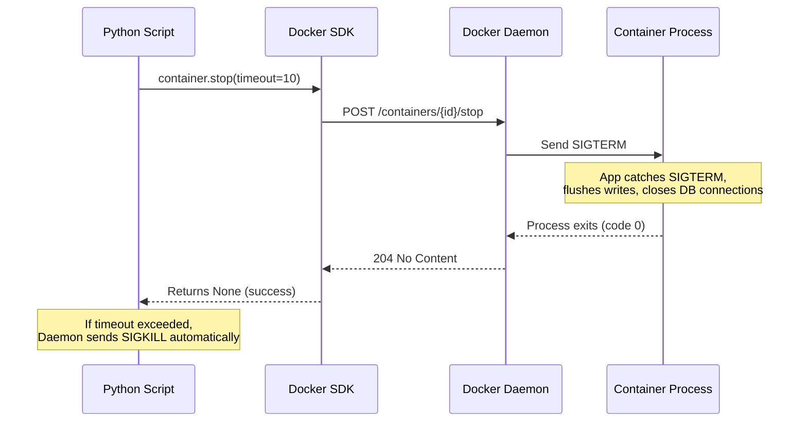

# Stopping Containers

Knowing how to stop containers properly is just as important as starting them. A poorly stopped container can leave processes mid-operation, corrupt database writes, or eat up resources on your server. Python's Docker SDK gives you fine-grained control over how containers stop, how long you wait, and how you handle ones that refuse to cooperate.

In this guide, we will learn how to stop containers gracefully and how to force-kill containers that will not stop on their own.

---

## Stop vs Kill — What's the Difference?

Docker has two ways to stop a container. They behave very differently and choosing the wrong one can cause data loss:

| Operation | SDK Method | Signal Sent | What Happens | When to Use |
| :--- | :--- | :--- | :--- | :--- |
| **Graceful stop** | `container.stop()` | SIGTERM then SIGKILL | Process gets a chance to clean up and exit | Normal shutdown — always try this first |
| **Force kill** | `container.kill()` | SIGKILL (immediately) | Process is killed instantly with no cleanup | When stop times out or container is frozen |
| **Restart** | `container.restart()` | SIGTERM then start | Stops and starts again | Service recovery, config reloads |
| **Pause** | `container.pause()` | SIGSTOP | Freezes process in memory | Debugging without losing state |

---

## How the Stop Sequence Works

When you call `container.stop()`, Docker does not immediately kill the process. It sends a polite shutdown signal first and waits for the process to exit cleanly.



---

## Stopping a Single Container

The most straightforward use case: find a container by name and stop it.

```python
import docker
from docker.errors import NotFound, DockerException

def stop_container(container_name, timeout=10):
    try:
        client = docker.from_env()
        
        # Get the container by name
        container = client.containers.get(container_name)
        
        current_status = container.status
        print(f"Container '{container_name}' is currently: {current_status}")
        
        if current_status != 'running':
            print(f"Container is not running — nothing to stop.")
            client.close()
            return False
        
        print(f"Sending SIGTERM to '{container_name}' (timeout: {timeout}s)...")
        container.stop(timeout=timeout)
        
        # Reload to confirm the new status
        container.reload()
        print(f"Container stopped. New status: {container.status}")
        
        client.close()
        return True

    except NotFound:
        print(f"Container '{container_name}' does not exist.")
        return False
    except DockerException as e:
        print(f"Failed to stop container: {e}")
        return False

stop_container("dev-nginx", timeout=15)
```

### Expected Output
```text
Container 'dev-nginx' is currently: running
Sending SIGTERM to 'dev-nginx' (timeout: 15s)...
Container stopped. New status: exited
```

---

## Stopping Multiple Containers by Label

In a real deployment, you might want to stop a group of containers together — for example, all containers tagged with `environment=staging`.

```python
import docker
from docker.errors import DockerException

def stop_containers_by_label(label_key, label_value, timeout=10):
    try:
        client = docker.from_env()
        label_filter = f"{label_key}={label_value}"
        
        # Only look at running containers with this label
        containers = client.containers.list(
            filters={"label": label_filter, "status": "running"}
        )
        
        if not containers:
            print(f"No running containers found with label '{label_filter}'.")
            client.close()
            return
        
        print(f"Stopping {len(containers)} container(s) with label '{label_filter}'...")
        
        for c in containers:
            print(f"  Stopping '{c.name}'...")
            c.stop(timeout=timeout)
            c.reload()
            print(f"  '{c.name}' -> {c.status}")
        
        print(f"\nDone. All matching containers stopped.")
        client.close()

    except DockerException as e:
        print(f"Error: {e}")

stop_containers_by_label("environment", "staging")
```

### Expected Output
```text
Stopping 2 container(s) with label 'environment=staging'...
  Stopping 'staging-api-server'...
  'staging-api-server' -> exited
  Stopping 'staging-worker'...
  'staging-worker' -> exited

Done. All matching containers stopped.
```

---

## Real-World Script: Graceful Stop with Fallback Kill

Some containers run long-lived connections (WebSocket servers, database processes) that take more than 10 seconds to clean up. Here is a production-grade pattern: try a graceful stop first, and if it times out, force kill.

```python
import docker
from docker.errors import NotFound, DockerException

def graceful_stop_or_kill(container_name, graceful_timeout=15):
    try:
        client = docker.from_env()
        container = client.containers.get(container_name)
        
        if container.status != 'running':
            print(f"'{container_name}' is already stopped ({container.status}).")
            client.close()
            return
        
        print(f"Attempting graceful stop of '{container_name}' (timeout: {graceful_timeout}s)...")
        
        try:
            container.stop(timeout=graceful_timeout)
            container.reload()
            print(f"Graceful stop succeeded. Status: {container.status}")
        except Exception as stop_err:
            # stop() can raise if the daemon times out waiting for the process
            print(f"Graceful stop did not complete: {stop_err}")
            print("Forcing immediate kill with SIGKILL...")
            container.kill()
            container.reload()
            print(f"Force kill done. Status: {container.status}")
        
        client.close()

    except NotFound:
        print(f"Container '{container_name}' not found.")
    except DockerException as e:
        print(f"Docker error: {e}")

graceful_stop_or_kill("slow-websocket-server", graceful_timeout=20)
```

### Expected Output
```text
Attempting graceful stop of 'slow-websocket-server' (timeout: 20s)...
Graceful stop succeeded. Status: exited
```

---

## Common Mistakes

### 1. Using `kill()` Instead of `stop()` for Databases
Force-killing a database container (PostgreSQL, MySQL, MongoDB) with `kill()` skips the write-ahead log flush. This can leave the database in an inconsistent state that requires manual repair on the next start. Always use `stop()` with a generous timeout for database containers.

### 2. Setting the Timeout Too Short
The default timeout for `container.stop()` is 10 seconds. For heavy workloads (JVM-based apps, Node.js with large connection pools), 10 seconds may not be enough. Use `timeout=30` or higher for services you know take longer to drain.

### 3. Not Reloading After Stop
The container object you hold in Python is a snapshot. After calling `container.stop()`, the object still shows the old status until you call `container.reload()`. Always reload before checking the new status.

### 4. Stopping a Container That Is Already Stopped
If you call `container.stop()` on an exited container, Docker returns success silently — no error is thrown. This is fine for scripts, but it means your script will not tell you if you targeted the wrong container by mistake. Always check the current status first.

---

## Summary

* `container.stop()` sends SIGTERM first and waits for a clean exit before sending SIGKILL.
* The `timeout` parameter controls how long Docker waits before escalating to SIGKILL.
* `container.kill()` sends SIGKILL immediately with no cleanup — only use it as a last resort.
* `container.restart()` is a convenient stop-then-start in a single call.
* Always use `container.stop()` for databases and stateful services to avoid data corruption.
* Filter containers by label to stop entire groups at once without hardcoding names.
* Call `container.reload()` after stopping to get the updated status from the daemon.
* Set a generous timeout for JVM applications, Node.js servers, and database engines.
* Check the current status before stopping to avoid acting on already-stopped containers.
* Use graceful stop with a fallback kill pattern for production reliability.
