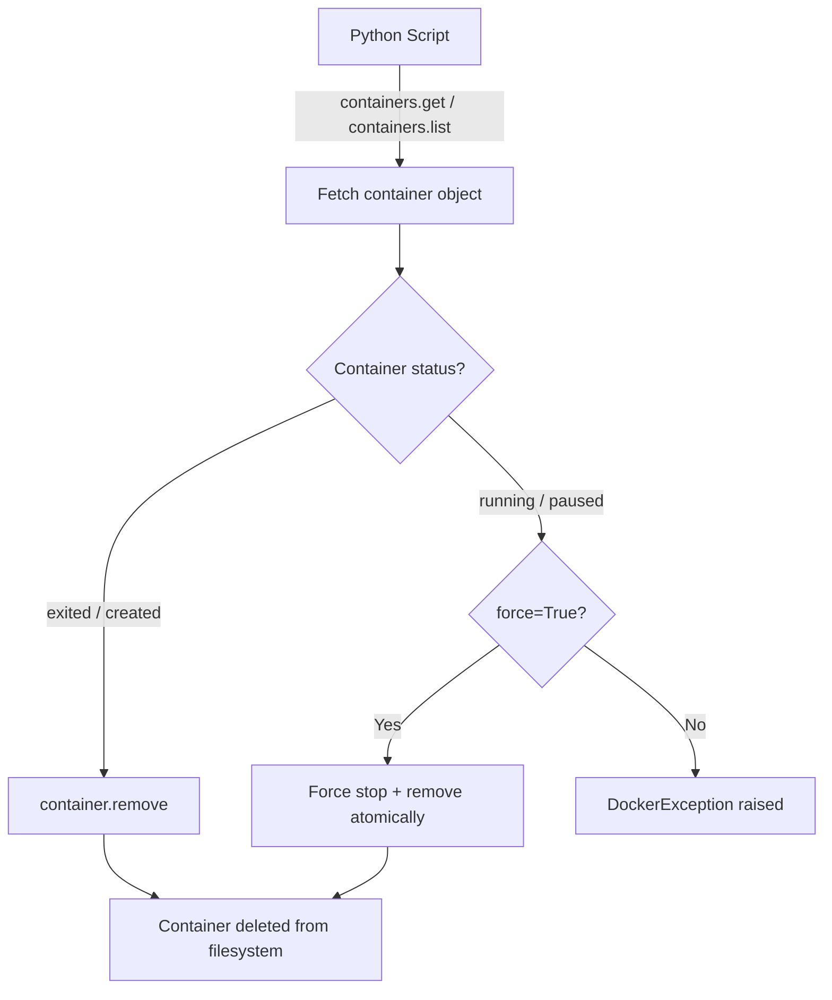

# Removing Containers

Stopping a container does not delete it. Stopped containers still sit on your disk, consuming filesystem space for their logs and layers. Over time, a busy server can accumulate hundreds of stopped containers from CI runs, test jobs, and old deployments. Removing them regularly keeps your system clean and prevents disk-full alerts.

In this guide, we will learn how to remove individual containers, bulk-remove stopped containers, and prune system garbage in a safe and controlled way.

---

## Container States and Removal Rules

Docker has rules about which containers can be removed without extra flags:

| Container State | Removable by default? | Force remove needed? | Notes |
| :--- | :--- | :--- | :--- |
| **exited** | ✅ Yes | No | Most common cleanup target |
| **created** | ✅ Yes | No | Allocated but never started |
| **running** | ❌ No | Yes (`force=True`) | Must stop first, or use force |
| **paused** | ❌ No | Yes (`force=True`) | Cannot remove while paused |
| **restarting** | ❌ No | Yes (`force=True`) | Mid-restart state |

---

## The Remove Workflow



---

## Removing a Single Stopped Container

The simplest case — remove one specific container by name after it has already exited.

```python
import docker
from docker.errors import NotFound, APIError, DockerException

def remove_container(container_name):
    try:
        client = docker.from_env()
        container = client.containers.get(container_name)
        
        print(f"Container '{container_name}' status: {container.status}")
        
        if container.status == 'running':
            print("Container is still running. Stop it first before removing.")
            client.close()
            return False
        
        container.remove()
        print(f"Container '{container_name}' has been removed successfully.")
        client.close()
        return True

    except NotFound:
        print(f"Container '{container_name}' does not exist.")
        return False
    except APIError as e:
        print(f"API error removing container: {e}")
        return False

remove_container("old-migration-runner")
```

### Expected Output
```text
Container 'old-migration-runner' status: exited
Container 'old-migration-runner' has been removed successfully.
```

---

## Force-Removing a Running Container

Sometimes you need to remove a container immediately — for example, during a failed deployment rollback where the container is stuck in a bad state. Pass `force=True` to stop and remove in one atomic step.

```python
import docker
from docker.errors import NotFound, DockerException

def force_remove_container(container_name):
    try:
        client = docker.from_env()
        container = client.containers.get(container_name)
        
        print(f"Force-removing container '{container_name}' (status: {container.status})...")
        
        # force=True sends SIGKILL and removes, even if running
        # v=True also removes anonymous volumes attached to the container
        container.remove(force=True, v=True)
        
        print(f"Container '{container_name}' force-removed (including any anonymous volumes).")
        client.close()
        return True

    except NotFound:
        print(f"Container '{container_name}' not found — nothing to remove.")
        return False
    except DockerException as e:
        print(f"Failed to remove: {e}")
        return False

force_remove_container("broken-build-worker")
```

### Expected Output
```text
Force-removing container 'broken-build-worker' (status: running)...
Container 'broken-build-worker' force-removed (including any anonymous volumes).
```

---

## Real-World Script: Bulk Remove All Exited Containers

This is the most common cleanup task — remove every container that has already exited. This is perfect to run on a schedule (e.g., nightly cron job) on shared CI servers.

```python
import docker
from docker.errors import DockerException

def remove_all_exited_containers(dry_run=False):
    try:
        client = docker.from_env()
        
        exited = client.containers.list(
            all=True,
            filters={"status": "exited"}
        )
        
        if not exited:
            print("No exited containers found. System is already clean.")
            client.close()
            return
        
        print(f"Found {len(exited)} exited container(s).")
        
        if dry_run:
            print("Dry-run mode: these would be removed:")
            for c in exited:
                image = c.image.tags[0] if c.image.tags else c.image.short_id
                print(f"  - {c.name:<35} | Image: {image}")
            client.close()
            return
        
        removed = 0
        failed  = 0
        
        for c in exited:
            try:
                name = c.name
                c.remove()
                print(f"  Removed: {name}")
                removed += 1
            except Exception as e:
                print(f"  Failed to remove {c.name}: {e}")
                failed += 1
        
        print(f"\nCleanup complete — Removed: {removed}, Failed: {failed}")
        client.close()

    except DockerException as e:
        print(f"Docker error: {e}")

# Preview first, then actually remove
remove_all_exited_containers(dry_run=True)
```

### Expected Output
```text
Found 3 exited container(s).
Dry-run mode: these would be removed:
  - old-migration-runner              | Image: flyway:latest
  - test-api-smoke-runner             | Image: python:3.9-slim
  - failed-build-worker               | Image: node:18-alpine
```

---

## Real-World Script: System Prune (Containers + Dangling Images)

Docker accumulates garbage over time: stopped containers, dangling images (images with no tag), unused networks. The SDK exposes a `prune` API that removes all of this in one call.

```python
import docker
from docker.errors import DockerException

def prune_system():
    try:
        client = docker.from_env()
        print("Running system prune (stopped containers + dangling images + unused networks)...")
        
        # Prune stopped containers
        container_result = client.containers.prune()
        removed_containers = container_result.get('ContainersDeleted') or []
        space_reclaimed_bytes = container_result.get('SpaceReclaimed', 0)
        space_reclaimed_mb = space_reclaimed_bytes / (1024 * 1024)
        
        print(f"Containers removed: {len(removed_containers)}")
        print(f"Disk space reclaimed: {space_reclaimed_mb:.2f} MB")
        
        # Prune dangling images (images with no tags)
        image_result = client.images.prune(filters={"dangling": True})
        removed_images = image_result.get('ImagesDeleted') or []
        img_space = image_result.get('SpaceReclaimed', 0) / (1024 * 1024)
        
        print(f"Dangling image layers removed: {len(removed_images)}")
        print(f"Image disk space reclaimed: {img_space:.2f} MB")
        
        client.close()

    except DockerException as e:
        print(f"Failed to prune: {e}")

prune_system()
```

### Expected Output
```text
Running system prune (stopped containers + dangling images + unused networks)...
Containers removed: 3
Disk space reclaimed: 142.56 MB
Dangling image layers removed: 7
Image disk space reclaimed: 892.31 MB
```

---

## Common Mistakes

### 1. Trying to Remove a Running Container Without `force=True`
Calling `container.remove()` on a running container throws a `docker.errors.APIError: conflict: unable to remove a running container`. Always check the status first, or use `force=True` when you know it is safe to do so.

### 2. Forgetting `v=True` and Leaving Orphan Volumes
When you remove a container that was started with `docker run -v` or anonymous volumes, the volumes are NOT removed by default. Over time, these orphan volumes accumulate on your disk. Pass `v=True` to `container.remove()` to clean them up together.

### 3. Confusing `containers.prune()` with Remove All
`containers.prune()` only removes containers in the `stopped` state. It will never touch running containers. This is safe to run anytime. If you want to remove running containers, you need to stop them explicitly first.

### 4. Running Bulk Remove in Loops Without Error Handling
If you iterate over a list of containers and one removal fails (e.g., permissions issue), an unhandled exception will stop the loop mid-way. Always wrap per-container operations in a `try/except` block so the loop continues to the next container.

---

## Summary

* Stopping a container does not delete it — use `container.remove()` to actually delete it.
* Exited and created containers can be removed without any extra flags.
* Running containers require `force=True` to remove — use this carefully.
* Pass `v=True` to also remove anonymous volumes attached to the container.
* `client.containers.list(filters={"status": "exited"})` fetches all stopped containers for bulk cleanup.
* Add a `dry_run` mode to your cleanup scripts to preview what would be deleted before committing.
* `client.containers.prune()` removes all stopped containers in one call and reports disk space freed.
* `client.images.prune(filters={"dangling": True})` removes untagged intermediate build layers.
* Wrap per-container operations in `try/except` so one failure does not block the entire cleanup loop.
* Schedule cleanup scripts as cron jobs on shared CI/CD servers to prevent disk-full incidents.
