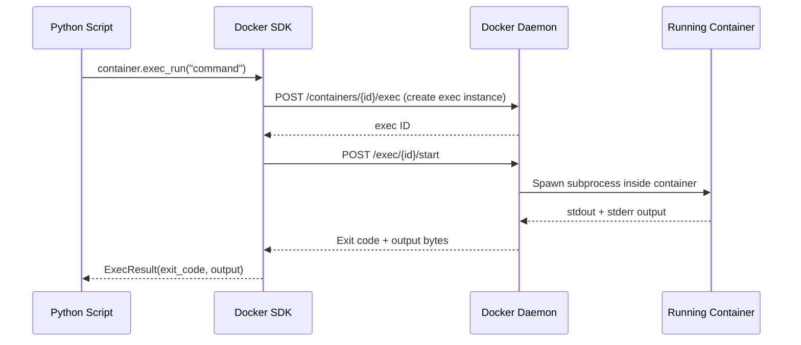

# Executing Commands Inside Containers

Sometimes you need to run a command inside a container that is already running — without stopping it or creating a new one. This is the Python equivalent of `docker exec`. You might need it to trigger a database query, run a health check script, reload a config file, or inspect the container's filesystem during debugging.

In this guide, we will learn how to use `container.exec_run()` to execute commands inside running containers and handle their output.

---

## exec_run vs containers.run — What to Use When

Both run code inside a container, but they serve very different purposes:

| | `container.exec_run()` | `client.containers.run()` |
| :--- | :--- | :--- |
| **Target** | An already-running container | Creates a brand new container |
| **State effect** | Zero — container keeps running | Creates and starts a new container |
| **Use case** | Admin commands, health checks, config reloads | Test jobs, one-shot tasks |
| **Requires running container** | Yes | No |
| **Returns** | Exit code + output | Output bytes or Container object |

---

## How exec_run Works Inside the Daemon



The key thing to notice: the exec command runs as a subprocess **inside** the container's existing PID namespace. It shares the container's filesystem, environment, and network. It does NOT share the host's filesystem.

---

## Basic Command Execution

The simplest use case: run a one-line command and capture the result.

```python
import docker
from docker.errors import NotFound, DockerException

def exec_command(container_name, command):
    try:
        client = docker.from_env()
        container = client.containers.get(container_name)
        
        if container.status != 'running':
            print(f"Container '{container_name}' is not running (status: {container.status}).")
            client.close()
            return None, None
        
        print(f"Executing '{command}' inside '{container_name}'...")
        
        # exec_run returns an ExecResult namedtuple: (exit_code, output)
        result = container.exec_run(command)
        
        exit_code = result.exit_code
        output = result.output.decode('utf-8').strip()
        
        print(f"Exit code: {exit_code}")
        print(f"Output:\n{output}")
        
        client.close()
        return exit_code, output

    except NotFound:
        print(f"Container '{container_name}' not found.")
        return None, None
    except DockerException as e:
        print(f"Error: {e}")
        return None, None

# Check disk usage inside a running container
exec_command("dev-nginx", "df -h /")
```

### Expected Output
```text
Executing 'df -h /' inside 'dev-nginx'...
Exit code: 0
Output:
Filesystem      Size  Used Avail Use% Mounted on
overlay         100G   12G   88G  12% /
```

---

## Running Shell Commands (Multiple Steps)

To run a multi-step shell command (using pipes, redirects, or shell built-ins), wrap it in `sh -c`.

```python
import docker
from docker.errors import NotFound, DockerException

def exec_shell(container_name, shell_command):
    try:
        client = docker.from_env()
        container = client.containers.get(container_name)
        
        # Wrap in sh -c so the daemon passes it through a shell interpreter
        result = container.exec_run(
            cmd=["sh", "-c", shell_command],
            workdir="/app"          # Set the working directory inside the container
        )
        
        output = result.output.decode('utf-8').strip()
        print(f"Exit code: {result.exit_code}")
        print(f"Output: {output}")
        
        client.close()
        return result.exit_code, output

    except NotFound:
        print(f"Container not found.")
        return None, None
    except DockerException as e:
        print(f"Error: {e}")
        return None, None

# Check running Python processes inside the container
exec_shell("django-app", "ps aux | grep python | grep -v grep")
```

### Expected Output
```text
Exit code: 0
Output: root         1  0.2  1.8 python manage.py runserver 0.0.0.0:8000
```

---

## Real-World Script: Health Check via Exec

This is a common pattern in deployment automation. After starting a container, run a health check command inside it to verify that the application is actually ready before marking the deployment as successful.

```python
import docker
import time
from docker.errors import NotFound, DockerException

def health_check(container_name, check_command, retries=5, delay=3):
    try:
        client = docker.from_env()
        container = client.containers.get(container_name)
        
        print(f"Running health check on '{container_name}'...")
        print(f"Command: {check_command}")
        
        for attempt in range(1, retries + 1):
            container.reload()
            
            if container.status != 'running':
                print(f"Container is not running ({container.status}). Health check failed.")
                client.close()
                return False
            
            result = container.exec_run(["sh", "-c", check_command])
            
            if result.exit_code == 0:
                print(f"Health check PASSED on attempt {attempt}.")
                client.close()
                return True
            else:
                output = result.output.decode('utf-8').strip()
                print(f"Attempt {attempt}/{retries} FAILED (exit code {result.exit_code}): {output}")
                if attempt < retries:
                    print(f"  Retrying in {delay} seconds...")
                    time.sleep(delay)
        
        print(f"Health check FAILED after {retries} attempts.")
        client.close()
        return False

    except NotFound:
        print(f"Container '{container_name}' not found.")
        return False
    except DockerException as e:
        print(f"Error: {e}")
        return False

# Verify PostgreSQL is accepting connections inside the container
health_check(
    container_name="test-postgres",
    check_command="pg_isready -U testuser -d testdb",
    retries=5,
    delay=3
)
```

### Expected Output
```text
Running health check on 'test-postgres'...
Command: pg_isready -U testuser -d testdb
Attempt 1/5 FAILED (exit code 1): /var/run/postgresql:5432 - no response
  Retrying in 3 seconds...
Attempt 2/5 FAILED (exit code 1): /var/run/postgresql:5432 - no response
  Retrying in 3 seconds...
Health check PASSED on attempt 3.
```

---

## Common Mistakes

### 1. Passing a String Command When You Need a List
`exec_run("ls -la /app")` passes the entire string to the container's default shell — but Alpine-based containers have a minimal shell and may not interpret it the same way as bash. Use a list `["ls", "-la", "/app"]` for simple commands and `["sh", "-c", "your command"]` for shell features like pipes.

### 2. Ignoring the Exit Code
`exec_run` never throws an exception when a command fails inside the container — it just returns a non-zero `exit_code`. You must check `result.exit_code != 0` yourself. Not checking it means your script will silently succeed even when the inner command failed.

### 3. Running exec on a Stopped Container
`exec_run` only works on running containers. Calling it on an exited or paused container raises an `APIError`. Always check `container.status == 'running'` or call `container.reload()` first.

### 4. Forgetting `workdir`
By default, exec runs from the container's root directory `/`. If your application expects commands to run from `/app` (because it uses relative file paths), pass `workdir="/app"` explicitly.

---

## Summary

* `container.exec_run()` runs a command inside an already-running container — the container keeps running.
* It returns an `ExecResult` namedtuple with two fields: `exit_code` and `output` (bytes).
* Always decode `result.output.decode('utf-8')` to get readable text.
* Use a list format for commands: `["ls", "-la"]` — it avoids shell interpretation issues.
* Wrap multi-step shell commands in `["sh", "-c", "your command"]` to use pipes, redirects, and variables.
* `exit_code == 0` means success; any other value means something went wrong inside the container.
* Use `workdir` to set the working directory for the exec process inside the container.
* Combine `exec_run` with a retry loop to build reliable post-deployment health checks.
* `exec_run` shares the container's filesystem and network — it does NOT have access to the host.
* Never use `exec_run` to modify configuration files in production without testing in a staging container first.
