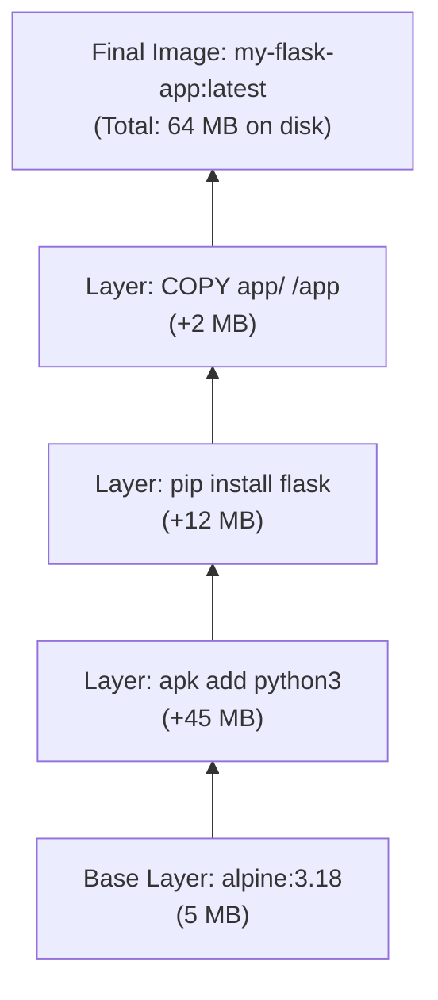

# Listing Images

Before you can run a container, you need an image. Docker images are the blueprints — they contain everything a container needs: the OS filesystem, application code, runtime, and configuration. Knowing how to list and inspect images using Python is essential for building cleanup scripts, audit tools, and deployment automation.

In this guide, we will learn how to list all local images, inspect their details, and find images that are wasting disk space.

---

## Image vs Container — Quick Recap

New learners sometimes mix these two up. Here's the key difference:

| | Image | Container |
| :--- | :--- | :--- |
| **What it is** | Read-only blueprint (like a class) | A running instance of an image (like an object) |
| **On disk** | Stored as compressed layers | Stored as a writable overlay on top of an image |
| **Created by** | `docker build` or `docker pull` | `docker run` or SDK `containers.run()` |
| **Can be started** | No — you run it to create a container | Yes |
| **Deleted with** | `image.remove()` | `container.remove()` |

---

## Image Layer Architecture

Docker images are made of stacked, read-only layers. Each instruction in a Dockerfile adds a layer. This is why listing images shows a size, but the actual disk usage is smaller — layers shared across images are only stored once.



---

## Listing All Local Images

This is the most common operation — list every image stored on your machine.

```python
import docker
from docker.errors import DockerException

def list_local_images():
    try:
        client = docker.from_env()
        
        images = client.images.list()
        
        if not images:
            print("No images found locally. Try pulling one first.")
            client.close()
            return []
        
        print(f"Local Images ({len(images)} total):")
        print("=" * 70)
        print(f"{'Repository:Tag':<35} {'Size (MB)':>10}  {'Image ID'}")
        print("-" * 70)
        
        for image in images:
            tags = image.tags
            if not tags:
                # Dangling image — no tag, often a leftover build cache layer
                display_tag = "<none>:<none>"
                tag_list = [display_tag]
            else:
                tag_list = tags
            
            size_mb = image.attrs['Size'] / (1024 * 1024)
            
            for tag in tag_list:
                print(f"{tag:<35} {size_mb:>10.2f}  {image.short_id}")
        
        print("=" * 70)
        client.close()
        return images

    except DockerException as e:
        print(f"Error listing images: {e}")
        return []

list_local_images()
```

### Expected Output
```text
Local Images (5 total):
======================================================================
Repository:Tag                       Size (MB)  Image ID
----------------------------------------------------------------------
nginx:alpine                             11.52  sha256:a3e5
redis:latest                             34.14  sha256:b2f1
postgres:15-alpine                       79.22  sha256:c3d4
python:3.11-slim                        125.67  sha256:e5f6
<none>:<none>                             0.18  sha256:7a8b
======================================================================
```

---

## Inspecting a Single Image

Once you have an image name, you can fetch all its metadata — creation time, architecture, exposed ports, environment variables, and entrypoint.

```python
import docker
from docker.errors import ImageNotFound, DockerException
from datetime import datetime

def inspect_image(image_name):
    try:
        client = docker.from_env()
        image = client.images.get(image_name)
        
        attrs = image.attrs
        config = attrs.get('Config', {})
        
        # Parse the creation timestamp
        created_str = attrs.get('Created', '')[:19]  # Trim nanoseconds
        created_dt  = datetime.strptime(created_str, '%Y-%m-%dT%H:%M:%S')
        
        print(f"Image: {image_name}")
        print(f"  Full ID:      {image.id[:20]}...")
        print(f"  Tags:         {', '.join(image.tags) or 'None'}")
        print(f"  Size:         {attrs['Size'] / (1024*1024):.2f} MB")
        print(f"  Architecture: {attrs.get('Architecture', 'unknown')}")
        print(f"  OS:           {attrs.get('Os', 'unknown')}")
        print(f"  Created:      {created_dt.strftime('%Y-%m-%d %H:%M')}")
        print(f"  Layers:       {len(attrs.get('RootFS', {}).get('Layers', []))}")
        print(f"  Exposed Ports:{list(config.get('ExposedPorts', {}).keys()) or 'None'}")
        print(f"  Entrypoint:   {config.get('Entrypoint') or 'None'}")
        
        client.close()
        return attrs

    except ImageNotFound:
        print(f"Image '{image_name}' not found locally. Try pulling it first.")
        return None
    except DockerException as e:
        print(f"Error: {e}")
        return None

inspect_image("nginx:alpine")
```

### Expected Output
```text
Image: nginx:alpine
  Full ID:      sha256:a3e5c7b29fa1...
  Tags:         nginx:alpine, nginx:1.25-alpine
  Size:         11.52 MB
  Architecture: amd64
  OS:           linux
  Created:      2026-01-15 09:30
  Layers:       6
  Exposed Ports:['80/tcp']
  Entrypoint:   ['/docker-entrypoint.sh']
```

---

## Real-World Script: Find Large and Dangling Images

This script is useful as a periodic audit to find images that are either wasting disk space (large unused images) or are dangling (no tag, leftover build cache).

```python
import docker
from docker.errors import DockerException

def audit_images(size_threshold_mb=200):
    try:
        client = docker.from_env()
        images = client.images.list(all=True)
        
        large_images    = []
        dangling_images = []
        
        for image in images:
            size_mb = image.attrs['Size'] / (1024 * 1024)
            
            if not image.tags:
                dangling_images.append((image.short_id, size_mb))
            elif size_mb > size_threshold_mb:
                for tag in image.tags:
                    large_images.append((tag, size_mb, image.short_id))
        
        print(f"=== Image Audit Report ===\n")
        
        print(f"Large images (>{size_threshold_mb} MB):")
        if large_images:
            for tag, size, sid in sorted(large_images, key=lambda x: -x[1]):
                print(f"  {tag:<40} {size:>8.2f} MB  [{sid}]")
        else:
            print("  None found.")
        
        print(f"\nDangling images (no tag, safe to prune):")
        if dangling_images:
            total_waste = sum(s for _, s in dangling_images)
            for sid, size in dangling_images:
                print(f"  [{sid}]  {size:.2f} MB")
            print(f"  Total wasted space: {total_waste:.2f} MB")
        else:
            print("  None found.")
        
        client.close()

    except DockerException as e:
        print(f"Error: {e}")

audit_images(size_threshold_mb=100)
```

### Expected Output
```text
=== Image Audit Report ===

Large images (>100 MB):
  python:3.11-slim                         125.67 MB  [sha256:e5f6]

Dangling images (no tag, safe to prune):
  [sha256:7a8b]  0.18 MB
  Total wasted space: 0.18 MB
```

---

## Common Mistakes

### 1. Using `images.list()` vs `images.list(all=True)`
By default, `images.list()` hides dangling images (images with no tags). Pass `all=True` to see every image, including intermediate build layers and dangling cache.

### 2. Checking `image.tags` Without Handling Empty Lists
Dangling images have an empty tags list. Accessing `image.tags[0]` directly will throw an `IndexError`. Always check `if image.tags` before accessing.

### 3. Comparing Sizes From `image.attrs['Size']` vs `VirtualSize`
`Size` is the image's own compressed size. `VirtualSize` includes the size of shared base layers. These can differ significantly. Use `Size` for disk impact of this specific image; use `VirtualSize` to understand the total logical size.

### 4. Assuming `images.get("nginx")` Finds the Latest
`images.get("nginx")` only works if you have an image tagged exactly as `nginx` locally. If your local image is `nginx:alpine`, use that full tag. Docker does not assume `latest` when looking up images through the SDK the same way the CLI does.

---

## Summary

* `client.images.list()` returns all locally cached images except dangling ones by default.
* Pass `all=True` to include dangling images (intermediate build layers with no tag).
* Each image object has `.tags`, `.short_id`, `.id`, and `.attrs` with full metadata.
* Image `Size` (in `.attrs`) is in bytes — divide by `1024 * 1024` for megabytes.
* Dangling images have an empty `.tags` list — always check before indexing.
* `client.images.get("name:tag")` fetches a single image by exact tag.
* `.attrs['Config']` contains the image's exposed ports, entrypoint, and environment variables.
* `.attrs['RootFS']['Layers']` gives you the list of layer digests that make up the image.
* Large images are not necessarily unused — check if any containers are based on them before removing.
* Use image auditing scripts as the first step in a disk cleanup workflow.
