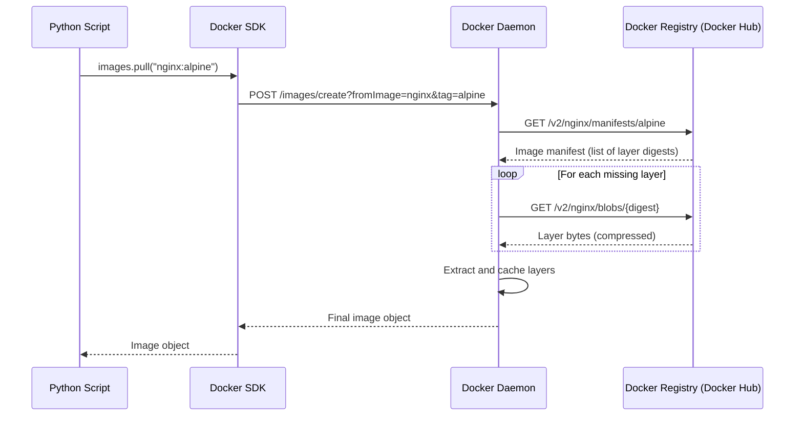

# Pulling Images

Before a container can run, the image it needs must be available on the local machine. If it is not there, Docker downloads it from a registry. The Python SDK lets you automate this pull process — which is useful in deployment pipelines, environment setup scripts, and pre-warming cache on new servers.

In this guide, we will learn how to pull images programmatically, track download progress, and handle errors when images do not exist.

---

## How Image Pulling Works

When you pull an image, Docker does not download one big file. It downloads each layer separately and in parallel, then assembles them locally. This is why pulling is fast on subsequent runs — only new or updated layers are downloaded.



---

## Pulling a Single Image

The most common use: pull a specific image with a tag.

```python
import docker
from docker.errors import ImageNotFound, APIError, DockerException

def pull_image(image_name, tag="latest"):
    try:
        client = docker.from_env()
        full_name = f"{image_name}:{tag}"
        
        print(f"Pulling image '{full_name}' from registry...")
        
        # images.pull() blocks until the pull is complete
        image = client.images.pull(image_name, tag=tag)
        
        size_mb = image.attrs['Size'] / (1024 * 1024)
        print(f"Pull complete!")
        print(f"  Image:    {full_name}")
        print(f"  ID:       {image.short_id}")
        print(f"  Size:     {size_mb:.2f} MB")
        print(f"  Tags:     {', '.join(image.tags)}")
        
        client.close()
        return image

    except ImageNotFound:
        print(f"Image '{image_name}:{tag}' not found in the registry.")
        return None
    except APIError as e:
        print(f"Registry API error: {e}")
        return None
    except DockerException as e:
        print(f"Docker error: {e}")
        return None

pull_image("nginx", "alpine")
```

### Expected Output
```text
Pulling image 'nginx:alpine' from registry...
Pull complete!
  Image:    nginx:alpine
  ID:       sha256:a3e5c7
  Size:     11.52 MB
  Tags:     nginx:alpine
```

---

## Pulling With Progress Reporting

`images.pull()` blocks until the download is complete. For large images, this can take a while with no feedback. Use the low-level `APIClient` to stream pull progress event by event.

```python
import docker
import json
from docker.errors import ImageNotFound, DockerException

def pull_with_progress(image_name, tag="latest"):
    try:
        # Use the low-level client for streaming
        api_client = docker.APIClient()
        
        full_name = f"{image_name}:{tag}"
        print(f"Pulling '{full_name}' with live progress...\n")
        
        seen_layers = {}
        
        # pull() on APIClient streams JSON events instead of blocking
        for raw_event in api_client.pull(image_name, tag=tag, stream=True, decode=True):
            status = raw_event.get('status', '')
            layer_id = raw_event.get('id', '')
            progress = raw_event.get('progressDetail', {})
            
            if status in ('Pulling fs layer', 'Downloading', 'Pull complete', 'Already exists'):
                if layer_id and layer_id not in seen_layers:
                    seen_layers[layer_id] = True
                
                if status == 'Downloading':
                    current = progress.get('current', 0)
                    total   = progress.get('total', 1)
                    pct = (current / total * 100) if total else 0
                    print(f"\r  [{layer_id[:12]}] Downloading... {pct:5.1f}%", end='', flush=True)
                elif status in ('Pull complete', 'Already exists'):
                    print(f"\n  [{layer_id[:12]}] {status}")
        
        print(f"\nDone. '{full_name}' is ready to use.")
        api_client.close()
        return True

    except ImageNotFound:
        print(f"Image not found: {image_name}:{tag}")
        return False
    except DockerException as e:
        print(f"Error: {e}")
        return False

pull_with_progress("python", "3.11-slim")
```

### Expected Output
```text
Pulling 'python:3.11-slim' with live progress...

  [a1b2c3d4e5f6] Downloading...  45.3%
  [a1b2c3d4e5f6] Pull complete
  [b2c3d4e5f6a1] Already exists
  [c3d4e5f6a1b2] Downloading...  100.0%
  [c3d4e5f6a1b2] Pull complete

Done. 'python:3.11-slim' is ready to use.
```

---

## Real-World Script: Pre-Pull a List of Images

In CI/CD pipelines, you can speed things up by pre-pulling all required images before a job starts. This way the image cache is warm and container startup is near-instant.

```python
import docker
from docker.errors import ImageNotFound, DockerException

REQUIRED_IMAGES = [
    ("nginx", "alpine"),
    ("postgres", "15-alpine"),
    ("redis", "7-alpine"),
    ("python", "3.11-slim"),
]

def pre_pull_images(image_list):
    client = docker.from_env()
    results = {"pulled": [], "already_cached": [], "failed": []}
    
    print(f"Pre-pulling {len(image_list)} images...\n")
    
    for image_name, tag in image_list:
        full_name = f"{image_name}:{tag}"
        
        # Check if already cached to skip unnecessary network calls
        try:
            existing = client.images.get(full_name)
            print(f"  [CACHED]  {full_name} ({existing.short_id})")
            results["already_cached"].append(full_name)
            continue
        except ImageNotFound:
            pass  # Not cached — need to pull
        
        try:
            print(f"  [PULLING] {full_name}...")
            image = client.images.pull(image_name, tag=tag)
            size_mb = image.attrs['Size'] / (1024 * 1024)
            print(f"  [DONE]    {full_name} — {size_mb:.2f} MB")
            results["pulled"].append(full_name)
        except (ImageNotFound, DockerException) as e:
            print(f"  [FAILED]  {full_name} — {e}")
            results["failed"].append(full_name)
    
    print(f"\nSummary:")
    print(f"  Pulled:        {len(results['pulled'])}")
    print(f"  Already cached:{len(results['already_cached'])}")
    print(f"  Failed:        {len(results['failed'])}")
    
    client.close()
    return results

pre_pull_images(REQUIRED_IMAGES)
```

### Expected Output
```text
Pre-pulling 4 images...

  [CACHED]  nginx:alpine (sha256:a3e5)
  [PULLING] postgres:15-alpine...
  [DONE]    postgres:15-alpine — 79.22 MB
  [CACHED]  redis:7-alpine (sha256:b2f1)
  [PULLING] python:3.11-slim...
  [DONE]    python:3.11-slim — 125.67 MB

Summary:
  Pulled:        2
  Already cached:2
  Failed:        0
```

---

## Common Mistakes

### 1. Pulling Without a Tag and Getting Unexpected Versions
`images.pull("nginx")` without a tag defaults to `latest`. In production pipelines, `latest` can change at any time and break reproducibility. Always pin a specific version tag like `nginx:1.25-alpine`.

### 2. Not Checking the Local Cache First
Calling `images.pull()` even when the image is already cached triggers a registry check and a brief network call. For offline environments or to speed up scripts, check with `images.get()` first and only pull if the image is not found.

### 3. Using `images.pull()` for Private Registries Without Auth
Pulling from a private registry (AWS ECR, GitHub Container Registry) requires authentication. You must either configure Docker credentials in `~/.docker/config.json` beforehand, or pass an `auth_config` dict to the pull call.

### 4. Assuming Pull is Instant for Large Images
`images.pull()` on a 1 GB image can take several minutes on a slow network. It blocks the script. If you pull multiple large images in a loop, the total wait time multiplies. Consider using threads (`concurrent.futures.ThreadPoolExecutor`) to pull images in parallel.

---

## Summary

* `client.images.pull(name, tag)` downloads an image and blocks until the download is complete.
* Always pin a specific version tag — avoid relying on `latest` in production pipelines.
* Check `client.images.get(name)` first to skip pulling already-cached images.
* Use the `APIClient` with `stream=True` to get layer-by-layer progress events during download.
* Each streamed event is a JSON dict with keys: `status`, `id`, `progress`, and `progressDetail`.
* Private registries require authentication — configure `~/.docker/config.json` or pass `auth_config`.
* Pre-pulling images before a CI job starts warms the cache and speeds up container launches.
* Large image pulls can take minutes — handle this with timeouts or parallel pulls via threading.
* `images.pull()` raises `ImageNotFound` if the image does not exist in the target registry.
* A successful pull returns an `Image` object with `.short_id`, `.tags`, and `.attrs`.
